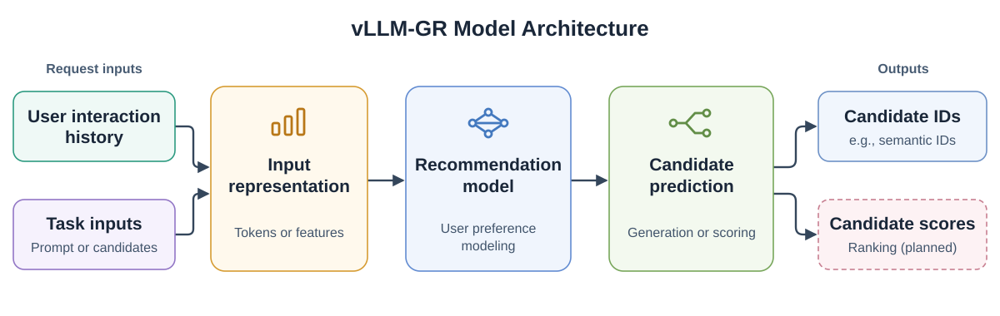

<!-- markdownlint-disable-file MD041 -->

<p align="center">
  
</p>

<h3 align="center">vLLM-GR brings generative recommendation models to vLLM.</h3>

## About

[vLLM](https://github.com/vllm-project/vllm) was originally built to serve
large language models that generate text autoregressively. vLLM-GR extends
that foundation to recommendation, where a model uses a person's interaction
history to predict which items will interest them. vLLM-GR is an independent
extension of vLLM.

- **Recommendation inputs.** Views, clicks and other interactions describe a
  user's history. A prompt can ask the model to recommend the next item.
- **Model architectures.** The current implementation focuses on inference
  for autoregressive generative recommendation models.
- **Recommendation outputs.** Generation returns candidate item IDs, such as
  semantic IDs (SIDs), ordered by sequence likelihood. Ranking a supplied
  candidate set is planned.



### vLLM-GR is fast with

- **One submission for the entire beam search.** The frontend submits the
  request to EngineCore once. The engine drives prefill and every decode step,
  then returns the ranked candidates and their scores in one response.
- **BeamAttn and KV cache reuse.** All beams attend to the same cached prompt.
  The beam KV cache carries each selected parent's suffix into the next step.
  Across requests, vLLM's prefix cache skips prefill for matching prompt blocks.
- **Asynchronous scheduling.** While the device executes one step, the
  host can prepare and submit the next. This overlaps host preparation with
  device execution across prefill and decode.
- **On-device beam postprocessing.** Device kernels apply catalog constraints
  and select the highest-scoring valid continuations. The next decode step
  uses the selected tokens directly on the device, avoiding a host round trip
  for each beam decision.

### vLLM-GR is flexible and easy to use with

- Generate candidate SIDs directly or, for compatible models, run an offline
  reasoning step before catalog-constrained SID generation.
- Choose full-vocabulary or catalog-constrained search, set candidate and beam
  widths at each stage, and specify how many results to return.
- Use the same `gr` configuration for offline Python inference, the
  OpenAI-compatible HTTP completions endpoint and experimental gRPC serving.
- Roll out new model weights and switch item catalogs independently on
  running service instances. Online catalog replacement requires asynchronous
  Beam execution on CUDA.
- Extend device support through backend providers that validate the environment,
  apply runtime patches, and implement catalog-constrained top-k selection.

### vLLM-GR supports the following models

- **Generative recommendation.** [OneRec-1.7B](https://huggingface.co/OpenOneRec/OneRec-1.7B)
  generates a ranked list of candidate SIDs for a user's history.
- **Text generation.** See the [supported models](docs/models/supported_models.md)
  for openPangu passthrough and device-specific guidance.

## Install from source

The current vLLM-GR code requires **upstream vLLM 0.30.0**. Prepare an accelerator
environment before installing.

| Target | Runtime | Setup guide |
| --- | --- | --- |
| CUDA | Python 3.11-3.13, CUDA 13.0, vLLM 0.30.0 | [CUDA installation](docs/getting_started/installation/gpu.md) |
| Ascend NPU | Validated with Python 3.12, CANN 9.2.0, vLLM 0.30.0, vLLM-Ascend 0.30.0rc2 and Triton-Ascend 3.6.0 | [Ascend installation](docs/getting_started/installation/npu.md) |

Clone the repository and enter it.

```bash
git clone https://github.com/JiusiServe/vllm-gr.git
cd vllm-gr
```

Install the CUDA build in a virtual environment.

```bash
VLLM_GR_TARGET_DEVICE=cuda python -m pip install -e .
```

Install the NPU build in the prepared Ascend container after installing its
required operators.

```bash
VLLM_GR_TARGET_DEVICE=npu python -m pip install -e . --no-build-isolation
```

## Run OneRec offline

In the installed environment, use a local OneRec-1.7B snapshot or download
one with the Hugging Face CLI.

```bash
export ONEREC_MODEL="$HOME/.cache/vllm-gr/models/OneRec-1.7B"
hf download OpenOneRec/OneRec-1.7B --local-dir "$ONEREC_MODEL"
```

Run Beam Search V1 on CUDA.

```bash
python examples/offline_inference/beam_search/quickstart.py --model "$ONEREC_MODEL"
```

On Ascend, use the eager path.

```bash
python examples/offline_inference/beam_search/quickstart.py \
  --model "$ONEREC_MODEL" --constraint-backend npu --execution eager
```

Expect `request=0 returned_beams=128` followed by the top five token sequences
and scores. See the [quickstart](docs/getting_started/quickstart.md) for HTTP
serving and catalog-constrained generation.

## Runtime limits

The first release includes CUDA and Ascend inference and
[experimental gRPC serving](docs/serving/grpc.md). The gRPC service requires
the `grpc` extra. See the [feature matrix](docs/user_guide/feature_compatibility.md)
for device-specific limits.

- CPU packages support packaging and host checks. Beam inference requires
  CUDA or Ascend.
- Ascend Beam requires ModelRunner V1. On CUDA, the library and general CLI
  default to V1, and the [direct Beam examples](examples/README.md#choose-a-modelrunner)
  select V2 by default for supported workloads.

See the [documentation](docs/README.md) for additional examples and deployment
guides.

## Contributing

We welcome and value any contributions and collaborations.
Please check out [Contributing to vLLM-GR](./CONTRIBUTING.md) for how to get involved.

## Security

See the [security policy](SECURITY.md) for reporting and deployment guidance.

## License

Apache License 2.0, as found in the [LICENSE](./LICENSE) file.
