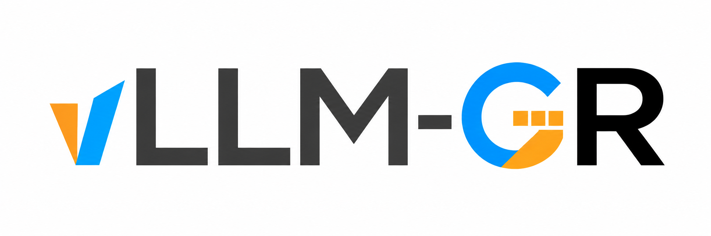
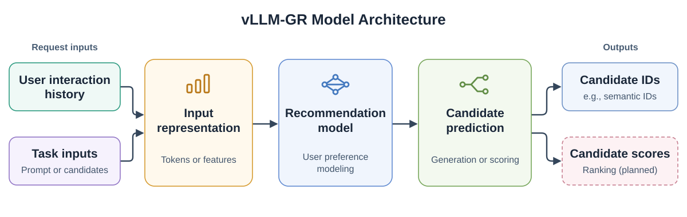

# Welcome to vLLM-GR

  

<strong>vLLM-GR brings generative recommendation models to vLLM.</strong>

## About

[vLLM](https://github.com/vllm-project/vllm) was originally built to serve
large language models that generate text autoregressively. vLLM-GR extends
that foundation to recommendation, where a model uses a person's interaction
history to predict which items will interest them. vLLM-GR is an independent
extension of vLLM.

- **Recommendation inputs.** Views, clicks and other interactions describe a
  user's history. A prompt can ask the model to recommend the next item.
- **Model architectures.** The current implementation focuses on inference
  for autoregressive generative recommendation models.
- **Recommendation outputs.** Generation returns candidate item IDs, such as
  semantic IDs (SIDs), ordered by sequence likelihood. Ranking a supplied
  candidate set is planned.

### Inference performance

- **One submission for the entire Beam search.** The frontend submits the
  request to EngineCore once. The engine drives prefill and every decode step,
  then returns the ranked candidates and their scores in one response.
- **BeamAttn and KV cache reuse.** All beams attend to the same cached prompt.
  The beam KV cache carries each selected parent's suffix into the next step.
  Across requests, vLLM's prefix cache skips prefill for matching prompt blocks.
- **Asynchronous scheduling.** While the device executes one step, the
  host can prepare and submit the next. This overlaps host preparation with
  device execution across prefill and decode.
- **On-device Beam postprocessing.** Device kernels apply catalog constraints
  and select the highest-scoring valid continuations. The next decode step
  uses the selected tokens directly on the device, avoiding a host round trip
  for each beam decision.

### Configuration and serving

- Generate candidate SIDs directly or, for compatible models, run an offline
  reasoning step before catalog-constrained SID generation.
- Choose full-vocabulary or catalog-constrained search, set candidate and beam
  widths at each stage, and specify how many results to return.
- Use the same [`gr` configuration](configuration/README.md) for offline Python
  inference, [HTTP serving](serving/completions.md) and
  [experimental gRPC serving](serving/grpc.md).
- [Roll out model weights and update catalogs](user_guide/weight_update.md)
  independently. Replacing a catalog on a running instance requires the CUDA
  asynchronous Beam path.
- Extend device support through [backend providers](design/module/platform_backend.md)
  that validate the environment, apply runtime patches and implement
  catalog-constrained top-k selection.

### Supported recommendation models

- [OneRec-1.7B](https://huggingface.co/OpenOneRec/OneRec-1.7B) generates a ranked
  list of candidate SIDs for a user's history. See the [model list](models/supported_models.md)
  for device support and other model workloads.

## Getting started

Install vLLM-GR on a [CUDA GPU or Ascend NPU](getting_started/installation/README.md),
then run the [OneRec quickstart](getting_started/quickstart.md) to generate
your first ranked candidates. Both device paths require upstream vLLM 0.30.0.

The first release includes CUDA and Ascend inference and
[experimental gRPC serving](serving/grpc.md). See the
[feature matrix](user_guide/feature_compatibility.md) for device-specific limits.

## Find a guide

| I want to | Start here |
| --- | --- |
| Install and run a model for the first time | [Getting started](getting_started/README.md) |
| Send a request over HTTP or gRPC | [Serving APIs](serving/README.md) |
| Scale replicas, update a running service, or monitor it | [Deployment and operations](user_guide/README.md#deployment-and-operations) |
| Check which Beam features work on CUDA or Ascend | [Features and compatibility](user_guide/feature_compatibility.md) |
| Run an offline or online example | [Examples](examples/README.md) |
| Configure Beam search or a constraint table | [Configuration](configuration/README.md) |
| Look up a command | [CLI reference](cli/README.md) |
| Check which models are supported | [Supported models](models/supported_models.md) |
| Measure accuracy or throughput | [Benchmarking](benchmarking/README.md) |
| Understand scheduling, execution, or the platform contract | [Design overview](design/index.md) |
| Change the code, run tests, or open a pull request | [Contributing](contributing/README.md) |

## Contributing

See [Contributing to vLLM-GR](contributing/README.md) for development setup,
validation and pull requests.

## License

vLLM-GR is distributed under the [Apache License, Version 2.0](../LICENSE).
