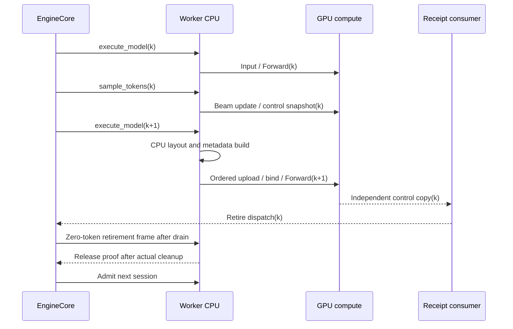

# Asynchronous scheduling

Asynchronous scheduling runs Beam Search V1 on the native vLLM 0.22.1 `execute_model → sample_tokens`
interface. The next dispatch can prepare inputs and submit GPU work after the
preceding sampling submission, before EngineCore consumes its receipt.

For a runnable OneRec-1.7B setup before reading this execution contract, see
[the OneRec-1.7B V1 asynchronous scheduling quickstart](onerec_v1_async_quickstart.md).

## Supported execution contract

- GPU ModelRunner V1, FP16/BF16, uniform text decoder with Beam Attention and a
  canonical CUDA constraint table; the existing model, KV and head-size checks apply.
- B=1, one execution owner, two physical dispatch slots including initial Prefill chunks.
- W is fixed at startup, 1–256. Effective N is 1, 2 or 3 and includes the first
  token sampled from Prefill. TP/PP/DP/DCP/PCP are all 1.
- Native async scheduling and an Executor batch queue of at least two entries.
  No ordinary/legacy Beam request mixing while an asynchronous scheduling session owns resources.
- No speculative decoding, LoRA, KV/EC transfer, quantization, sliding-window
  attention, multimodal inputs, hybrid models or microbatching.

Public output-consumer readiness checks remain in place. This contract covers
native Scheduler and Worker execution; public output delivery is separate.

## Existing baseline and new behavior

The base is upstream `6bca38c` (the same tree as `632f7d2`): native
BatchQueue/Executor/Futures, two-dispatch lookahead,
device Beam state, individual dispatch KV leases, Beam update/KV reorder kernels
and an independent control D2H stream already existed.

Asynchronous scheduling adds:

1. **Admission before native selection.** A view of native waiting queues exposes
   only the FIFO execution owner, retaining the original Request objects and queue
   ordering. A zero native token budget blocks both Decode and Prefill chunks when
   either physical slot is unavailable. Admission reserves P+N-1 native KV positions
   through `allocate_slots(num_lookahead_tokens=...)`. Temporary shortage applies
   backpressure; impossible capacity is rejected. Recompute after generation is rejected.
2. **Complete per-step CPU preparation.** `GRInputBuffers.prepare_cpu` rebuilds
   positions, offsets, suffix lengths, prefix blocks and logits rows from Host
   metadata and bindings. No generated device state is read on the CPU. The
   metadata builder's asynchronous entrypoints bypass its geometry, layout,
   view, copy and schedule caches. Missing CPU mirrors are errors.
3. **Ordered device binding.** Ordinary PyTorch operations select actual device
   tokens and constraint prefixes, validate generated count and planned step, and
   mask terminated successors. Active step mismatches produce device error 6.
   Two pinned staging slots each have an H2D completion event. H2D, state binding
   and Forward run on the compute stream; control snapshots use separate slots
   and D2H events. The first Decode retains the native input-preparation Host fence.
4. **Startup graph capture.** A dedicated fixed-W Forward graph is captured
   at startup; LM head and Beam postprocessing run outside it. Device input, mask,
   metadata and KV addresses stay fixed while their contents change each step and
   request. Metadata descriptions are fresh each step.
   Prefix bounds are block-aligned model capacity; suffix bounds are pool capacity.
   A requested but unavailable graph is an error; requests never capture graphs.
   Asynchronous Prefill reuses the existing project Prefill runner, including padded
   graph replay: 900 scheduled tokens can use a captured 1024-token bucket. Bucket
   selection uses the scheduled token count after prefix-cache hits and chunking.
   Replay refreshes static buffers, preserves real Attention lengths and masks padded
   KV writes. Missing startup graphs, unsupported live inputs, missing metadata or
   slot mapping, and exceeded captured KV-length or buffer bounds still fall back
   to the native Forward path; requests never create or capture a new runner.
   Padding alone does not trigger eager fallback. It can change BF16 results and
   Beam candidate ordering; the historical exact-bucket results do not establish
   precision for the padded path, whose matching validation remains outstanding.
5. **Independent retirement proof.** Result completion and resource completion
   are separate. Resources transition `WAITING → RUNNING → DRAINING → RETIRING →
   CLOSED`. A zero-token SchedulerOutput carries session, owner generation and
   retirement ID. Worker drains control consumers and GPU work, clears actual
   session/workspace ownership, then returns a normal ModelRunnerOutput proof.
   Only the matching proof allows the next owner. Cancelled waiting requests that
   never allocated Worker resources close immediately.
6. **Native queue progress and errors.** Retirement counts as pending work even
   for the last request. Submissions, receipt consumption, retirement and admission
   increment Host progress and avoid the fixed idle sleep. Each active dispatch
   requires a matching Worker receipt; absent receipts cannot confirm tokens.
   Async conversion failures
   become request errors; fatal Worker/CUDA failures reach native Executor failure
   handling, including exceptions raised in Multiproc's output consumer thread.

### First Decode after Prefill

The final Prefill chunk advances the issued-stage count when it is scheduled;
its real output need not have reached the CPU. Once Worker has submitted both
Prefill execution and sampling, EngineCore can submit D1 into the second slot.
Worker begins D1's CPU layout preparation inside `execute_model(D1)`. It then
checks the native pinned-input fence, updates native request state, uploads the
layout, builds attention metadata, and submits device binding and Forward.
The fence protects Host buffer reuse; it does not wait for Prefill Forward.
Actual token/Beam-state reads remain ordered after Prefill sampling on the GPU.

Prefill Graph reduces the time spent submitting model operations on the Host.
That leaves a larger GPU execution window for D1 preparation in the same Worker
thread. Graph replay and asynchronous queue progress are both needed to explain
the observed benefit; graph replay alone does not move CPU preparation earlier
when the benchmark deliberately waits for each receipt. Short eager fallbacks
can still finish before the next dispatch's CPU preparation starts.

## Validation

See [the validation summary](async_scheduling_validation.md) for supported
inputs, precision results and regression commands. Experimental benchmarks,
trace analysis and diagnostic instrumentation are maintained outside the
production change.
