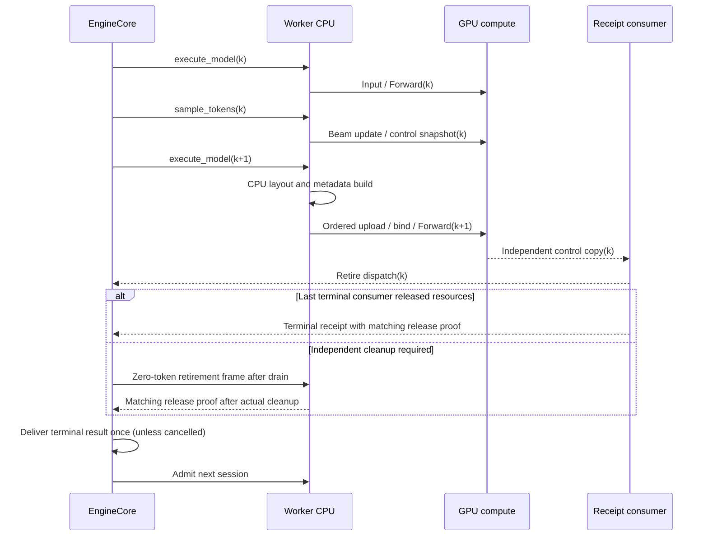

# Asynchronous scheduling

Asynchronous scheduling runs Beam Search V1 on the native vLLM 0.30.0 `execute_model → sample_tokens`
interface. The next dispatch can prepare inputs and submit GPU work after the
preceding sampling submission, before EngineCore consumes its receipt.

For a runnable OneRec-1.7B setup before reading this execution contract, see
[the OneRec-1.7B V1 asynchronous scheduling quickstart](onerec_v1_async_quickstart.md).

## Supported execution contract

- The worked example below uses CUDA ModelRunner V1, one request and a
  canonical Constraint Table. A session has one execution owner and two
  in-flight stage dispatch slots. Dispatch depth and logical batch size
  describe different dimensions.
- [Batch admission](beam_batch_execution_contract.md#validation-boundaries)
  defines batch sizes, Beam and candidate width limits, and platform
  constraints. See [ModelRunner V2](modelrunner_v2_multibatch.md) and the
  [Ascend guide](quickstart-ascend.md) for runner-specific setup.
- An enabled Constraint Table fixes generation to exactly three effective
  steps, including the token sampled in Prefill; with both OneRec boundary
  tokens configured that is public `max_tokens=5`. Without the table, one to
  three steps are supported, subject to the decode-step capacity limit. Enable
  native asynchronous scheduling and disable Chunked Prefill. Prefix Cache hits
  and misses are supported. Use `ignore_eos=True` for the Python V1 API.

Public offline and online `beam_search_v1()` return complete sequences and
cumulative scores only after matching resource-release confirmation.
`GRLLM.beam_search()` raises a migration error; the legacy frontend step loop
is retired.

## Native progress and execution ownership

In the single-request example, one native Request is added and remains
resident across Prefill and Decode.
After native `_update_after_schedule`, the stage index is
`num_computed_tokens - num_prompt_tokens`: zero is Prefill, and positive values
are Decode with `decode_step = stage_index - 1`. The native Scheduler counts one
logical token per Decode; the Worker runs W physical rows using its own mutable
input view. GR stores dispatch/generation identities, dependency records and KV
leases, without a separate token/placeholder budget.

For P=900 and N=3, a cache miss schedules 900 Prefill tokens; a hit reusing
896 tokens schedules 4. Both reach computed=900, stage=0. Subsequent Decode
stages reach computed=901/902 and schedule one logical token each. Worker
snapshots carry the pre-schedule count and validate this same token extent.

The native BatchQueue and Executor use their Future-based submission
interface. The execution stages have the following responsibilities:

1. **Admission before native selection.** A view of native waiting queues exposes
   only the FIFO execution owner, retaining the original Request objects and queue
   ordering. A zero native token budget blocks new stage dispatches when
   either physical slot is unavailable. Admission reserves P+N-1 native KV positions
   through `allocate_slots(num_lookahead_tokens=...)`. Temporary shortage applies
   backpressure; impossible capacity is rejected. Recompute after generation is rejected.
2. **Complete per-step CPU preparation.** `GRInputBuffers.prepare_cpu` rebuilds
   positions, offsets, suffix lengths, prefix blocks and logits rows from Host
   metadata and bindings. No generated device state is read on the CPU. The
   metadata builder's asynchronous entrypoints bypass its geometry, layout,
   view, copy and schedule caches. Missing CPU mirrors are errors.
3. **Ordered device binding.** Ordinary PyTorch operations select actual device
   tokens and constraint prefixes, validate generated count and planned step, and
   mask terminated successors. Active step mismatches produce device error 6.
   Two pinned staging slots each have an H2D completion event. H2D, state binding
   and Forward run on the compute stream; control snapshots use separate slots
   and D2H events. The first Decode retains the native input-preparation Host fence.
4. **Graph execution.** The dedicated Decode graph captures model Forward.
   LM head and Beam postprocessing run outside it. Device input, mask,
   metadata and KV addresses stay fixed while their contents change each step and
   request. Metadata descriptions are fresh each step.
   Prefix bounds are block-aligned model capacity; suffix bounds are pool capacity.
   Decode capture, reuse and fallback depend on the runner and shape. See the
   [V1 and V2 policies](modelrunner_v2_multibatch.md#v1-compatibility-boundary).
   Asynchronous Prefill reuses the existing project Prefill runner, including padded
   graph replay: 900 scheduled tokens can use a captured 1024-token bucket. Bucket
   selection uses the scheduled token count after prefix-cache hits.
   Replay refreshes static buffers, preserves real Attention lengths and masks padded
   KV writes. Missing startup graphs, unsupported live inputs, missing metadata or
   slot mapping, and exceeded captured KV-length or buffer bounds still fall back
   to the native Forward path; requests never create or capture a new runner.
   Padding alone does not trigger eager fallback. It can change BF16 results and
   Beam candidate ordering; the historical exact-bucket results do not establish
   precision for the padded path.
5. **Matching release proof.** Terminal data waits until all in-flight dispatches
   drain and resource release is confirmed. The last terminal output consumer can
   report `resources_released=True`, preserving the existing normal path. When
   that proof is unavailable, a zero-token SchedulerOutput carries session,
   owner generation and retirement ID. Worker drains consumers/GPU work and
   clears session/workspace ownership before acknowledging retirement. Pending
   terminal data survives this round trip and is delivered once, then the next
   owner can start. Cancelled waiting requests allocate no Worker resources;
   running cancellation drains and releases without sending a late success.
   Already-issued successors use masked inputs. Native block references keep
   dispatched prompt KV live until the corresponding receipts drain. See
   [GPU Beam state and slot lifetime](beam_gpu_state.md#streams-graphs-and-retirement).
6. **Native queue progress and errors.** Retirement counts as pending work even
   for the last request. Submissions, receipt consumption, retirement and admission
   increment Host progress and avoid the fixed idle sleep. Each active dispatch
   requires a matching Worker receipt; absent receipts cannot confirm tokens.
   Async conversion failures
   become request errors; fatal Worker/CUDA failures reach native Executor failure
   handling, including exceptions raised in Multiproc's output consumer thread.

### First Decode after Prefill

Native scheduling records complete Prefill progress when it is scheduled;
its real output need not have reached the CPU. Once Worker has submitted both
Prefill execution and sampling, EngineCore can submit D0 into the second slot.
Worker begins D0's CPU layout preparation inside `execute_model(D0)`. It then
checks the native pinned-input fence, updates native request state, uploads the
layout, builds attention metadata, and submits device binding and Forward.
The fence protects Host buffer reuse; it does not wait for Prefill Forward.
Actual token/Beam-state reads remain ordered after Prefill sampling on the GPU.

Prefill Graph reduces the time spent submitting model operations on the Host.
That leaves a larger GPU execution window for D0 preparation in the same Worker
thread. Graph replay and asynchronous queue progress are both needed to explain
the observed benefit; graph replay alone does not move CPU preparation earlier
when the benchmark deliberately waits for each receipt. Short eager fallbacks
can still finish before the next dispatch's CPU preparation starts.

## Independent-engine reduction policy

Both canonical configuration entry points, `vllm_gr_config` and
`additional_config["vllm_gr"]`, write the complete normalized GR mapping into
`VllmConfig.additional_config`. Equivalent settings with omitted defaults must
have the same compilation cache identity. Otherwise, independent offline and
online engines can tune different reduction kernels and produce different BF16
Beam candidates and scores, despite having the same effective configuration.

CUDA ModelRunner V1 engines using `beam.execution_mode=v1` and Inductor now
default `compilation_config.inductor_compile_config.dynamic_scale_rblock` to
`false`. The native compilation configuration includes this choice in its cache
identity. Existing explicit values take precedence; ModelRunner V2, NPU and
non-Beam engines keep their own defaults.

The reduction block size can affect BF16 scores before candidate selection.
The policy addresses an independent-engine mismatch observed on OneRec.

## Validation

The [validation summary](async_scheduling_validation.md) records historical
correctness and scheduling measurements under the exact-bucket policy and
links to the current system test.
