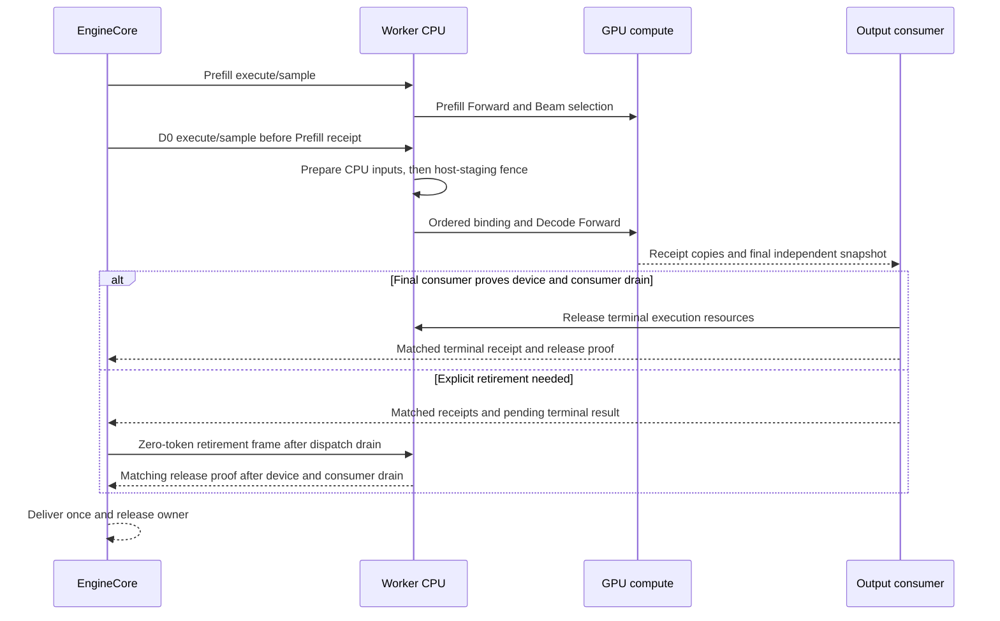

# Asynchronous scheduling

Beam Search V1 uses vLLM 0.22.1's native `execute_model -> sample_tokens`,
BatchQueue and Future consumption. Both `GRLLM.beam_search_v1()` and the
online `OpenAIServing.beam_search_v1()` return final Beam results after Worker
retirement. Legacy `beam_search()` remains available in legacy execution mode.

For a runnable OneRec-1.7B setup before reading this execution contract, see
[the OneRec-1.7B V1 asynchronous scheduling quickstart](onerec_v1_async_quickstart.md).

## Supported execution contract

- GPU ModelRunner V1, FP16/BF16, uniform text decoder with Beam Attention and a
  canonical CUDA Constraint Table. Existing model, KV and head-size limits apply.
- B=1, fixed membership, synchronous Beam progression, TP/PP/DP/DCP/PCP=1.
- Fixed startup width W=1..256. Effective generation budget N=1/2/3 includes the
  first token from Prefill. Optional begin/end tokens reserve their budget once
  in the frontend; begin is appended to the prompt, end to the final output.
- `ignore_eos=True` is mandatory. Legal EOS is an ordinary generated token.
  Successful completion has finish reason `length`; output conversion never
  trims generated EOS or changes cumulative logprobs.
- V1 execution mode, native `async_scheduling=True`, and at least two Executor
  batch queue entries. There is one execution owner and at most two physical
  dispatches awaiting receipts.
- `enable_chunked_prefill=False`. Prompt-only prefix-cache hits and misses are
  supported. Full logical KV capacity is reserved before execution.
- No ordinary/legacy request mixing, speculative decoding, LoRA, KV/EC transfer,
  quantization, sliding-window attention, multimodal models, hybrid models or
  microbatching. NPU execution requires the adapter tracked by #399.

Invalid request semantics are rejected before session allocation. Device
capability and startup capture checks stay in the GPU implementation. No
additional asynchronous scheduler or public async Beam switch is introduced.

EngineCore validates static execution constraints during initialization and
shares that startup contract with Scheduler. Each submission is validated by
Core once; Scheduler consumes a request-bound admission result and rechecks the
mutable native fields before ADD. Direct submissions with mutable contract
containers retain full Scheduler validation. Duplicate-request, request-mixing
and KV-capacity checks always remain at admission.

## State ownership

One native Request is submitted with one ADD and remains through Prefill and
Decode. Its computed-token count, output placeholders and generation budget
control scheduling. GR freezes stage metadata after native schedule bookkeeping;
for an emitted stage, `stage_index = num_computed_tokens - num_prompt_tokens`.
Prefill is stage 0 and Decode stages have `decode_step = stage_index - 1`.
Metadata does not require the previous receipt or a generated token on the CPU.

GR keeps session status, owner generation, dispatch identities, in-flight records
and individual dispatch KV leases. These protect resource ownership rather than
maintaining a second token budget. Diagnostic issued/completed counts derive
from those records. Duplicate, stale and mismatched-generation receipts cannot
advance native progress or release a lease twice.

Admission exposes the FIFO owner through the native waiting queues. Native KV
reservation covers P+N-1 computed positions. Prefix caching only publishes valid
prompt KV; speculative logical positions do not become reusable prefix entries.
Resource shortage applies backpressure. Impossible capacity and recomputation
after generation are rejected.

## Execution and terminal delivery

`GRStageMetadata`, `GRWorkerResult`, `BeamBatchResult` and
`GRRetireMetadata`/`GRRetireResult` describe dispatch, receipt, terminal output
and retirement. They contain no CUDA stream or event types. Worker copies the
mutable native execution view before updating it, including when EngineCore and
Worker share a process. The Scheduler sees one logical Decode token; the device
adapter executes W rows.

CPU preparation builds complete layout and metadata from host geometry. The
first Decode performs that work before the native Prefill host-staging fence.
Two pinned staging slots have individual reuse fences. Upload, generated-token
binding and Forward remain ordered on the compute stream. Fixed graph addresses
and full suffix-KV reorder semantics are retained.

The Decode graph contains Forward only; the LM head and Beam decisions remain
outside it. Prefill reuses the existing startup runner and padded replay, with
the existing eager fallbacks. Bucket selection uses scheduled tokens after a
prefix-cache hit. Padding preserves real attention lengths and masks padded KV
writes; it can change BF16 rounding and Beam ordering. Requests never capture
graphs. See the validation document for measured replay/fallback and precision.

The last effective stage produces completed records, including N=1 directly
from Prefill. The GPU uses `GPUBeamFinalOutput` to rank completed records,
walk parent history and pack the returned paths into independent, reusable
storage. The terminal receipt header and sequences/scores share one pinned-host
transfer. At W=128/N=3 this payload is 5,136 bytes. The output consumer waits
for its event; the model submission thread performs no device-wide wait.

V1 returns final token sequences, cumulative scores and parent chains through
the upstream compact transport contract. Per-step candidate logprobs are not
part of that contract: offline `logprobs` is empty and online `logprobs` is
`None`. Offline token/text materialization reuses the upstream lazy converter,
including its tokenizer-boundary checks. Fixed-length survivors need no
length-penalty ranking kernel because their denominators are identical.

Typed terminal conversion also checks sequence values for effective budgets
N=1/2/3. Public conversion reuses those checks only for the same immutable
output and budget; replaced values and direct construction retain full checks.
The validation metadata is local to the frontend and never adds a wire field.
Protocol/request identity, success/failure status and candidate counts are
checked before any output is returned. Offline construction shares a request
template while allocating separate mutable fields for each Beam.

Terminal output and resource completion are separate facts. Public delivery
waits for both:

The final output consumer can prove release in its terminal receipt, avoiding
an additional retirement round trip. Otherwise, resources drain through
`DRAINING -> RETIRING -> CLOSED`; retirement remains pending work even after
the native Request has been removed. The zero-token frame follows the native
queue and output-consumption mechanism. Both paths require matching owner and
generation identities before resource reuse and final frontend delivery.
Native placeholder tokens never enter public results.

Cancellation before Worker admission allocates no Worker resources. Running
cancellation stops new scheduling and drains submitted work. The frontend sends
internal IDs even if a prior abort removed routing, and uses ordered nonblocking
native utility queries to await retirement. Submission rollback fences delayed
acceptance; retained cleanup tasks survive caller cancellation and retry
recoverable transport failures. Fatal EngineCore errors propagate through the
native error path rather than retrying forever.

## Device adapter for #399

The implemented routing boundary is `v1/worker/gr_execution.py`; GPU ownership,
staging, streams, snapshots and graph details stay in `gpu_beam_stage_runner.py` and `beam_final_output.py`.
An NPU adapter must provide the same concrete operations used by the GPU path:

1. Validate device capability and capacity at startup; admit frozen dispatch
   metadata with `validate_gr_dispatch` before allocating an owner.
2. Execute the detached native input view using public Prefill/Decode metadata;
   keep logical token counts distinct from the W-row device view.
3. Submit sampling and return an asynchronous native output wrapper whose
   consumer yields matched `GRWorkerResult` receipts and a final
   `BeamBatchResult` containing final sequences, cumulative scores and parent chains.
4. Handle cancellation and consume `GRRetireMetadata`; prove actual device and
   output-consumer drain with `GRRetireResult` before slot/workspace reuse.

NPU supplies its own ordering primitives and graph implementation. It reuses the
Scheduler, native Request, queues, terminal conversion and lifecycle contracts;
no unused abstract runtime framework is required.

## Examples

See [reproducible public calls](beam_search_v1_examples.md) and the
[current validation and ABBA record](benchmarks/beam_search_v1_398_validation.md).
The current performance timer covers only the `beam_search_v1()` call and return.
Reading lazy offline tokens/text happens outside that timer. Historical Worker
retirement timings and measurements including lazy materialization use different
boundaries and must be compared separately.
