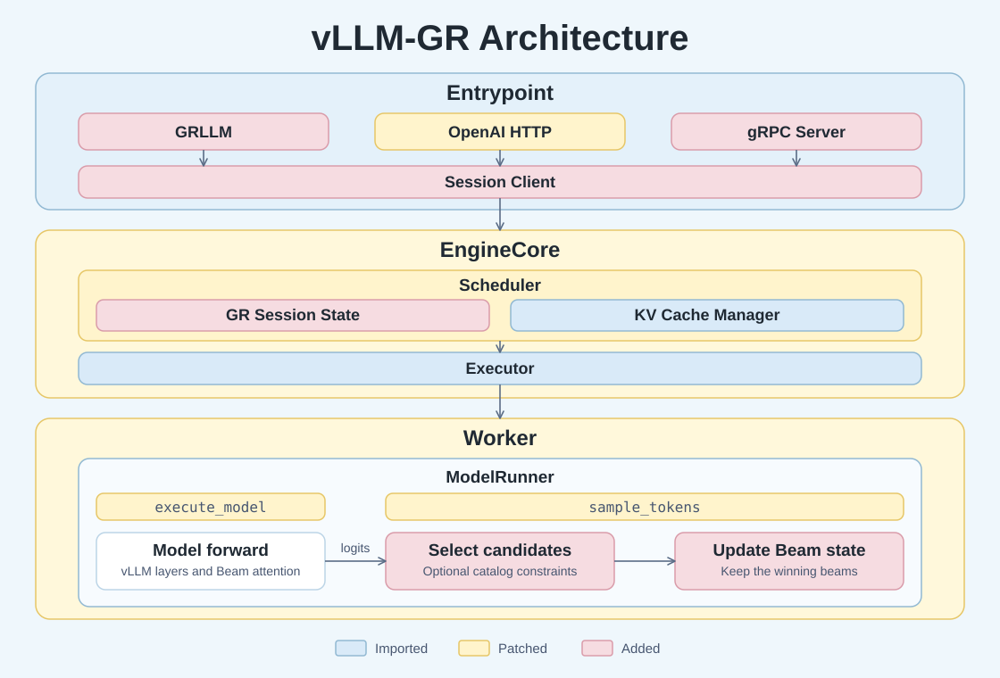
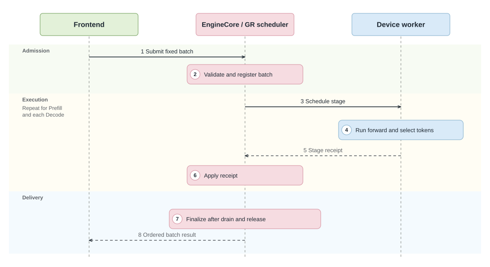

# vLLM-GR architecture overview

vLLM-GR extends vLLM to serve generative recommendation models. For OneRec,
the prompt represents a user's history, and the model generates semantic IDs
for candidate items. Beam search keeps several candidate continuations for
each prompt. When a catalog constraint is enabled, the selected catalog trie
limits which tokens may extend each partial ID.

Blue marks components imported from vLLM, yellow marks native components
patched by GR, and pink marks components added by GR. The vLLM general plugin
entry point installs the runtime hooks in each process that needs them.

vLLM-GR ships as an open-source subproject. It extends vLLM's scheduler, model
execution, KV cache, parallelism and quantization instead of replacing them.
The serving goal is lower end-to-end latency, SLA compliance and higher
effective throughput.

## How a OneRec request runs

The offline library, HTTP and gRPC accept Beam requests.

| Entry point | Submission unit |
| --- | --- |
| `GRLLM.beam_search()` | One logical Beam batch. |
| HTTP `POST /v1/completions` with `use_beam_search` | One Beam batch for an eligible non-streaming prompt list when its count is in `gr.beam_batch_sizes` and capacity and request checks pass. The fallback opens independent Beam sessions for each prompt. |
| gRPC `VllmEngine.GenerateBatch` | One logical Beam batch. |

A batch may contain several prompts. Each prompt keeps its own candidate
history and result.

1. **Admission.** EngineCore validates the batch before admitting its members.
   The native scheduler accounts for prompt tokens and allocates paged KV
   blocks for the prompt and the reserved Decode positions. GR associates the
   native requests with a Beam session and adds session and stage metadata to
   the scheduled work.
2. **Prefill and Decode.** The worker runs the prompt forward and selects the
   first token for each retained beam. At each Decode step it scores
   continuations, applies catalog constraints when enabled, and retains the
   winning beams. Each winner inherits its parent's history and KV state. The
   frontend submits the batch once and waits for the terminal result.
3. **Completion and cancellation.** EngineCore tracks outstanding dispatches.
   It publishes a successful result after confirming that the session's worker
   resources have been released. An in-flight cancellation also drains
   outstanding work before another session can reuse those resources.

See [Beam batch execution](feature/beam_batch_execution.md) for the request
and result contracts and [asynchronous scheduling](feature/async_scheduling.md)
for ownership, dispatch and retirement ordering.

## Key techniques

| Technique | Implementation |
| --- | --- |
| Session scheduling and asynchronous pipeline | Submit a whole Beam batch once, keep its session resident across stages, and overlap host preparation with device execution. |
| Beam execution and KV optimization | Share the prompt KV across beams, fuse short-suffix attention, and replay captured graphs. |
| SID constraints and dynamic Beam | Apply catalog-constrained selection, vary candidate and retained widths per stage, and slice the vocabulary projection. |
| Online ingress and hot update | Admit requests with low copying, and reload model weights or swap the SID catalog on a running service. |

## Component responsibilities

| Component | Responsibility |
| --- | --- |
| Native vLLM | Runs model forwards, schedules native requests, and manages paged KV blocks for prompt context. |
| GR frontend and EngineCore extensions | Convert input into a Beam batch, validate it, track its members as one session, and deliver ranked sequences and scores per prompt. |
| GR worker extensions | Maintain per-beam state, select and reorder candidates, and coordinate the worker resources used across Prefill and Decode. |
| GR update sidecar | Coordinates checkpoint and catalog updates across serving instances through management requests. |

The split matters during Decode. The scheduler advances a logical request by
one token while the worker evaluates multiple beam rows for that request. The
[constraint table](module/constraint_tables.md) determines which continuations
are legal. The [Beam state design](module/beam_state.md) explains how the CUDA
worker preserves candidate ancestry across reordering. The
[update design](feature/weight_update.md) covers the separate management path.

## Configuration lifecycle

The [configuration guide](../configuration/README.md) owns user-facing YAML,
overrides, and defaults. EngineArgs resolves those settings on the driver
and publishes a JSON-compatible snapshot in `additional_config["vllm_gr"]`.
Workers consume that snapshot rather than reloading user configuration.

Step width lists determine runtime capacities when present. A Python
`GRConfig` can also specify pool and candidate capacities without request
defaults: the snapshot carries `gr.beam_max_width` and
`gr.beam_candidate_width` while preserving the absence of a step schedule.
Conflicting capacities and schedules are rejected at construction.

An unspecified constraint setting omits both constraint keys from the
snapshot; explicit `constraint_mode: none` selects unconstrained generation.
The driver resolves `backend: auto` before publishing table configuration.
On CUDA, workers derive the vocabulary projection window from the loaded
table's token IDs. Per-parent candidate counts come from `gr.candidate_width`.

## Platform execution

Both backends use the same Beam batch and result contracts. At startup, each
process activates the provider for the current vLLM device type. The provider
checks the runtime and applies platform-specific patches. The worker and
attention dispatchers then select the runner and attention implementation for
the device.

- **CUDA** workers manage device Beam state and can replay captured Prefill
  and Decode work. The [CUDA Prefill design](feature/cuda_prefill_graph.md)
  explains capture selection, and the [ModelRunner V2 design](module/model_runner_v2.md)
  describes integration with the native runner.
- **Ascend** workers use NPU-specific attention and KV operations. Eligible
  prompt shapes can use [BSND Prefill graphs](feature/npu_prefill_bsnd.md).
  The [Ascend Decode design](feature/npu_decode_execution.md) describes the
  fused and cascade paths and their fallback conditions.

See the [platform backend contract](module/platform_backend.md) for provider
ownership and [feature compatibility](../user_guide/feature_compatibility.md)
for the supported combinations.
