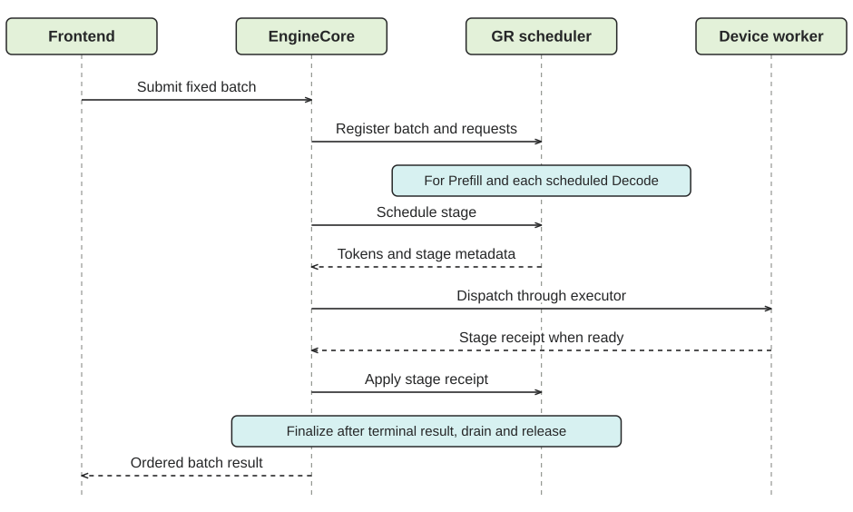

# vLLM-GR architecture overview

vLLM-GR extends vLLM to serve generative recommendation models. For OneRec,
the prompt represents a user's history, and the model generates semantic IDs
for candidate items. Beam search keeps several candidate continuations for
each prompt. When a catalog constraint is enabled, the selected catalog trie limits which
tokens may extend each partial ID.

## How a OneRec request runs

`GRLLM.beam_search()`, the HTTP Beam endpoint, and the gRPC Beam service
accept different input formats. Each submits a complete logical Beam batch
to EngineCore. A batch may contain several prompts. Each prompt keeps its
own candidate history and results.

1. **Admission.** EngineCore validates the batch before admitting its members.
   The native scheduler accounts for prompt tokens and allocates paged KV
   blocks. GR associates the native requests with a Beam session and adds
   session and stage metadata to the scheduled work.
2. **Prefill and Decode.** The worker runs the prompt forward and selects the
   first candidates. At each Decode step it scores continuations, applies
   catalog constraints when enabled, and retains the winning beams. Each
   winner inherits its parent's history and KV state. The frontend submits the
   batch once and waits for the terminal result.
3. **Completion and cancellation.** EngineCore tracks outstanding dispatches.
   It publishes a successful result after receiving confirmation that the
   session's worker resources have been released. An in-flight cancellation
   also drains outstanding work before another session can reuse those
   resources.

See [Beam batch execution](feature/beam_batch_execution.md) for the request
and result contracts and [asynchronous scheduling](feature/async_scheduling.md)
for dispatch and retirement ordering.

## Component responsibilities

| Component | Responsibility |
| --- | --- |
| Native vLLM | Runs model forwards, schedules native requests, and manages paged KV blocks for prompt context. |
| GR frontend and EngineCore extensions | Convert input into a Beam batch, validate it, track its members as one session, and deliver ranked sequences and scores per prompt. |
| GR worker extensions | Maintain per-beam state, select and reorder candidates, and coordinate the worker resources used across Prefill and Decode. |
| GR update sidecar | Coordinates checkpoint and catalog updates across serving instances through management requests. |

The split matters during Decode. The scheduler advances a logical request by
one token while the worker evaluates multiple beam rows for that request.
The [constraint table](module/constraint_tables.md) determines which
continuations are legal. The [Beam state design](module/beam_state.md)
explains how the CUDA worker preserves candidate ancestry across reordering.
The [update design](feature/weight_update.md) covers the separate management path.

## Platform execution

Both backends use the same Beam batch and result contracts. At startup, each
process activates the provider for the current vLLM device type. The provider
checks the runtime and applies platform-specific patches. The worker and
attention dispatchers select the runner and attention implementation for the
device.

- **CUDA** workers manage device Beam state and can replay captured Prefill
  and Decode work. The [CUDA Prefill design](feature/cuda_prefill_graph.md)
  explains capture selection, and the [ModelRunner V2 design](module/model_runner_v2.md)
  describes integration with the native runner.
- **Ascend** workers use NPU-specific attention and KV operations. Eligible
  prompt shapes can use [BSND Prefill graphs](feature/npu_prefill_bsnd.md).
  The [NPU Decode design](feature/npu_decode_execution.md) describes the
  fused and cascade paths and their fallback conditions.

See the [platform backend contract](module/platform_backend.md) for provider
ownership and [feature compatibility](../user_guide/feature_compatibility.md)
for the supported combinations.
