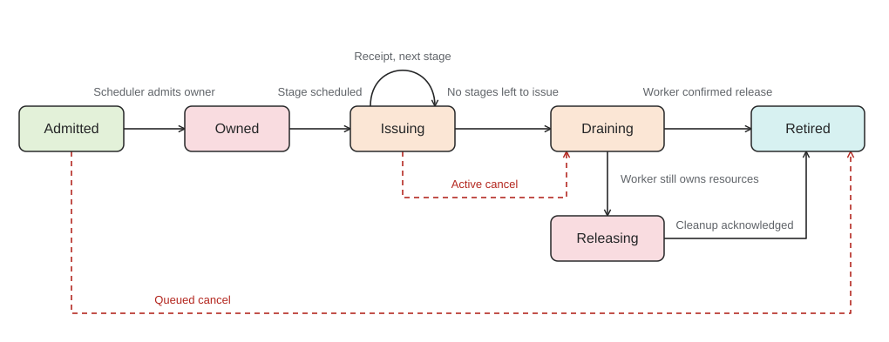

# Asynchronous scheduling

Each Beam Decode step needs the token IDs selected by the previous stage.
On CUDA, EngineCore can dispatch the next stage before it receives the
previous stage's receipt. The worker can then prepare the next input layout
on the host while the GPU is still selecting beams. On Ascend, the worker
samples the pending forward pass before accepting the next stage. Both paths
use the same GR scheduler and keep selected token IDs on the device.

## Scheduling model

### Batch ownership

The GR scheduler grants execution ownership to one fixed Beam batch at a
time, in arrival order. While that batch owns execution, the native scheduler
can schedule only its members. Ordinary requests wait, and an attempt to
allocate KV for a request outside the batch raises an error. The scheduler
allows up to two stages of the owning batch to await a receipt.

### Native request accounting

The native scheduler tracks one logical request per prompt. Its first paged
KV allocation covers the prompt and all reserved Decode positions. Prefill
selects the first output token for each retained beam. Each subsequent Decode
advances the logical request by one position, while the worker evaluates one
input row for each surviving beam. The worker manages each beam's suffix KV
separately.

For a 128-token prompt and a three-token output, the reservation covers 130
positions (128 prompt positions and two Decode inputs). Cached prefix blocks
count toward the reservation. Admission checks that each request fits the
model context and that the batch fits the KV block pool. The scheduler also
rejects a stage if native scheduling splits its batch, schedules only part of
Prefill, or attempts to recompute Prefill.

## CUDA dispatch timeline

The worker can prepare the layout for step *k+1* as soon as it knows the
scheduled shape. The forward pass for *k+1* waits for the tokens selected at
step *k*. For the nonterminal stages shown below, a separate stream copies
status to the host after the compute stream records that selection is ready.


| Color | Meaning |
| --- | --- |
| Green | Execution context: worker host, compute stream or copy stream. |
| Pink | Sampling and token selection. |
| Orange | Host layout preparation and the next Decode. |
| Cyan | Status copy on its own stream. |

The first Decode can prepare its layout before waiting to update native
request state. The wait protects host buffers that Prefill may still use.

| First Decode after Prefill | When the worker can update native request state |
| --- | --- |
| CUDA ModelRunner V1 | Waits for the input event, if present, before updating pinned host buffers that Prefill may still be reading. |
| CUDA ModelRunner V2 | Updates as soon as the layout is ready. V2 builds a fresh input batch each step, so the hook returns without waiting. |

## Ascend stage execution

One Ascend runner handles all stages of the batch. It samples each pending
forward pass before accepting another stage. Sampling returns a receipt to
EngineCore and leaves the selected token IDs on the NPU for the next Decode.
For two prompts with three input beams each, the scheduler advances two
logical requests by one position each and the worker runs six Decode rows. See
[Ascend Decode execution](npu_decode_execution.md).

## Completion and cancellation



| Color or line | Meaning |
| --- | --- |
| Green | Admitted batch. |
| Pink | Ownership and release bookkeeping. |
| Orange | Stage issue or drain. |
| Cyan | Retired terminal state. |
| Dashed red | Cancellation path. |

Before EngineCore delivers the terminal result, all issued stages must drain
and the worker must confirm release for the matching session and owner
generation. On Ascend, final sampling builds the result, releases the Beam
state, and sets `resources_released` in that stage's receipt. If the worker
still holds resources after the last issued stage drains, the scheduler sends
a zero-token cleanup and waits for its receipt. The scheduler finishes the
native member requests internally, and EngineCore emits one batch result
with finish reason `LENGTH` on success or `ERROR` on failure.

A queued batch can be cancelled immediately. When the caller cancels an
active batch, the scheduler stops issuing stages and waits for outstanding
work to drain. It discards any late success and releases ownership before
the next batch can take over. See
[Beam state lifetime](../module/beam_state.md#streams-graphs-and-retirement).

## Configuration

The packaged Beam configuration enables asynchronous scheduling and disables
chunked Prefill through the native vLLM startup options below. Set the
logical request and token budgets using the
[configuration reference](../../configuration/README.md#asynchronous-scheduling).

```yaml
async-scheduling: true
enable-chunked-prefill: false
```

## Performance

Use the [Beam performance workload](../../cli/bench/beam_performance.md) to
measure a scheduler revision on CUDA. Keep the model, prompt, batch size,
beam width and Prefill mode fixed across runs. The workload reports timings
in JSON. Use an external profiler for a timeline that shows whether host
preparation overlaps the previous GPU stage.

## Validation

The [OneRec scheduler system test](../../../tests/e2e/test_onerec_v1_scheduler_st.py)
covers offline and online execution on both CUDA runners, including retirement
by the time the result is delivered. On Ascend, the
[worker](../../../tests/v1/worker/test_npu_model_runner_patch.py),
[cleanup](../../../tests/v1/worker/test_npu_stage_preparation_rollback.py) and
[dynamic-width](../../../tests/e2e/test_npu_dynamic_beam_st.py) tests cover
Decode row counts, failure recovery and both eager and graph execution.

## Source map

| File | Responsibility |
| --- | --- |
| [GR scheduler](../../../vllm_gr/v1/core/sched/beam_async_scheduler.py) | Issues stages, restricts scheduling to the owning batch, and handles receipts and retirement. |
| [CUDA stage runner](../../../vllm_gr/v1/worker/cuda/gpu_beam_stage_runner.py) | Orders device work and status copies. |
| [V1 hooks](../../../vllm_gr/v1/worker/cuda/v1/gpu_beam_stage_runner_v1.py) | Implements the pinned-host-buffer fence after Prefill. |
| [V2 hooks](../../../vllm_gr/v1/worker/cuda/v2/gpu_beam_stage_runner_v2.py) | Prepares fresh input batches and skips the host buffer wait. |
| [Ascend stage runner](../../../vllm_gr/v1/worker/npu/npu_beam_stage_runner.py) | Executes and samples each stage before the next stage. |

[Beam batch execution](beam_batch_execution.md#validation-boundaries) defines
admission. The [OneRec walkthrough](../../user_guide/onerec_quickstart.md) shows
a complete request.
