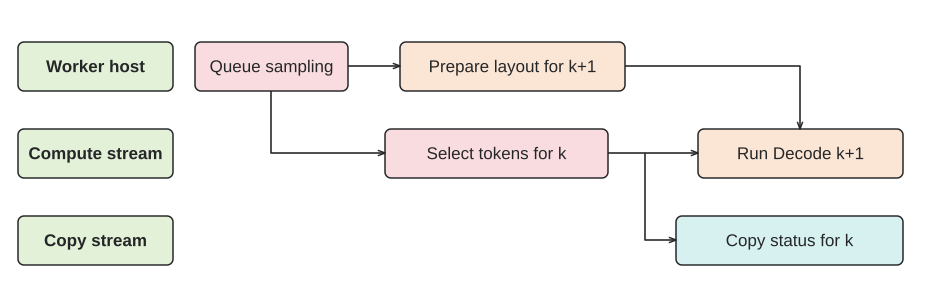

# Asynchronous scheduling

Each beam Decode consumes token IDs selected by the previous stage. EngineCore
can issue the next stage before the worker acknowledges the previous one, so
the CUDA worker prepares the next input layout while the GPU is still selecting
beams. Selected tokens stay on the device. CUDA and Ascend share the scheduler
but implement the handoff differently.

## Scheduling model

### Batch ownership

The GR scheduler gives one fixed batch at a time ownership of native
scheduling, in arrival order. While a batch owns execution, the native
scheduler can see and schedule only that batch's members: ordinary requests
are held back, and any allocation outside the owner raises. Up to two stages
of the owning batch can await acknowledgement.

### Native request accounting

The native scheduler tracks one request per prompt and allocates paged KV for
the prompt plus every reserved Decode position in the first allocation. Prefill
selects the first token for each retained beam. Each subsequent Decode advances
the native request by one position while the worker evaluates that request's
surviving beams.

For a 128-token prompt and a three-token output, the reservation covers 130
positions: the prompt plus two Decode inputs. Cached prefix blocks count toward
that reservation. The scheduler rejects a batch whose full extent exceeds the
model context or the KV block pool, and rejects a native split of the batch or
a partial Prefill after generation has started.

## CUDA dispatch timeline

Preparing the layout for step *k+1* depends on the scheduled shape, and running
its forward depends on the tokens selected at step *k*. The figure follows two
nonterminal steps from left to right; arrows show dependencies. The status copy
uses its own stream.



| Color | Meaning |
| --- | --- |
| Green | Execution context: worker host, compute stream or copy stream. |
| Pink | Sampling and token selection. |
| Orange | Host layout preparation and the next Decode. |
| Cyan | Status copy on its own stream. |

The two model runners hand off host buffers differently:

| First Decode after Prefill | When the worker can update native request state |
| --- | --- |
| CUDA ModelRunner V1 | After the input event, when present. Prefill can still be reading pinned host buffers that the update will reuse, so the stage fence waits for it. |
| CUDA ModelRunner V2 | As soon as the layout is ready. V2 builds a fresh input batch for every step and reuses no pinned host buffers, so its fence is a no-op. |

## Ascend stage execution

One Ascend runner handles every stage of the batch. It samples its pending
forward before accepting another stage, returns a receipt to EngineCore and
keeps the selected token IDs on the NPU. Two prompts with input width three
advance one position each in the scheduler and produce six physical Decode
rows. See [Ascend Decode execution](npu_decode_execution.md).

## Completion and cancellation


| Color or line | Meaning |
| --- | --- |
| Green | Admitted batch. |
| Pink | Ownership and release bookkeeping. |
| Orange | Stage issue or drain. |
| Cyan | Retired terminal state. |
| Dashed red | Cancellation path. |

EngineCore delivers the terminal result after issued stages drain and the
worker confirms release for the matching session and owner generation. On
Ascend, final sampling builds the result, releases the Beam state and sets
`resources_released` in the same receipt. If stages have drained but the worker
still owns resources, the scheduler issues a zero-token cleanup and waits for
its acknowledgement. The native member requests are then finished and
suppressed; the frontend-visible finish reason is synthesized as `LENGTH` on
success and `ERROR` on failure.

A queued cancellation can finish immediately. For an active cancellation, the
scheduler stops issuing stages, drains outstanding work, discards a late
success and releases the owner before admitting the next batch. See
[Beam state lifetime](../module/beam_state.md#streams-graphs-and-retirement).

## Configuration

The packaged Beam configuration uses these native vLLM options at startup.
Batch and token budgets are described in the
[configuration reference](../../configuration/README.md#asynchronous-scheduling).

```yaml
async-scheduling: true
enable-chunked-prefill: false
```

## Performance

Use the [Beam performance workload](../../cli/bench/beam_performance.md) to
measure a specific scheduler revision. Keep the model, prompt, batch size,
beam width and Prefill mode fixed across runs. The workload reports JSON
timings and does not emit a timeline; use an external profiler to check whether
host preparation overlaps the previous GPU stage.

## Validation

The [OneRec scheduler system test](../../../tests/st/test_onerec_v1_scheduler_st.py)
covers offline and online execution on both CUDA runners, including retirement
at result delivery; on Ascend, the [worker](../../../tests/v1/worker/test_npu_model_runner_patch.py),
[cleanup](../../../tests/v1/worker/test_npu_stage_preparation_rollback.py) and
[dynamic-width](../../../tests/st/test_npu_dynamic_beam_st.py) tests cover row
counts, failure recovery and eager or graph execution.

## Source map

| File | Responsibility |
| --- | --- |
| [GR scheduler](../../../vllm_gr/v1/core/sched/beam_async_scheduler.py) | Stage issue, ownership filtering, acknowledgements and retirement. |
| [CUDA stage runner](../../../vllm_gr/v1/worker/cuda/gpu_beam_stage_runner.py) | Orders device work and status copies. |
| [V1 hooks](../../../vllm_gr/v1/worker/cuda/v1/gpu_beam_stage_runner_v1.py) | Implements the pinned-host-buffer fence after Prefill. |
| [V2 hooks](../../../vllm_gr/v1/worker/cuda/v2/gpu_beam_stage_runner_v2.py) | Reuses no host buffers, so its fence is a no-op. |
| [Ascend stage runner](../../../vllm_gr/v1/worker/npu/npu_beam_stage_runner.py) | Executes and samples a pending stage. |

[Beam batch execution](beam_batch_execution.md#validation-boundaries) defines
admission. The [CUDA walkthrough](../../user_guide/beam_search_cuda.md#run-with-a-constraint-table) shows
a complete request.
