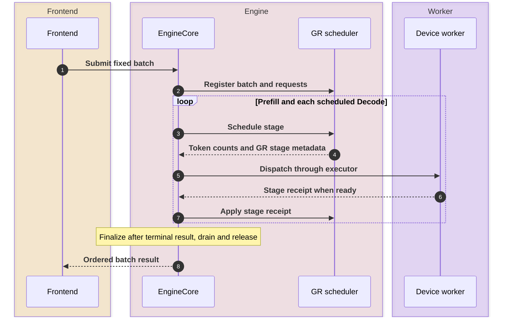

# Beam batch execution

A Beam batch request takes a fixed, ordered list of prompts and returns ranked
continuations. The frontend submits the prompts together. Each prompt has its
own native request ID, scores and beam history. The caller receives one
terminal result for the batch on both CUDA and Ascend.

## How a batch runs

The frontend prepares every prompt before submission. EngineCore preprocesses
the request and registers its members on the core thread, so the scheduler sees
the whole batch before running any member. Solid arrows in the diagram show
calls, and dashed arrows show replies.

EngineCore reports validation failures to the caller as admission errors. Once
it admits the batch, EngineCore can issue the next stage while a receipt from
the previous stage is still pending. See the
[dispatch timeline](async_scheduling.md#cuda-dispatch-timeline).

### Scheduling and resource ownership

Consider a batch of two prompts, with three output tokens and four retained
beams per prompt.

| Stage | Native scheduler | Device worker |
| --- | --- | --- |
| Prefill | Schedules the uncached prompt tokens. | Selects the first token for each retained beam, up to four per prompt. |
| First Decode | Advances one position per prompt. | Evaluates four input rows for each prompt and selects that prompt's next beams. |
| Final Decode | Advances one more position per prompt. | Selects the third token and builds ranked sequences for each prompt. |

The scheduler's first paged KV allocation covers the prompt and every reserved
Decode position. Scheduler limits apply to the entire reservation. The worker
uses parent indices to carry each surviving beam's history into the next step.

### Validation boundaries

| Boundary | Checks |
| --- | --- |
| Request identity and encoding | Item indices are contiguous and start at zero. Native request IDs are unique within the batch, and the first must equal the batch ID. Each prompt is a nonempty, contiguous, one-dimensional CPU array of nonnegative `int64` token IDs. |
| Request form | Dispatch rejects `prompt_embeds`, `mm_features`, empty prompts and LoRA. It requires `ignore_eos=true`, `n=1` and matching values for `sampling_params.max_tokens` and `beam_params.max_tokens`. EngineCore clears native stop tokens. |
| Engine capacity | Dispatch accepts one to eight prompts. The batch must fit the native request, Prefill token, context and KV limits, and its beam width must match the engine's fixed startup width. |
| Dynamic widths | If set, `dynamic_beam_widths` and `per_parent_beam_widths` must each be a tuple of `max_tokens` positive widths, with `max_tokens` between 1 and 3. The request beam width caps retained widths. `MAX_CANDIDATE_WIDTH` caps per-parent widths. The first per-parent width must equal the first retained width. Each stage must satisfy `input_width * per_parent >= output_width`. |
| Device and catalog | Ascend budgets Decode rows using the largest input width across Decode stages. A table-constrained request must match the table's depth and fit its candidate capacity. |
| Output options | Candidate width is the number of expansions per parent. Retained width is the number of survivors per prompt. `num_return_sequences` is capped at the final retained width. |

Requests and results use wire protocol version 2. Multiprocess clients send
`SUBMIT_GR_SESSION`. In-process clients invoke the core handler directly. Both
ends of the wire protocol must use the same positional schema. A batch uses the
`default` constraint resource and can select a Trie for each item. See
[catalog routing](../module/constraint_tables.md#request-routing).

### What the caller receives

EngineCore returns the terminal payload in
`EngineCoreOutput.kv_transfer_params["gr_batch_result"]`. The offline
`LLMEngine` and online `AsyncLLM` adapters run the same checks. They verify the
protocol version and batch ID and require exactly one of an output or a
failure. For failures, they check the code, message and range of any item
index. For successful results, they check the item count and each item's
`item_index`, `request_id`, sequence count, token length, cumulative scores and
parent indices. Each sequence must have finish reason `length` and no stop
token. The stop-token check is independent of `include_stop_token`.

- **Success.** Each item has between one and `num_return_sequences` ranked
  continuations of the requested length, with cumulative scores and parent
  indices when requested. Equal-length sequences can travel as
  [binary columns](../../serving/grpc.md#binary-beam-results).
- **Failure.** The caller receives one batch error with a code, a message and
  an optional item index. The `no_valid_beams` code means final selection found
  no valid candidates.
- **Cancellation.** The engine can cancel queued work immediately. It drains
  active work before releasing resources and discards any late success.

## Configuration

`gr.beam_batch_sizes` sets the prompt counts eligible for grouped HTTP
completions and the CUDA request counts used to capture FULL Prefill and Beam
Decode graphs. The packaged list is `[1, 2, 4]`. Add `8` to enable grouping for
eight-prompt HTTP completions.

An explicit Beam batch can pass admission with a prompt count outside the
list. CUDA V2 looks up PIECEWISE Prefill graphs by token bucket alone, so
admitted batches with different prompt counts can replay the same graph if
their token bucket was captured.

Set `max-num-seqs` for the number of logical requests. Set
`max-num-batched-tokens` for the Prefill workload and, on Ascend, the peak
Decode row count. See the
[batch and token budgets](../../configuration/README.md#batch-sizes-and-token-budgets)
and [OneRec walkthrough](../../user_guide/onerec_quickstart.md).

## Performance

One submission covers all generation steps. The Decode workload depends on
the number of live beams per prompt. At a fixed width of four, two prompts
occupy two native request slots and eight Decode rows. Each HTTP call keeps
its own batch membership.

## Validation

The [contract tests](../../../tests/contract/test_beam_batch_contracts.py)
cover request identity, widths, wire round trips and terminal results. The
[CPU reference tests](../../../tests/v1/beam/test_beam_cpu_reference.py) cover
score accumulation, tie-breaking and ordering.
[Operator parity tests](../../../tests/v1/beam/test_beam_cpu_reference_parity.py)
compare the PyTorch operators with the NumPy reference using CPU tensors.

## Source map

| File | Responsibility |
| --- | --- |
| [Batch schema](../../../vllm_gr/v1/beam/batch_contracts.py) | Defines request and result shapes, width rules and the protocol version. |
| [Wire codec](../../../vllm_gr/v1/engine/codec.py) | Decodes incoming payloads using the wire schema for each request type. |
| [Dispatch validation](../../../vllm_gr/v1/beam/dispatch.py) | Rejects unsupported request forms and checks the fixed beam width. |
| [Runtime admission](../../../vllm_gr/v1/engine/beam_admission.py) | Checks a prepared batch against engine capacity. |
| [Session client](../../../vllm_gr/v1/engine/beam_session_client.py) | Submits the request and validates its terminal result. |
