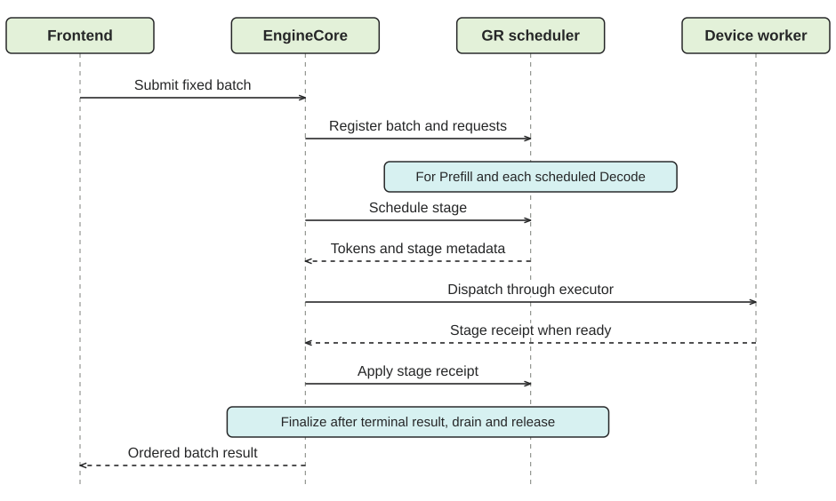

# Beam batch execution

One Beam batch request asks for ranked continuations of a fixed, ordered set
of prompts. The frontend submits all prompts together. Each prompt keeps its
own native request ID, scores and beam history. The caller receives one
terminal result for the batch on either CUDA or Ascend.

## Architecture

### From submission to delivery

The frontend prepares every prompt before submission. EngineCore preprocesses
the request and registers its members on the core thread, so the scheduler can
see the whole batch before running any member. The diagram follows an admitted
batch through one stage cycle and the terminal handoff. Solid arrows mark
calls, dashed arrows mark replies and shaded notes mark stage boundaries.

EngineCore reports an admission error to the caller if the batch fails
validation. After admission, a receipt can arrive while the next stage is
being issued. See the [dispatch timeline](async_scheduling.md#dispatch-timeline).

### Scheduling and resource ownership

Consider two prompts, three generated tokens and four retained beams per prompt.

| Stage | Native scheduler | Device worker |
| --- | --- | --- |
| Prefill | Schedules the uncached prompt tokens. | Selects the first token and retains up to four beams for each prompt. |
| First Decode | Advances one position per prompt. | Evaluates four input rows per prompt and selects the next beams within that prompt. |
| Final Decode | Advances one more position per prompt. | Selects the third token and builds ranked sequences for each prompt. |

The scheduler manages paged prompt KV. The worker uses parent indices to
carry each survivor's history into the next step.

### Validation boundaries

| Boundary | Checks |
| --- | --- |
| Request identity and encoding | Item indices start at zero and are contiguous. Native IDs are unique within the batch. The first ID equals the batch ID. Each prompt is a nonempty, contiguous, one-dimensional CPU array of nonnegative `int64` token IDs. |
| Engine capacity | Dispatch accepts one to eight prompts within native request, Prefill token, context and KV limits. Retained widths must fit the engine's beam capacity. |
| Device and catalog | Ascend budgets Decode rows at the largest input width across Decode stages. Table-constrained requests must match the table depth and fit its candidate capacity. |
| Output options | Candidate width counts expansions per parent. Retained width counts survivors per prompt. The final retained width bounds `num_return_sequences`. |

Requests and results use wire protocol version 2. Multiprocess clients send
`SUBMIT_GR_SESSION`. In-process clients invoke the core handler directly.
Both ends must use the same positional schema. A batch uses the `default`
constraint resource and can select a trie per item. See
[catalog routing](../module/constraint_tables.md#request-routing).

### What the caller receives

EngineCore returns the terminal payload in
`EngineCoreOutput.kv_transfer_params["gr_batch_result"]`. Both frontend
transports check batch ID, item order, request IDs and requested output fields.

- **Success.** Each item has one to `num_return_sequences` ranked continuations of the requested length, with cumulative scores and parent indices when requested. Equal-length sequences can travel as [binary columns](../../serving/grpc.md#binary-beam-results).
- **Failure.** The caller receives one batch error with a code, a message and an optional item index. For example, `no_valid_beams` means final selection produced no valid candidates.
- **Cancellation.** Queued work can be cancelled immediately. Active work drains before release, and the engine suppresses any late success.

## Configuration

`gr.beam_batch_sizes` selects the prompt counts eligible for an atomic
multi-prompt HTTP completion. The packaged list is `[1, 2, 4]`. Add `8` to
enable eight prompts on that route. Size `max-num-seqs` for logical requests
and `max-num-batched-tokens` for the Prefill workload and, on Ascend, the peak
Decode row count. See the [batch and token budgets](../../configuration/README.md#batch-sizes-and-token-budgets)
and [OneRec walkthrough](../../user_guide/onerec_quickstart.md).

## Performance

The caller submits once for all generation steps. Decode work scales with the
number of live beams within each prompt. For example, two prompts at a fixed
width of four occupy two native request slots and eight Decode rows. Separate
HTTP calls keep their own batch membership.

## Validation

The [contract tests](../../../tests/contract/test_beam_batch_contracts.py)
cover request identity, widths, wire round trips and terminal results. The
[CPU reference](../../../tests/v1/beam/test_beam_cpu_reference.py) exercises
score accumulation, tie-breaking and ordering. The [operator parity tests](../../../tests/v1/beam/test_beam_cpu_reference_parity.py)
compare device selections with the reference.

## Related files

- [Batch schema](../../../vllm_gr/v1/beam/batch_contracts.py) and [wire codec](../../../vllm_gr/v1/engine/codec.py) define what crosses the engine boundary.
- [Runtime admission](../../../vllm_gr/v1/engine/beam_admission.py) checks a prepared batch against engine capacity.
- [Session client](../../../vllm_gr/v1/engine/beam_session_client.py) submits the request and validates its terminal result.
