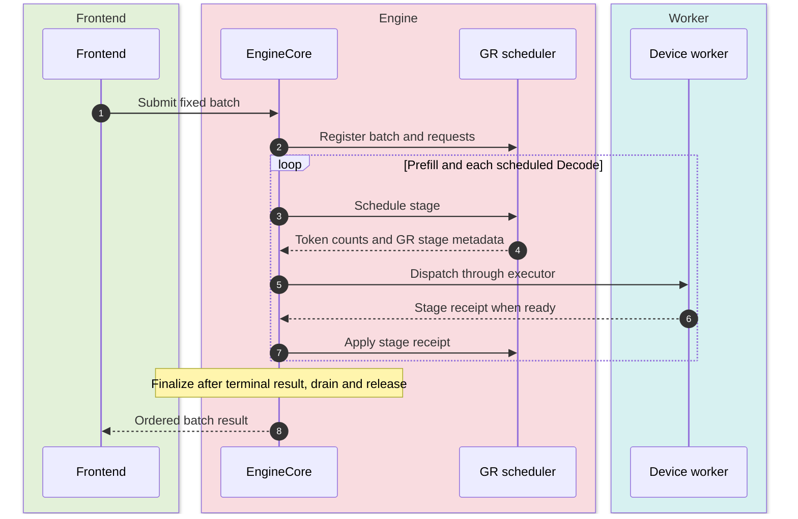

# Beam batch execution

A Beam batch request asks for ranked continuations of a fixed, ordered set of
prompts. The frontend submits all prompts together. Each prompt keeps its own
native request ID, scores and beam history, and the caller receives one
terminal result for the batch on either CUDA or Ascend.

## How a batch runs

The frontend prepares every prompt before submission. EngineCore preprocesses
the request and registers its members on the core thread, so the scheduler sees
the whole batch before running any member. The diagram follows an admitted
batch through one stage cycle and the terminal handoff. Solid arrows mark calls,
dashed arrows mark replies and shaded notes mark stage boundaries.

EngineCore reports an admission error to the caller if the batch fails
validation. After admission, a receipt can arrive while the next stage is
being issued; see the [dispatch timeline](async_scheduling.md#cuda-dispatch-timeline).

### Scheduling and resource ownership

Consider two prompts, three generated tokens and four retained beams per
prompt.

| Stage | Native scheduler | Device worker |
| --- | --- | --- |
| Prefill | Schedules the uncached prompt tokens. | Selects the first token for each retained beam, up to four per prompt. |
| First Decode | Advances one position per prompt. | Evaluates four input rows per prompt and selects the next beams within that prompt. |
| Final Decode | Advances one more position per prompt. | Selects the third token and builds ranked sequences for each prompt. |

The scheduler reserves paged KV for the prompt and every reserved Decode
position in the first allocation, and its limits apply to that whole extent.
The worker uses parent indices to carry each survivor's history into the next
step.

### Validation boundaries

| Boundary | Checks |
| --- | --- |
| Request identity and encoding | Item indices start at zero and are contiguous. Native IDs are unique within the batch. The first ID equals the batch ID. Each prompt is a nonempty, contiguous, one-dimensional CPU array of nonnegative `int64` token IDs. |
| Request form | Rejects `prompt_embeds`, `mm_features`, empty prompts and LoRA. Requires `ignore_eos=true`, `sampling_params.max_tokens` equal to `beam_params.max_tokens`, and `n=1`. EngineCore also clears native stop tokens. |
| Engine capacity | Dispatch accepts one to eight prompts within native request, Prefill token, context and KV limits. The request beam width must equal the engine's fixed startup beam width. |
| Dynamic widths | `dynamic_beam_widths` and `per_parent_beam_widths` must be tuples of length `max_tokens`; `max_tokens` must be 1 to 3 when either is set. Entries must be positive and at most the beam width, the first per-parent width must equal the first retained width, and each stage must satisfy `input_width * per_parent >= output_width`. |
| Device and catalog | Ascend budgets Decode rows at the largest input width across Decode stages. Table-constrained requests must match the table depth and fit its candidate capacity. |
| Output options | Candidate width counts expansions per parent. Retained width counts survivors per prompt. The final retained width bounds `num_return_sequences`. |

Requests and results use wire protocol version 2. Multiprocess clients send
`SUBMIT_GR_SESSION`; in-process clients invoke the core handler directly. Both
ends must use the same positional schema. A batch uses the `default` constraint
resource and can select a Trie per item. See
[catalog routing](../module/constraint_tables.md#request-routing).

### What the caller receives

EngineCore returns the terminal payload in
`EngineCoreOutput.kv_transfer_params["gr_batch_result"]`. The offline
`LLMEngine` and online `AsyncLLM` adapters share one result check: protocol
version, batch ID, exactly one of output or failure, failure code and message,
item-index range, item count, per-item `item_index` and `request_id`, sequence
count, token length, cumulative scores and parent indices. The check requires
finish reason `length` with no stop token; it does not validate
`include_stop_token`.

- **Success.** Each item has one to `num_return_sequences` ranked continuations
  of the requested length, with cumulative scores and parent indices when
  requested. Equal-length sequences can travel as
  [binary columns](../../serving/grpc.md#binary-beam-results).
- **Failure.** The caller receives one batch error with a code, a message and
  an optional item index. For example, `no_valid_beams` means final selection
  produced no valid candidates.
- **Cancellation.** Queued work can be cancelled immediately. Active work
  drains before release, and the engine suppresses any late success.

## Configuration

`gr.beam_batch_sizes` selects the prompt counts eligible for grouped HTTP
completions and the CUDA request counts used to capture FULL Prefill and Beam
Decode graphs. The packaged list is `[1, 2, 4]`. Add `8` to make eight-prompt
HTTP completions eligible for grouping. An explicit Beam batch outside the
list can still pass admission. On CUDA V2, that batch can replay a PIECEWISE
Prefill graph if its token bucket was captured. PIECEWISE uses the token
bucket alone and can serve different admitted request counts.

Size `max-num-seqs` for logical requests and `max-num-batched-tokens` for the
Prefill workload and, on Ascend, the peak Decode row count. See the
[batch and token budgets](../../configuration/README.md#batch-sizes-and-token-budgets)
and [OneRec walkthrough](../../user_guide/onerec_quickstart.md).

## Performance

The caller submits once for all generation steps. Decode work scales with the
number of live beams within each prompt. For example, two prompts at a fixed
width of four occupy two native request slots and eight Decode rows. Separate
HTTP calls keep their own batch membership.

## Validation

The [contract tests](../../../tests/contract/test_beam_batch_contracts.py)
cover request identity, widths, wire round trips and terminal results; the
[CPU reference](../../../tests/v1/beam/test_beam_cpu_reference.py) covers score
accumulation, tie-breaking and ordering. [Operator parity tests](../../../tests/v1/beam/test_beam_cpu_reference_parity.py)
compare the torch operators with the NumPy reference on CPU tensors, not device
selection.

## Source map

| File | Responsibility |
| --- | --- |
| [Batch schema](../../../vllm_gr/v1/beam/batch_contracts.py) | Request and result shapes, width rules and protocol version. |
| [Wire codec](../../../vllm_gr/v1/engine/codec.py) | Encodes what crosses the engine boundary. |
| [Dispatch validation](../../../vllm_gr/v1/beam/dispatch.py) | Rejects unsupported request forms and checks the fixed beam width. |
| [Runtime admission](../../../vllm_gr/v1/engine/beam_admission.py) | Checks a prepared batch against engine capacity. |
| [Session client](../../../vllm_gr/v1/engine/beam_session_client.py) | Submits the request and validates its terminal result. |
