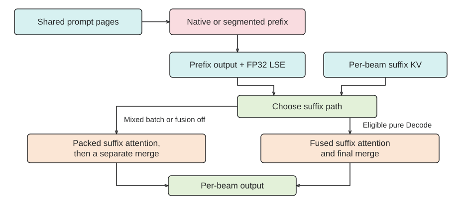

# CUDA Beam Decode attention

At Decode, each beam attends to two histories: the paged prompt KV shared by
all beams of that prompt, and the suffix KV for its own selected tokens. CUDA
can split a long prefix across GPU work or fuse a short suffix with the final
merge. The two decisions are independent: a step can use a segmented prefix
with either suffix path.

| Color or shape | Meaning |
| --- | --- |
| Green | Shared input: prompt pages or per-beam suffix KV. |
| Orange | Attention work. |
| Pink | Partial state carried between stages. |
| Cyan | Final per-beam output. |
| Yellow diamond | Independent suffix-path choice. |

## How it works

### Shared prompt prefix

Native FlashAttention reads the prompt pages. Prefix segmentation is opt-in:
it runs only with `prefix_policy: auto` (the default is `off`). For eligible
FA2 shapes, the prefix planner divides the pages into segments when device
calibration predicts a gain. A plan is accepted only when all of these hold:

- Calibration data is present, and the predicted plan needs at least two
  segments.
- The split saves at least 5% over the unsplit chain
  (`native / predicted >= 1.05`) and leaves at least 1.5x headroom.
- The unsplit chain takes at least `prefix_min_chain_us`.
- The page count divides evenly by the segment count.
- Attention metadata allows splitting (`max_num_splits == 0`) and the block
  table is wide enough for the segment layout.

The planner builds a virtual batch of page ranges for one FA call and merges
the partial results in FP32. Empty segments are masked and the final segment
can be shorter. Both prefix paths produce attention output in the activation
dtype and its natural-log normalizer (LSE) in FP32.

### Per-beam suffix and final merge

The fused path applies to pure incremental Decode with one query per beam and a
live, eligible pool. It reads the beam's suffix KV, computes attention and
combines it with the prefix state in one launch. Eligible shapes use a fused
Gluon kernel; other shapes use the generic Triton kernel. The packed path
copies suffix KV into a packed layout, runs suffix attention and merges the
partial outputs. Both paths handle an empty prefix.

A valid mixed standard/Beam batch uses the packed path. A missing session or
multiple queries per incremental beam is an input error, detected before
attention or cache writes.

Fusion can be enabled only when the attention backend and model support it:
a configured maximum width, a positive pool capacity, an integral
query-to-KV head ratio, at least one KV head, a head size in `(0, 256]` that is
a multiple of 8, an available FA2/FA3/FA4 backend, a CUDA device, and a model
dtype of FP16, BF16 or FP32. The attention must be unwindowed and without
ALiBi, softcap or sinks. Invalid static configurations fail at initialization.

### Decode graphs and fallback

For eligible segmented shapes, the async metadata builder derives a prefix
bucket from host metadata. The bucket is a value on the 1024-token ladder,
block-size aligned only for lengths up to 1024; the generic builder leaves the
bucket at zero. The graph key includes batch size, beam width and prefix
bucket.

Replay updates lengths, page IDs and active rows at stable addresses. The
startup graph is captured at model capacity with the bucket reset to zero, and
length-bucket graphs are captured lazily on first use; a new bucket can
therefore incur capture time and graph memory. Calibration stays fixed while
serving. The suffix kernel reads the current step and active mask from device
buffers during replay.

## Configuration

| GR setting | Effect |
| --- | --- |
| `prefix_policy` | `off` (default) keeps native prefix attention. `auto` allows calibrated segmentation of eligible paged FA2 shapes. |
| `prefix_calibration` | `false` disables segmentation outright, not only measurement. |
| `prefix_calibration_path`, `prefix_min_chain_us` | Select the calibration profile and the minimum predicted unsplit chain time for segmentation. |
| `enable_short_suffix_attention` | Defaults to `true` on eligible CUDA CUSTOM engines. Set to `false` under `gr` at startup to use the packed path. |

`attention_config.flash_attn_version` affects segmentation; the
`gr.prefill_flash_attn_version` option is resolved for Prefill only. An
explicit FA2 still allows segmentation, while FA3 and FA4 suppress it and keep
their native splitting heuristics. Batch-invariant mode disables splitting.
The calibrated path requires plain paged FP16 or BF16 attention without
windows, ALiBi, softcap or sinks. See the
[startup configuration](../../configuration/README.md).

## Performance

Measure with the [Beam performance workload](../../cli/bench/beam_performance.md).
Keep the model, prompt, batch size, beam width and Prefill mode fixed across
runs, and record the revision, device, model dtype, runner, decode length,
warmup count and measured runs with the results. An earlier revision of this
page quoted packed-versus-fused latency numbers, but they could not be tied to
a revision in this checkout and were removed. See the
[benchmark acceptance policy](../../contributing/ci/benchmark_acceptance.md)
before treating a comparison as evidence.

## Validation

The [prefix planner](../../../tests/v1/attention/test_beam_prefix_policy.py),
[segmented attention](../../../tests/kernels/attention/test_beam_prefix_segmented.py)
and [suffix](../../../tests/kernels/attention/test_beam_short_suffix.py) tests
cover calibration, ragged prefixes, empty segments, replay, and parity with
packed FA2 and an independent dense reference.

## Source map

| File | Responsibility |
| --- | --- |
| [CUDA attention backend](../../../vllm_gr/v1/attention/backends/beam_attn_gpu.py) | Dispatches prefix and suffix work and checks fusion eligibility. |
| [Prefix planner](../../../vllm_gr/v1/attention/backends/beam_prefix_policy.py) | Selects native or segmented prefix attention. |
| [Short-suffix kernels](../../../vllm_gr/v1/attention/backends/beam_short_suffix.py) | Dispatch to the fused Gluon kernel or the generic Triton merge. |
| [FA2-aligned suffix kernel](../../../vllm_gr/v1/attention/backends/beam_short_suffix_fa2.py) | Implements the Gluon path for eligible shapes. |
