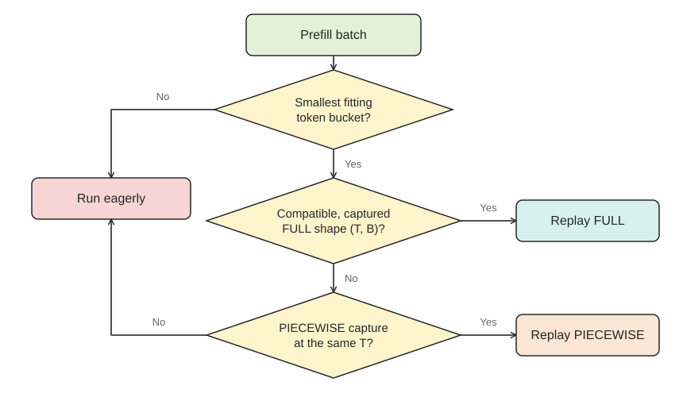

# CUDA Prefill graph capture

CUDA workers capture Prefill at selected request counts and token budgets.
A later batch can replay a captured graph even when its prompt lengths differ
from the capture inputs. Padding fixes the execution shape. Attention uses
the real lengths, and only real tokens write to the KV cache.

## Architecture

### Capture shape selection

A FULL shape is the pair of request count `B` and scheduled-token bucket
`T`. It must fit the token budget, request capacity and model context and
have at least one token per request. ModelRunner V2 distributes dummy tokens
as evenly as possible across the requests. For example, at `T = 8191` and
`B = 4`, the longest dummy request has 2,048 tokens.

### Replay with prompt history

V2 finds the smallest bucket that fits the scheduled tokens. FULL replay
also requires a successful capture at that request count and a compatible
Prefill batch. The diagram follows V2 dispatch when its GR Prefill plan is
installed.

A graph records its attention path at capture. With dense Prefill enabled,
FULL replay requires zero computed tokens for every request. With this setting, a batch with
history returns to native execution on V1. On V2 it can use PIECEWISE at the
selected bucket, then eager execution if that capture is unavailable. See
[ModelRunner V2](../module/model_runner_v2.md).

### Where attention reads the prompt

Paged attention reads KV from the cache. For a fresh, complete prompt, dense
attention can read contiguous K/V from the current layer's projection. Both
paths populate the real KV cache for Decode. Only the GR runners' fresh-Prefill
capture scope permits dense attention during graph capture.

Dense Prefill requires prefix caching, chunked Prefill and KV connectors
to be disabled. The worker checks live context and scheduled lengths.
Batch-invariant mode, sliding windows, ALiBi, softcap, sinks, quantized KV
and KV sharing retain paged attention.

## Configuration

| Startup setting | ModelRunner V1 | ModelRunner V2 |
| --- | --- | --- |
| `gr.prefill_token_buckets` is a list (packaged default) | Filters the list against feasible request counts before allocating buffers. | Filters the list against batch and model capacity. |
| `gr.prefill_token_buckets: null` | Uses the built-in grid bounded by token and context capacity. | Uses native `cudagraph_capture_sizes`. An absent list uses the fallback grid. An explicitly empty native list stays empty. |

`gr.prefill_graph_enabled` controls GR Prefill capture. The independent
`gr.dense_prefill` option selects attention on eligible fresh prompts.

| `gr.dense_prefill` | Attention path |
| --- | --- |
| `off` (default) | Paged attention. |
| `fa2` | Dense FlashAttention 2. |
| `cudnn` | cuDNN SDPA for supported single-request shapes of at least 64 tokens. Other eligible shapes use dense FA2. |

## Performance

A token bucket can serve several nearby prompt lengths with one capture.
Closer bucket spacing reduces padding and increases the number of graphs
the worker may need to capture and keep. Prefix-cache hits reduce the
scheduled token count, which can move a batch into a smaller bucket.

## Validation

The [V2 runner tests](../../../tests/v1/worker/test_gpu_prefill_graph_runner_v2.py)
cover bucket selection and replay fallback. The [dense Prefill tests](../../../tests/kernels/attention/test_beam_dense_prefill.py)
compare attention outputs on CUDA.

## Related files

- [V1 Prefill graph runner](../../../vllm_gr/v1/worker/cuda/v1/gpu_prefill_graph_runner.py) owns V1 capture buffers and replay.
- [V2 Prefill graph runner](../../../vllm_gr/v1/worker/cuda/v2/gpu_prefill_graph_runner_v2.py) builds the FULL and PIECEWISE plan and selects a descriptor at dispatch.
- [Dense Prefill attention](../../../vllm_gr/v1/attention/backends/beam_attn_gpu.py) checks whether attention can use projected KV. The next generation stage uses [CUDA Decode attention](cuda_decode_attention.md).
