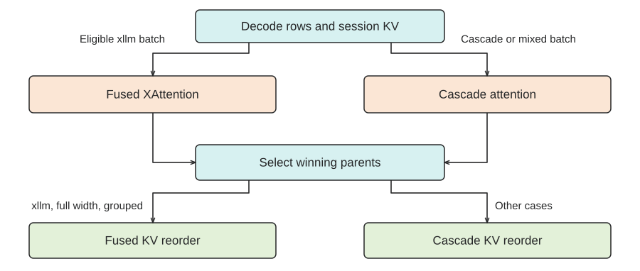

# Ascend Beam Decode execution

Each Ascend Decode step reads the shared prompt KV and each beam's own suffix
KV. The worker chooses one of two attention paths, then chooses how to reorder
the surviving suffix histories. Both choices are made per step and can differ
between steps of the same request.



| Color or shape | Meaning |
| --- | --- |
| Green | Decode rows and session KV. |
| Yellow diamond | Independent dispatch check. |
| Cyan | Fused xllm path. |
| Orange | Cascade path. |
| Pink | Candidate selection between the two decisions. |

## How it works

### Per-step dispatch

The [Ascend stage runner](async_scheduling.md#ascend-stage-execution) expands
each logical request into one row per input beam. The forward reads paged
prompt KV and session-owned suffix KV and writes the new KV. Once the worker
selects the winners, their parent indices identify the histories needed by the
next Decode.

### Attention backend selection

| Path | When it runs | What it does |
| --- | --- | --- |
| xllm XAttention | A homogeneous incremental Beam batch on a build with xllm-ops. | Computes prefix and suffix attention in one operator. |
| Cascade | Every other valid batch, including a mixed standard/Beam batch. | Runs separate prefix and suffix attention, then merges the results. |

The fused path additionally requires `softmax_scale` to equal
`1 / sqrt(head_dim)` and the batch's beam rows to be divisible by the request
Beam width; it raises on either mismatch. Missing sessions and invalid Decode
metadata raise before attention runs. Ascend CUSTOM attention rejects sliding
windows, ALiBi, nonzero logits softcap, attention sinks and FP8 KV caches.

### KV reorder

After selection, the worker reorders the surviving suffix histories from the
old beam order to the new one.

| Reorder path | Requirements |
| --- | --- |
| Fused `select_unshared_kv` | Decode mode is `xllm`; the pool's beam dimension is full width (`beam_max_width`); parent indices are grouped by ascending source beam index. |
| Cascade reorder | Any other case, including unsorted parents or a shrinking retained width. |

The two decisions are independent. A step can use XAttention, shrink the
retained width and then use cascade reorder. Two winners with the same parent
inherit the same suffix so far and can append distinct tokens at the next
step; both still read the request's paged prompt KV.

### Caller-owned XAttention output

A homogeneous incremental Beam batch can write directly to a caller-supplied
ND-format output buffer. The leading view `output[:num_prefix_indices]` must
match the gathered beam query's shape, dtype (BF16 or FP16) and device, the
buffer must be contiguous and have storage separate from every input, and the
view may start at a nonzero storage offset.

| Binding and destination | Action |
| --- | --- |
| Compatible | Invoke XAttention with the caller's buffer. |
| Binding absent or incompatible, or the output needs scatter | Use the allocating API and copy or scatter the result. |
| The native call fails after it starts | Propagate the error; the destination may already hold partial output. |

The loader verifies the build receipt, Python ABI, runtime versions and the
identities of the binding, operator library and ACLNN provider.

### Shared-prefix KV gather

Separate, compatible NHD K/V allocations continue to use the original paged
cache directly. When XAttention needs contiguous shared-prefix buffers, the
worker uses a fused bit-preserving gather by default on eligible NPU tensors.
The paged cache remains authoritative: every Decode invocation reads its
current block table and current KV values. There is no cross-session KV data
cache, and the parent-to-child suffix reorder is unchanged.

The fused copy requires unblocked NCHW (format 0) or ND (format 2) storage,
positive strides, internally contiguous KV blocks and an int32/int64 block
table on the same device. Interleaved K/V pools and nonzero storage offsets
are supported. Unsupported metadata uses the existing Torch gather, with a
warning and an observable fallback reason. Compilation or launch errors
propagate instead of being reported as successful optimized execution.
BF16 and FP16 are the model-attention validation scope. The copy helper also
supports FP32 bit patterns; this does not add FP32 support to XAttention.

During graph capture, K/V output capacity and the remapped table keep the full
fixed shape. The graph owns those allocations for its lifetime. The copy reads
the actual prefix length from the same fixed-address device tensor passed to
XAttention and rewrites every active whole block on each replay. Inactive tail
blocks are intentionally not written or cleared; XAttention must not read them.
If a later replay increases the prefix length, all newly active blocks are
rewritten from current cache contents before attention consumes them. Invalid
device length values conservatively copy full capacity; they do not make an
otherwise invalid attention request valid.

Two implementation debugging switches allow reproducing the original path.
Set them before engine startup; restart the engine to recapture graphs after
changing them. They do not change Beam selection or attention mathematics.

| Environment variable | Unset default | Behavior |
| --- | --- | --- |
| `VLLM_GR_NPU_FUSED_SHARED_KV_GATHER` | `1` | `1` tries the eligible fused copy; `0` uses the original Torch gather. |
| `VLLM_GR_NPU_SHARED_KV_LENGTH_MASK` | Inherits the resolved fused-copy switch | `1` skips unread tail copies; `0` copies full selected capacity. |

Only literal `0` and `1` are accepted. Explicitly setting the length mask to
`1` while disabling the fused copy raises a configuration error. Setting only
`VLLM_GR_NPU_FUSED_SHARED_KV_GATHER=0` disables both optimizations and restores
the original Torch path. Host diagnostic counters count Python launches and
fallbacks, not graph replays; use the worker graph counters for replay proof.

### Decode graph capture

FULL Beam Decode replay requires all of the following:

- An active Beam session whose pool slot is zero, so the graph's captured
  addresses match the session's buffers.
- Fused xllm Decode and a batch that contains only Beam Decode work.
- Each request mapped to exactly `width` identity rows with a complete prefix.
- Zero active LoRA adapters.
- Tensor parallelism of 1, no data-parallel ubatching, and
  `max_model_len > W`.

Startup captures use an exact logical request count; scheduler capacity is
configured separately. Dynamic Beam schedules can capture additional exact
Decode input widths. Replay checks the batch size, input width and physical
token bucket against the capture. When a condition is unmet, dispatch keeps
native PIECEWISE or eager execution as applicable. See the
[ModelRunner dispatch code](../../../vllm_gr/v1/worker/npu/npu_model_runner_patch.py)
for the exact checks.

## Configuration

| `gr.npu_decode_execution` | Backend selection at startup |
| --- | --- |
| `null` (default) | Use xllm if xllm-ops is available, otherwise cascade. |
| `xllm` | Require xllm-ops. Use XAttention for eligible incremental Beam batches. |
| `cascade` | Always use separate prefix and suffix attention with a merge. |

`gr.beam_graph_enabled` allows Beam Decode graph use. Device requirements and
serving settings are in [Beam search on NPU](../../user_guide/beam_search_npu.md).

## Performance

XAttention combines prefix and suffix attention in one operator. On compatible
batches, the optional output binding also removes a temporary allocation and a
copy. The [binding verification steps](../../user_guide/beam_search_npu.md#optional-xattention-output-binding)
show how to compare outputs on an Ascend device and check graph replay.

## Validation

The [Ascend attention parity tests](../../../tests/kernels/test_beam_attn_npu_xllm_parity.py)
compare xllm with cascade; the [binding tests](../../../tests/ops/npu/test_npu_xattention_out_binding.py)
cover discovery of the optional `vllm_gr_xattention_out_ext` extension.

The collected [shared-KV contracts](../../../tests/kernels/test_npu_shared_kv_contracts.py)
run representative BF16, width-32 interleaved-cache cases on one selected NPU.
They verify bitwise copy and native XAttention results, stable graph addresses,
fresh KV/block-table updates, and short-to-full-to-short prefix changes with
NaN-poisoned unused tails. Collection itself does not initialize a device.

```bash
python -m pytest --strict-test-levels tests/kernels/test_npu_shared_kv_contracts.py
```

For the broader BF16/FP16 matrix, run the standalone scripts with `--attention`.
FP32 is a copy-only contract and intentionally omits native attention:

```bash
python tests/kernels/check_npu_shared_kv_gather_contract.py \
  --quick --dtypes float32 --widths 32 --output /tmp/shared-kv-fp32-copy.json
```

Each output path must be new. These functional contracts are separate from
model accuracy comparisons and unprofiled end-to-end performance gates.

## Source map

| File | Responsibility |
| --- | --- |
| [xllm attention](../../../vllm_gr/v1/attention/backends/beam_attn_npu_xllm.py) | Implements fused Decode, its dispatch checks and the caller-owned output path. |
| [Shared-prefix copy](../../../vllm_gr/v1/attention/backends/npu_shared_kv_gather.py) | Validates copy eligibility, gathers active KV blocks and reports fallback reasons. |
| [Cascade attention](../../../vllm_gr/v1/attention/backends/beam_attn_npu.py) | Computes separate prefix and suffix contributions. |
| [Ascend stage runner](../../../vllm_gr/v1/worker/npu/npu_beam_stage_runner.py) | Expands requests into beam rows and selects candidates. |
| [KV reorder dispatcher](../../../vllm_gr/v1/beam/reorder.py) | Checks the decode mode and parent layout to choose fused or cascade reorder. |
