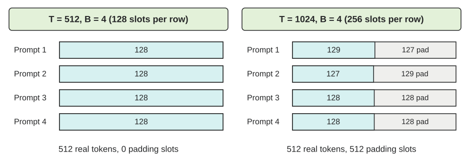

# Ascend BSND Prefill graphs

Ascend Prefill can use an optional graph for complete prompts in BSND
(batch, sequence, head, head dimension) layout. The runner pads each prompt
to a fixed number of sequence slots. On replay, it fills the input buffers
and reuses the fused attention parameters captured for each layer.



## Capture selection

A capture shape `(T, B)` divides `T` token slots evenly among exactly `B`
requests. The runner chooses the smallest ready capture whose request count
and per-request capacity fit the batch.

- `B` must equal the number of requests. A `(512, 4)` capture serves a batch
  of exactly four requests.
- `T / B` must fit the longest prompt (`num_prompt_tokens`) in the batch.

Allowed request counts for `B` are 1, 2, and 4. `T` must be a positive
multiple of `B` and match one of the runner's Prefill buckets.

## Replay and fallback

1. **Place prompts.** The runner copies complete prompts in native
   input-batch order and pads each request's slots on the right. Padding has
   slot mapping `-1`, which skips the paged KV write.
2. **Replay.** Fused attention reads the layer's Q/K/V, making the tensors
   contiguous when needed. The causal mask keeps prompt tokens from attending
   to the right padding. The model writes real-token K/V to the paged cache
   for Decode.
3. **Compact.** The runner gathers the real-token hidden states in the order
   expected by the logits indices.

The runner copies each call's token IDs, positions, and slot mapping into
the buffers bound at capture. If a captured buffer changes identity or its
tensor descriptor changes, replay raises a `RuntimeError` with
`recapture is required`.

A TND graph packs the batch onto one token axis and updates the per-layer
attention parameters on each replay.

| Dispatch condition | Action |
| --- | --- |
| All prompts are fully scheduled with zero computed tokens, and the batch fits a ready BSND capture | Replay BSND and compact the real-token outputs. |
| A prompt has cached history, only part of a prompt is scheduled, or no BSND capture fits | Try a TND graph. Use native Prefill if TND cannot replay. |
| The batch carries `intermediate_tensors`, `inputs_embeds`, or extra model kwargs | Use native Prefill. |
| A required per-call tensor is missing, its dimensions are incompatible, or the token counts exceed the capture's limits | Decline BSND and try TND. |
| The captured-buffer identity check fails, or the capture itself fails on an eligible backend | Propagate the error. |

Beam Prefill capture requires the Beam/CUSTOM metadata builder in every
attention group. Models with native or mixed attention backends skip these
captures. BSND rejects KV sharing, sliding windows, softcap, sinks, ALiBi, and
FP8 KV. The runner keeps the FIA workspace and log-sum-exp buffers for each
BSND shape in the capture metadata (`bsnd_resources`). Replays reuse the
captured buffer addresses.

!!! note "Enabling BSND raises the bar for TND"

    The runner captures BSND graphs before TND graphs. When a BSND spec is
    active, the runner propagates a TND capture failure and aborts startup.

## Configuration

```yaml
gr:
  prefill_graph_enabled: true
  npu_bsnd_capture_specs: "512,4;1024,4"
```

Enter capture shapes in `gr.npu_bsnd_capture_specs` as a semicolon-separated
string. An empty string or an omitted key disables BSND. The configuration
rejects YAML `null`. The Prefill graph runner validates shapes at
initialization, so invalid shapes surface when `gr.prefill_graph_enabled`
is true.

## Performance

BSND saves per-layer attention parameter updates at the cost of padding. In
the figure, four 128-token prompts fill the 512-slot capture. Moving one
token from the second prompt to the first keeps the total at 512. The
129-token prompt exceeds the 128 slots available per request, so the runner
uses the 1024-slot capture shown in the figure.

## Validation

The [BSND tests](../../../tests/v1/worker/test_npu_prefill_bsnd.py) cover shape
selection, row order, output compaction, buffer identity, and when dispatch
uses a fallback. They check padding indirectly through the compaction
destination and the slot buffer. To type-check the host regression file, run
`python tools/pre_commit/mypy.py 3.12 tests/v1/worker/test_npu_prefill_bsnd.py`.

## Source map

| File | Responsibility |
| --- | --- |
| [Ascend Prefill graph runner](../../../vllm_gr/v1/worker/npu/npu_prefill_graph_runner.py) | Parses shapes, captures buffers and compacts replay output. |
| [NPU ModelRunner patch](../../../vllm_gr/v1/worker/npu/npu_model_runner_patch.py) | Selects BSND at dispatch and falls back to TND or native Prefill. |
| [Packaged configuration](../../../vllm_gr/config/default_config.yaml) | Defines Prefill buckets and BSND settings. |
| [Ascend Decode execution](npu_decode_execution.md) | Describes how beams consume the prompt pages after Prefill. |
