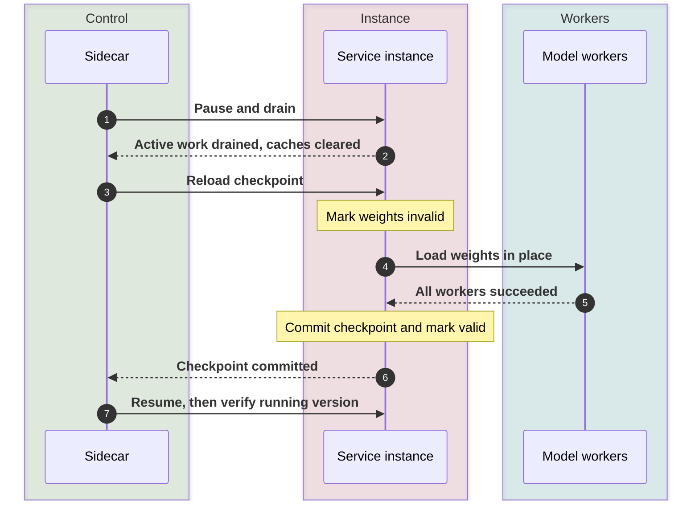
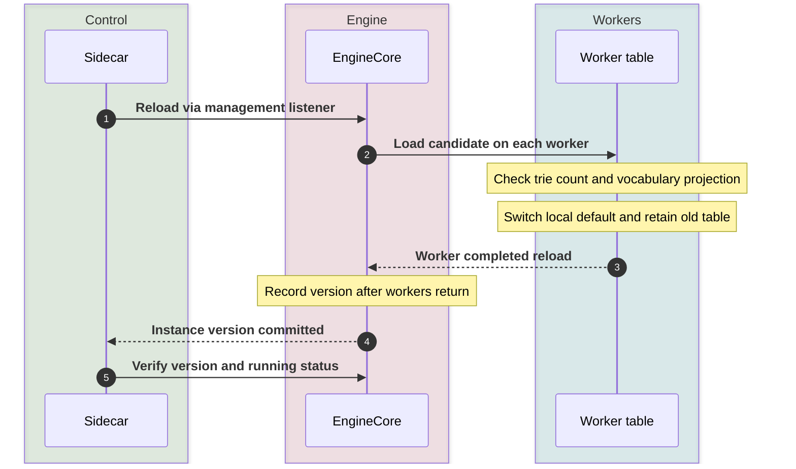

# Model and catalog updates

A running GR service can reload model weights or replace the constraint
catalog used by Beam search. The update sidecar stages each published version,
checks it against the current resource, and coordinates the rollout. For a
checkpoint reload, the sidecar pauses and drains each instance before its
workers write weights in place. A catalog update switches each worker's
default constraint table while the scheduler remains unpaused.

## Update lifecycle

1. **Select.** The sidecar uses `update_mode` to group the target instances
   before querying the publisher. It rejects empty groups, duplicate or
   missing targets, and instances outside the target set.
2. **Fetch.** The sidecar queries the publisher and reuses a cached copy of
   the published version when available. Otherwise, it downloads the version
   to a staging directory and renames it into the shared cache when complete.
3. **Check.** Under the instance lock, the sidecar checks the staged candidate
   against the current resource at the path reported by the instance. The
   default checkers compare relative file names and sizes for checkpoints or
   tensor names and counts for Tries.
4. **Apply.** The configured update process runs the checkpoint or catalog
   reload on each target instance.
5. **Commit and verify.** The instance records the new version. The sidecar
   checks the instance's status to verify that version is running.

Each sidecar process has an `asyncio.Lock` per instance. The sidecar holds it
throughout `update_process.run`, including the status check and rollout, and
looks up and downloads published versions outside the instance lock.

| Resource | Compatibility check | Rollout |
| --- | --- | --- |
| Checkpoint | Relative file names and sizes. | Rolling groups of one instance by default. The rollout stops if a group fails. |
| Catalog (Trie) | Tensor names and counts. Each worker also checks Trie count and model vocabulary projection. | Target instances update concurrently. Each worker publishes its own default table. |

## Checkpoint reload

Use `RollingUpdate` with `PausedUpdateProcess` to replace weights on an
already constructed model. Before publishing, verify that the checkpoint
matches the running model's architecture, tokenizer, and configuration. The
native loader reports the tensor mismatches it detects during loading, so the
publisher is responsible for checking compatibility.

1. **Pause and drain.** The scheduler leaves new requests queued while active
   requests finish. The instance then clears its inference caches.
2. **Invalidate.** The instance marks its weights invalid before any worker
   writes to them.
3. **Load.** Each worker loads the new tensors in place.
4. **Commit.** Once all workers succeed, the instance records the new version
   and marks the weights valid.
5. **Resume.** The sidecar resumes the instance and verifies that it is
   running the committed version.

### Failure and recovery

If loading fails or is cancelled, the instance stays paused and may hold a
mix of old and new weights. Its status reports the last committed version
and `checkpoint_valid=false`. Both `PausedUpdateProcess` and
`OnlineUpdateProcess` stop with an
`invalid checkpoint weights; manual recovery is required` error. The
management listener returns HTTP 409 for checkpoint reload and resume
requests. Restart the instance from a known-good checkpoint to recover from
the failed load.

If the sidecar misses the reply after the instance commits the target
version, a later poll can find the instance paused with valid weights. The
sidecar then resumes it. A poll during the load sees `checkpoint_valid=false`
and reports the same error as a failed load.

## Online catalog replacement

Use `SyncUpdate` with `OnlineUpdateProcess` to replace a catalog. The service
must use the CUDA asynchronous Beam path and have an enabled constraint table.

1. **Load and validate.** Each worker loads the candidate table and checks its
   Trie count and vocabulary projection.
2. **Publish locally.** Each worker switches its default table as soon as its
   validation passes. If validation fails, that worker keeps its previous
   default. Each switch takes effect independently.
3. **Record.** EngineCore records the instance version once all workers
   complete the reload successfully.
4. **Reclaim.** Table operations release retired versions once
   `gr.trie_retention_seconds` has elapsed since replacement.

New requests can queue during a catalog update. The reload runs synchronously
on the EngineCore event loop, so requests advance again once every worker
returns. A request keeps its Trie selector across lookups. Each lookup uses
the current table, so one request can use two table versions across an update.

Publishers must keep each version's contents immutable and reserve
`__initial__` for the initial table. An update request for the version already
committed returns success without reloading it. A worker rejects a candidate
whose artifact digest differs from that of a retained version with the same
name. Digest comparison is limited to versions the worker still retains.
Old and new tables can coexist in worker memory during a reload.

## Configuration

| Setting | Effect |
| --- | --- |
| `update_mode` | Groups the target instances. The sidecar validates the groups before any download or update. |
| `update_process` | Runs the per-instance rollout. Use `PausedUpdateProcess` for checkpoints and `OnlineUpdateProcess` for catalogs. |
| `checker` | Overrides the task's default compatibility check for staged files. |
| `max_local_checkpoints` | Number of cached checkpoint versions to keep (default 2). See [cache retention](#cache-retention). |
| `gr.admin_port` | Enables the instance's HTTP management listener, which tracks checkpoint validity and reports the committed version. |
| `gr.trie_retention_seconds` | Minimum time a worker retains a replaced Trie version (default 60 seconds). |

The sidecar accepts other mode and process pairings in its configuration.
The sidecar and target services must access staged files at the same
absolute path.
For startup and publication steps, see the
[deployment guide](../../user_guide/weight_update.md).

### Cache retention

On each poll, even when the publisher has no new version, the sidecar checks
the checkpoint cache against `max_local_checkpoints`. It prunes the oldest
unused version directories first, using modification time and then directory
name to order them. It protects the published version for the poll and every
version and path reported by an instance. Cleanup requires valid checkpoint
status and a known checkpoint path from every instance. Cleanup skips
dot-prefixed directories and symbolic links.

## Operational limits

- Separate sidecar processes can attempt to update the same instance
  concurrently.
- `OnlineUpdateProcess` rejects updates on a paused instance, including during
  a checkpoint reload.
- `checkpoint_valid=false` blocks both checkpoint and catalog updates.
- Rolling groups limit how many instances pause and queue new requests at once.

## Validation

[Sidecar runtime](../../../tests/sidecar/test_runtime.py), [management](../../../tests/sidecar/test_management.py),
[retention](../../../tests/sidecar/test_retention.py) and [worker update](../../../tests/sidecar/test_worker_update.py)
tests cover rollout order, HTTP 409 responses, checkpoint validity transitions,
cache pruning, and Trie switching. The [HDFS system entry point](../../../tests/e2e/run_sidecar_hdfs.py)
exercises rollout and failure recovery end to end.

## Source map

| File | Responsibility |
| --- | --- |
| [Sidecar controller](../../../vllm_gr/sidecar/controller.py) | Polls, stages files, serializes updates per instance and prunes the cache. |
| [Update processes](../../../vllm_gr/sidecar/processes.py) | Applies and verifies each instance update, or reports that recovery is required. |
| [Management listener](../../../vllm_gr/entrypoints/serve/management.py) | Tracks checkpoint validity and exposes the reload and resume routes. |
| [EngineCore update handlers](../../../vllm_gr/v1/engine/hot_update.py) | Coordinate catalog reload and record the instance version. |
| [Versioned table](../../../vllm_gr/constraints/versioned_table.py) | Holds the worker's default and retired Trie versions and checks digests for retained versions. |
