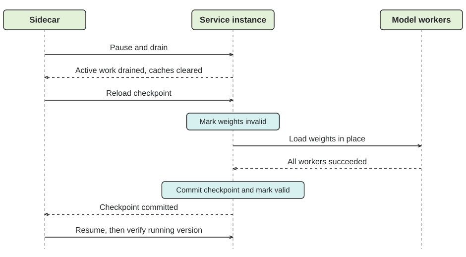
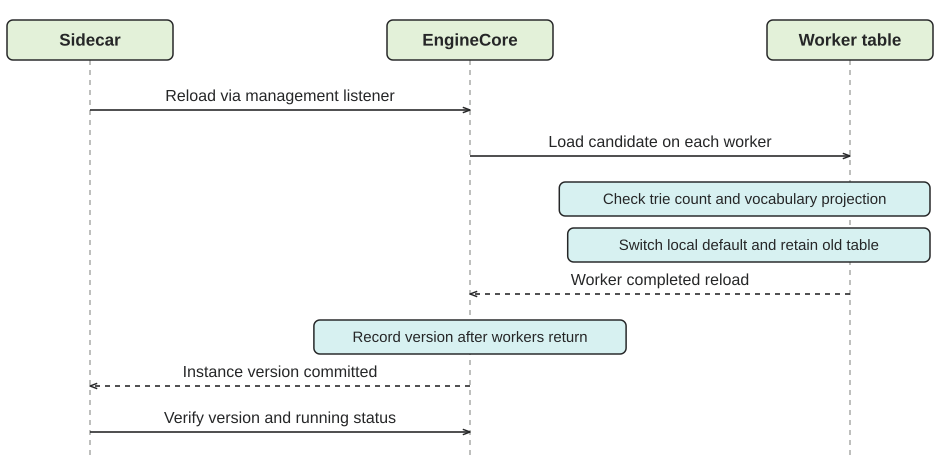

# Model and catalog updates

A running GR service can load a compatible checkpoint or replace the catalog
that constrains beam search. Checkpoint reload writes into the live model
and requires a drained instance. Online catalog reload prepares a second
constraint table and switches the default used by subsequent lookups.

## Architecture

### Shared update lifecycle

The sidecar watches a published version, downloads it to a staging directory
and renames the completed download into a shared local cache. Checkpoint and
catalog tasks share a per-instance lock. Inside that lock the sidecar reads
the live version before deciding whether the instance needs an update.

| Resource | Compatibility checks | Rollout |
| --- | --- | --- |
| Checkpoint | Architecture and tokenizer must stay compatible. The default file checker compares relative names and sizes. | Rolling groups, one instance by default. A failed group stops subsequent groups. |
| Catalog (Trie) | The default checker compares tensor names and counts. Each worker checks trie count and model vocabulary projection. | Target instances can update concurrently. Each worker switches its own default table. |

### Checkpoint reload

The sidecar checks the staged files before pausing the target. Active requests
finish, new work stays queued and inference caches are cleared. The service
marks its weights invalid before the first in-place write. The diagram follows
one instance through a successful group update.

If loading fails or is cancelled, the service can hold mixed weights. It
keeps the last committed version, stays paused and rejects further reload or
resume attempts with HTTP 409. Restart that instance from a known-good
checkpoint. If only the reply was lost, the next poll can instead find the
target version committed, valid and paused. The sidecar resumes the instance
and verifies that it is serving that version.

### Online catalog replacement

Online Trie replacement requires the CUDA asynchronous Beam path and an
enabled constraint table. A worker loads and validates its candidate before
switching its local default. EngineCore records the instance version after
the worker calls return successfully.

A request keeps its trie selector. Its next lookup can therefore see the new
default even if an earlier lookup used the old table. A worker that rejects
a candidate keeps its previous default. Workers publish independently, so a
failure on one worker cannot undo a switch on another. The next sidecar poll
checks the committed instance state.

## Configuration

The sidecar task's `update_mode` controls grouping and its `update_process`
controls what happens on each instance. Checkpoint tasks use
`RollingUpdate` with `PausedUpdateProcess`. Catalog replacement uses
`SyncUpdate` with `OnlineUpdateProcess`. Sidecar and target services must
see staged files at the same absolute path.

For gRPC serving, `gr.admin_port` enables the instance's HTTP management
listener. `gr.trie_retention_seconds` defaults to 60 seconds. A later table
access or reload collects expired versions. See the
[deployment guide](../../user_guide/weight_update.md) for startup and publication.

## Performance

During a checkpoint reload, new requests queue on the paused instance.
Rolling groups bound the number of instances paused at once. During a catalog
reload, serving continues and old and new tables can coexist in worker
memory. After the retention interval expires, the next table operation can reclaim
the old version.

## Validation

The [sidecar tests](../../../tests/sidecar/test_runtime.py) cover rollout
order, shared locks and lost replies. The [HDFS system entry point](../../../tests/st/run_sidecar_hdfs.py)
exercises rollout.

## Related files

- [Sidecar controller](../../../vllm_gr/sidecar/controller.py) stages files and serializes updates per instance. The [update processes](../../../vllm_gr/sidecar/processes.py) drive each instance through its rollout.
- [Management listener](../../../vllm_gr/entrypoints/serve/management.py) owns checkpoint validity and the committed checkpoint version.
- [EngineCore update handlers](../../../vllm_gr/v1/engine/hot_update.py) coordinate catalog reload. The [versioned table](../../../vllm_gr/constraints/versioned_table.py) owns the worker's default and retained versions.
