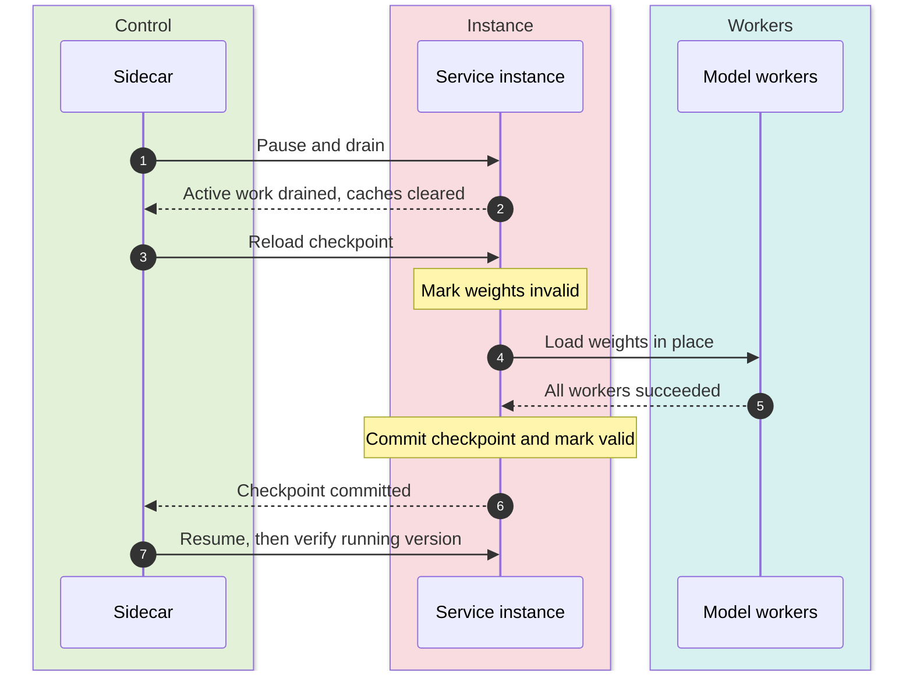
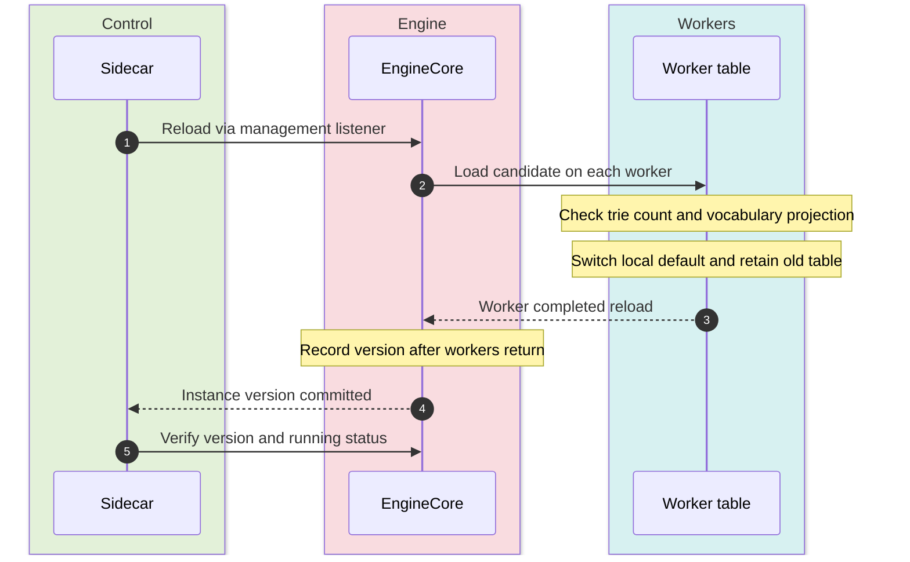

# Model and catalog updates

A running GR service can load new model weights or replace the constraint
catalog used by Beam search. Both updates go through the update sidecar,
which stages a published version, checks it, then drives each target
instance. A checkpoint reload writes weights in place, so the instance is
paused and drained first. A catalog replacement swaps the worker's default
Trie while the scheduler keeps serving.

## Update lifecycle

Checkpoint and catalog tasks share one pipeline:

1. **Select.** `update_mode` groups the target instances. The sidecar validates
   that every target appears exactly once before querying the publisher.
   Empty groups, duplicates, non-targets and missing targets abort the poll.
2. **Fetch.** The sidecar reads the published version. It reuses a version in
   the local cache or downloads it to a staging directory and renames the
   completed download into the shared cache.
3. **Check.** Under the per-instance lock, the sidecar compares the staged
   candidate with the path the instance reports as its current resource. The
   default checkers compare relative file names and sizes for checkpoints and
   tensor names and counts for Tries.
4. **Apply.** The update process performs the resource-specific rollout
   described below.
5. **Commit and verify.** The instance records the new version, and a later
   status poll confirms it.

The per-instance lock is an `asyncio.Lock` inside one sidecar process. It
serializes `update_process.run` only; the download and version lookup happen
outside it, and two sidecar processes are not coordinated.

| Resource | Compatibility check | Rollout |
| --- | --- | --- |
| Checkpoint | Relative file names and sizes. | Rolling groups, one instance by default. A failed group stops later groups. |
| Catalog (Trie) | Tensor names and counts; each worker also checks Trie count and model vocabulary projection. | Target instances update concurrently. Each worker publishes its own default table. |

## Checkpoint reload

Reload replaces the weights of an already-constructed model. The publisher
must ensure that the checkpoint is compatible with the running architecture,
tokenizer and model configuration before publishing. The native loader
reports mismatches it detects while loading tensors. A successful load alone
does not establish compatibility. Use the `RollingUpdate` mode with
`PausedUpdateProcess`.

1. **Pause and drain.** The instance stops accepting new work and waits for
   active requests to finish. New requests stay queued.
2. **Invalidate.** The service marks its weights invalid before the first
   in-place write and clears inference caches.
3. **Load.** Every worker loads the new tensors in place.
4. **Commit.** After all workers return, the instance records the committed
   version.
5. **Resume.** The sidecar resumes the instance and verifies that it serves
   the committed version.

### Failure and recovery

If the load fails or is cancelled, the instance can hold mixed weights. It
stays paused and reports the previous committed version, but that report no
longer describes the in-memory weights. Both `PausedUpdateProcess` and
`OnlineUpdateProcess` then refuse further work with an
`invalid checkpoint weights; manual recovery is required` error, and the
management listener rejects reload and resume attempts with HTTP 409.

Recovery is a restart of that instance from a known-good checkpoint. If only
the reply was lost, a later poll can instead find the target version
committed, valid and paused; the sidecar then resumes the instance. A poll
that lands while the load is still in flight sees `checkpoint_valid=false`
and reports the failure path above.

## Online catalog replacement

Catalog replacement needs the CUDA asynchronous Beam path and an enabled
constraint table. Use the `SyncUpdate` mode with `OnlineUpdateProcess`.

1. **Load and validate.** Each worker loads the candidate table and checks its
   Trie count and vocabulary projection.
2. **Publish locally.** A worker that passes validation switches its own
   default table. A worker that fails keeps its previous default; workers
   publish independently, so one failure cannot undo another worker's switch.
3. **Record.** EngineCore records the instance version after the worker calls
   return.
4. **Reclaim.** Old versions remain until `gr.trie_retention_seconds` expires;
   a later table operation collects them.

The scheduler is not paused and no request is rejected, but the reload is a
synchronous utility call on the EngineCore event loop: the engine does not
advance requests until every worker returns. Because each lookup resolves the
table's current version, a later lookup by the same request can observe the
new table even if an earlier one used the old table. The request keeps its
Trie selector; it does not pin a table version.

Publishers must keep the contents of each version immutable and reserve
`__initial__` for the initial table. A request for the already committed
version succeeds without reloading it. When a worker loads a candidate under
a version name it still retains, it rejects a different artifact digest.
Once a version expires, the worker has no earlier digest to compare. Old and
new tables can coexist in worker memory during a catalog reload.

## Configuration

The [deployment guide](../../user_guide/weight_update.md#configuration) owns
sidecar settings and the runnable configuration link. The mode and process
pairings above are conventions; the sidecar does not enforce them.

### Cache retention

`max_local_checkpoints` bounds the checkpoint cache. On every poll, including
polls that find no new publication, the sidecar deletes the oldest unused
version directories by modification time and name. It protects every version
and path reported by any instance, skips cleanup entirely while an instance
reports `checkpoint_valid=false` or is unreachable, and never touches
dot-directories or symbolic links.

## Operational limits

- The per-instance lock lives in one sidecar process; a second sidecar
  targeting the same instance is not serialized.
- A paused instance blocks catalog updates. `OnlineUpdateProcess` refuses to
  run until the checkpoint task resumes the instance.
- `checkpoint_valid=false` blocks both checkpoint and catalog updates, not
  only reload and resume calls.
- During a checkpoint reload, new requests queue on the paused instance.
  Rolling groups bound how many instances are paused at once.
- Loading or committing the catalog blocks EngineCore for the duration of the
  worker reload.

## Validation

[Sidecar runtime](../../../tests/sidecar/test_runtime.py), [management](../../../tests/sidecar/test_management.py),
[retention](../../../tests/sidecar/test_retention.py) and [worker update](../../../tests/sidecar/test_worker_update.py)
tests cover rollout order, 409 handling and validity transitions, cache
pruning and Trie switching. The [HDFS system entry point](../../../tests/e2e/run_sidecar_hdfs.py)
exercises the end-to-end rollout and failure recovery.

## Source map

| File | Responsibility |
| --- | --- |
| [Sidecar controller](../../../vllm_gr/sidecar/controller.py) | Polls, stages files, serializes updates per instance and prunes the cache. |
| [Update processes](../../../vllm_gr/sidecar/processes.py) | Drives each instance through its rollout and decides when recovery is required. |
| [Management listener](../../../vllm_gr/entrypoints/serve/management.py) | Owns checkpoint validity and exposes the reload and resume routes. |
| [EngineCore update handlers](../../../vllm_gr/v1/engine/hot_update.py) | Coordinate catalog reload and record the instance version. |
| [Versioned table](../../../vllm_gr/constraints/versioned_table.py) | Holds the worker's default and retained Trie versions, and enforces version immutability. |
