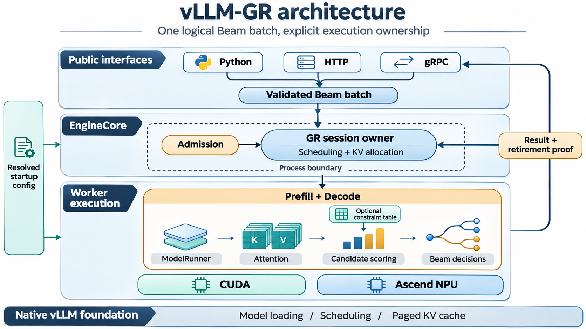

# vLLM-GR main architecture

vLLM-GR adds generative-recommendation inference to an installed vLLM runtime.
Native vLLM owns model execution infrastructure, prompt scheduling and paged
KV allocation. GR adds the Beam batch protocol, device Beam state, constraints,
specialized Attention and resource-update control.

Use this page for the overall architecture and cross-module responsibilities.
The [feature guides](../features/README.md) own detailed configuration, behavior
and validation. Installation starts with [CUDA](../getting_started/installation/cuda.md) or
[Ascend](../getting_started/installation/ascend.md); a runnable Beam flow is in the
[OneRec quickstart](../getting_started/quickstart.md).

## Design goals

The architecture keeps three responsibilities distinct: frontends translate
public requests, EngineCore owns admitted batches, and Workers own the device
resources that execute them. GR reuses native vLLM scheduling and KV allocation
while adding recommendation-specific candidate selection and Beam state.

| Requirement | Architectural response |
| --- | --- |
| Share one execution contract across Python, HTTP and gRPC | Validate a complete atomic batch before native scheduling |
| Reuse prompt context across Beam expansion | Keep persistent Worker state and backend-specific Attention |
| Return catalog-valid candidates | Bind canonical artifacts and tokenizer identity at startup |
| Cancel safely and reuse memory | Drain dispatches and require matching retirement proof |
| Support CUDA and Ascend | Keep provider activation separate from runner and device implementations |

## Request flow

[](../assets/architecture.png)

The frontend submits a complete logical batch through `beam_search()` or
the corresponding serving path. EngineCore admits it atomically and owns its
progress. Native scheduling carries GR metadata to the Worker, which maintains
device state and executes Prefill and Decode. A terminal result is returned
after the required work and resource retirement complete.

Ordinary non-GR requests retain their native execution paths. Public Beam
protocol names do not choose the native ModelRunner implementation.

## Module responsibilities

| Layer | Responsibility | Main code |
| --- | --- | --- |
| Configuration | Canonical fields, validation and serialization | `vllm_gr/config/` |
| Frontends | Offline calls, HTTP/gRPC conversion and result consumption | `vllm_gr/entrypoints/` |
| Engine arguments and startup | Apply native options and GR settings, then admit the backend plan | `vllm_gr/engine/arg_utils.py`, `vllm_gr/engine/startup.py` |
| V1 session transport and EngineCore | Register frontend sessions, submit batches in-process or through the Core socket, and admit them on the Core thread | `vllm_gr/v1/engine/` |
| Scheduling and dispatch | Track session progress, cancellation and retirement; exchange stage records with workers | `vllm_gr/v1/core/sched/`, `vllm_gr/v1/beam/dispatch.py` |
| Worker | Device Beam state, stage execution and storage lifetime | `vllm_gr/v1/worker/`, `vllm_gr/v1/beam/` |
| Constraints | Artifact identity, root routing and candidate scoring | `vllm_gr/constraints/` |
| Attention and operators | Backend-specific computation and KV operations | `vllm_gr/v1/attention/backends/`, `vllm_gr/ops/` |
| Platform integration | Provider activation, environment checks and compatibility hooks | `vllm_gr/platforms/`, `vllm_gr/plugin.py`, `vllm_gr/patch.py` |

Within `vllm_gr/v1/engine/`, `beam_session_client.py` owns the frontend session lifecycle.
`core_client.py` submits batches, `core_socket.py` receives them across the process
boundary, and `core.py` handles admission. `engine_core_patch.py` installs the
Core hooks and the spawned process entry point. Prefix hashing lives in
`vllm_gr/v1/core/kv_cache_utils.py`.

## State and lifecycle boundaries

- Frontends own request conversion and result consumption; they do not drive
  a per-token Beam scheduling loop.
- EngineCore owns session identity and admission. Native scheduling owns prompt
  accounting and KV blocks; physical row or slot indices are not session IDs.
- Workers own persistent device state and scratch buffers. Graph replay requires
  valid storage bindings through the final consumer; cancellation still drains
  already issued work before reuse or release.
- Constraint artifacts must match the configured tokenizer and format. Candidate
  validity, score normalization and final result ranking have explicit contracts.
- Sidecar updates coordinate service control with Worker-owned resources.
  Checkpoint and Trie updates have different pause, publication and recovery rules.

Detailed request and failure semantics are in [Beam Search](../features/beam-search.md).
Resource update behavior is in [hot updates](../features/hot-update.md).

## Configuration and backend selection

Public configuration flows through `GRConfig` and
`VllmConfig.additional_config`, including parser-cache invalidation on writes.
`import vllm_gr` stays lightweight; resolving `GRLLM` loads the offline entry point.
Runtime initialization occurs in every relevant
frontend, EngineCore and Worker process. Registration is process-local and
hardware-import-free; activation selects the canonical device provider.

`gr.beam_width` enables the GR Beam protocol at engine startup. CUDA ModelRunner V1,
CUDA ModelRunner V2 and NPU have distinct graph policies, capacity limits and
storage lifecycles. Use the relevant feature's supported configuration; do not
infer backend support from a shared interface or CPU-based test fixture.

The [runtime patch inventory](runtime_patch_inventory.md) explains active hooks
and upstream dependencies. Its [YAML inventory](patch_inventory.yaml) remains
the ownership source of truth. The platform contract below defines registration,
activation and extension boundaries.

## Feature map

| Feature | Details |
| --- | --- |
| Beam batch execution and asynchronous progress | [Beam Search](../features/beam-search.md) |
| Catalog constraints and multiple roots | [Constraint tables](../features/constraint-tables.md) |
| CUDA capture and ModelRunner V2 | [CUDA graphs](../features/cuda-graphs.md) |
| Prefix, suffix and NPU Attention optimizations | [Attention](../features/attention.md) |
| Catalog-free Beam generation | [Unconstrained Beam Search](../features/unconstrained-beam-search.md) |
| Checkpoint and Trie replacement | [Hot updates](../features/hot-update.md) |
| Binary transport, replicas and observability | [Serving](../serving/README.md) |

For code changes, use [development navigation](../contributing/development.md). Verify graph
replay, business accuracy and performance separately using the
[validation guide](../contributing/tools/README.md) and [benchmark guides](../usage/benchmarks/README.md).

## Platform backend contract

### Scope

The platform backend boundary separates hardware-neutral vLLM-GR runtime
orchestration from CUDA- and NPU-specific implementations. A backend provider
binds declared provider metadata and an identity match against the native
platform vLLM already selected to ModelRunner patch hooks, Beam Attention
execution primitives, environment validation, and any platform-specific
compatibility patches.

Production startup already uses provider activation, environment validation,
runtime compatibility patches, and the constrained TopK execution factory.
GR EngineArgs also publishes an immutable backend plan. Model load binds its
services to the native runner, and EngineCore checks every worker's readiness
before its constructor returns. See [Engine plans](#engine-plans-and-service-binding).
The active provider supplies the process hooks for the native ModelRunner.
Planned runners dispatch through their own adapter. Beam Attention continues
to select its execution module in the attention backend.

### Lifecycle and process model

Backend registration and activation are process-local. Each vLLM main,
EngineCore, or Worker process owns an independent registry.

The general-plugin startup sequence is:

1. Configure the ModelRunner default before platform-dependent configuration.
2. `check_environment()` registers built-ins, loads external providers, selects
   the provider matching the current native platform identity, and invokes its
   environment check.
3. `re_apply_patches()` reuses that provider (or activates it in a fresh process).
4. Install the shared Pangu and CUSTOM attention selector compatibility hooks.
5. Invoke `provider.apply_runtime_patches(force=True)`. The NPU provider installs
   spawn protection, then the native worker hook and its early config filter.
6. Install the common frontend Beam plan and sliced-logits hooks.

The provider's environment method must call leaf validation functions, not the
shared `check_environment()` dispatcher, to avoid recursive activation.
Repeated initialization probes live targets and does not stack wrappers.
Provider patch failures retain their original exception, identify the backend,
and stop initialization with a partial-installation/restart diagnostic. This
stage does not implement rollback; a failed process must not continue serving.

EngineArgs still reasserts the Ascend EngineCore config sanitizer on every
`create_engine_config()` call. The sanitized child entry still initializes the
common EngineCore plan before native construction. The NPU worker hook still
retries runtime installation, installs KV/warmup/utility hooks, and delegates to
native `init_device()` before loading constraint tables. These earlier and
later boundaries are not moved into general-plugin initialization.
Every worker patch attempt revalidates the early config filter and its native
caller bindings before checking the device-wrapper marker. This repairs a
restored native config alias without wrapping `init_device()` again.

| Initialization boundary | Responsibility |
| --- | --- |
| General plugin | Select defaults and validate the active provider |
| Process-local activation | Bind one canonical device provider |
| Shared compatibility | Install Pangu and CUSTOM selector hooks |
| Provider compatibility | Install NPU spawn/worker hooks when selected |
| Common runtime plan | Install Beam and sliced-logits hooks |
| Native Worker initialization | Install and validate deferred Worker integration |

Provider resolution and activation must happen before any runtime patch that
needs platform-specific behavior. Activation does not itself run environment
checks or apply patches.

Only one backend may be active in a process. Re-activating the same provider
is idempotent; switching to another provider is an error. Backend IDs are not
aliased by the registry. In particular, `gpu` does not mean `cuda`, and the
built-in Ascend provider's ID is `ascend`, not the `npu` tensor device type.

An unsupported platform fails provider selection before worker hook discovery.

## Engine plans and service binding

`BackendRequest`, `BackendPlan`, and `PlanData` are import-light values in
`config/backend_plan.py`. A request contains normalized GR settings, common native
configuration, compatibility versions, and backend-owned JSON options. Plans
encode their schema and planning API versions separately from the provider
identity API. SHA-256 covers the canonical JSON encoding, including the
provider/adapter versions and admitted choices. Device ordinals, native
objects, handles, and unordered containers are excluded. Nested inputs are
copied into immutable canonical data; decoded views cannot mutate the plan.

EngineArgs writes the envelope to
`additional_config["vllm_gr_backend_plan"]` after normalizing configuration.
The ordinary native configuration transport carries this JSON/pickle-safe
data to workers. The canonical GR parser preserves this key alongside the serialized GR settings. Backend
options use the separate `vllm_gr_backend_options` object. The provider validates
its own option schema. Built-ins currently retain their typed `GRConfig`
options and reject additional options; an external provider can add its own
option names and choice values without changing the core encoder.

Provider identity API version 2 remains compatible. Providers opt into the
planning extension by declaring `plan_api_version = 1` and an
`adapter_revision` compatibility string, then implementing:

```python
def resolve(request: BackendRequest) -> BackendPlan: ...
def validate_worker(*, plan: BackendPlan, native_runner): ...
def create_model_runner_adapter(*, plan: BackendPlan, native_runner): ...
def create_attention_executor(*, plan: BackendPlan, device): ...
def create_constrained_topk_execution(*, plan=None, device=None): ...
```

An optional `ConfigProvider.create_config_service()` supplies the host policy
used while EngineArgs builds the native configuration. Providers may subclass
`vllm_gr.platforms.config.BackendConfigService` to apply platform defaults,
validate GR settings, and finalize the native configuration. Explicit user
settings take precedence. Providers without the optional factory use shared
defaults. Registration validates the factory's zero-argument signature when
it is available.

`resolve()` uses only its request. Runtime and installed distribution metadata
are collected before calling it. Factories receive the same engine plan and
the actual owner/device explicitly. A provider never holds `current_plan` or
runner resources. Unknown declared planning versions and missing methods fail
registration. API-v1/v2 providers without this declaration use narrow legacy
delegation: existing getters and the device-only constraint factory are
preserved, extra backend options are rejected, and incidental methods never
count as planning capabilities.

A provider can attach `ServiceRequirements(stage=..., attention=..., graph=...,
constraint=...)` to a `BackendPlan`. Each supplied value pins the implementation
ID in the wire plan. Binding checks each required ID before publishing any
services. The engine checks the same IDs on every worker. A requirement for
a service the worker cannot bind prevents startup. The attention and constraint
compatibility factories are available in this slice. The stage and graph
bindings follow in #712 and #715. Original schema-1 plans omit the optional
`requirements` field and retain their fingerprints.

The built-in plan records CUDA V1/V2 or Ascend V1, Prefill/Decode policy,
constraint implementation, stage path, and graph/eager policy. Native defaults
and existing configuration validation remain authoritative during migration.
Ascend's unset Decode mode retains its capability-sensitive `auto` behavior;
readiness also compares the actual bound implementation so workers cannot
choose different modes silently. An explicitly requested mode conflicting
with the existing process-global attention mode requires a separate process.

The runner owns `BackendBinding`. Binding verifies the received plan against
local configuration and runtime versions, runs provider capability validation,
then constructs required services. Native model loading or KV-cache profiling
can reduce `max_model_len` before the first binding or a later full reload.
Worker comparison retains the admitted positive length for a positive runtime
length no larger than that limit. The live configuration keeps its fitted
length, which provider capability validation receives with the native runner.
Length increases, invalid lengths, and changes to other configuration or
compatibility fields still fail comparison before any service factory runs.
After model load, the readiness RPC reports the bound services and their
original admitted plan. Partial construction releases services already
created. Reload/shutdown detach the binding, release owned services,
and clear the legacy execution alias. Stateless module bindings do not close
process-wide modules. Canonical constraint artifacts retain their current
loader and lifecycle owner; readiness requires successful load before binding.

EngineCore calls `worker_backend_readiness` through the native executor and
requires its expected number of worker reports, an identical plan
fingerprint, and matching implementation identities. A failed or missing
report shuts down the executor and aborts startup. This gate runs before
request acceptance. With vLLM's external launcher, each executor owns one
worker. The engines gather those local reports using the native world
CPU group so every participating rank verifies the same result.

Stage and operator routing, attention admissibility, constraint identity and
graph resource ownership have separate implementation slices in RFC #706.

Host-only contract coverage can run without Torch or vLLM:

```bash
python -m pytest --confcutdir=tests/platforms -q \
  tests/platforms/test_backend_plan.py \
  tests/platforms/test_external_provider_fixture.py::test_installed_provider_plan_round_trip_and_factory_binding
```

`tests/engine/test_backend_plan_engine_args.py` additionally covers the real EngineArgs
wrapper under the normal Torch/vLLM test fixtures. CUDA V1/V2 and Ascend startup,
graph replay, inference accuracy, and performance still require device runs.

## Platform identity and deterministic selection

A backend ID is a stable GR implementation identity, not tensor placement.
NVIDIA CUDA and AMD ROCm both report `device_type == "cuda"`, so selection
cannot key on it.

`vllm_gr.platforms.identity` is the only bridge from the native platform to GR.
It builds an immutable `PlatformIdentity` from the live `current_platform`
instance: the upstream platform enum name, the tensor `device_type`, the
`device_name`, and the qualified class name plus full MRO lineage. Reading it
imports no vendor runtime and instantiates nothing, so the packaging and import
isolation guarantees still hold. Native vLLM remains the only hardware
selection authority, and no availability probe is made here.

Selection follows these rules:

1. Register built-ins that are not explicitly disabled, then discover external
   entry points. Validate the complete batch before committing.
2. Reject a duplicate backend ID from a different provider, reporting both
   origins, before any match is evaluated.
3. Call `provider.matches(identity)` for every registered provider.
4. With an explicit `VLLM_GR_BACKEND`, that ID must exist and match the selected
   platform. An explicit request can resolve ambiguity but cannot suppress a
   duplicate-ID error or make an incompatible platform match.
5. Without an explicit request, exactly one provider must match. Zero matches is
   `UnsupportedBackendError`; several is `AmbiguousBackendError`. Discovery order
   and priority scores are never used as tie-breakers.

Core holds no hardware identity allowlist. `matches()` is the only place a
platform identity is accepted or rejected, so adding a backend never edits a
table under `platforms/`.

### Provider contract

A provider exposes declared metadata, an identity match, and five operations:

```python
class GRBackendProvider(Protocol):
    backend_id: str
    device_type: str            # placement, for diagnostics only
    api_version: int            # currently 2
    gr_version_range: str | None
    vllm_version_range: str | None
    vendor_version_range: str | None
    vendor_distribution: str | None

    def matches(self, identity: PlatformIdentity) -> bool: ...

    def check_environment(self) -> dict[str, str]: ...

    def apply_runtime_patches(
        self,
        *,
        force: bool = False,
    ) -> int: ...

    def get_model_runner_hooks(self) -> ModelRunnerInstaller | ModelRunnerPatchHooks: ...

    def get_attention_execution(self) -> BeamAttentionExecution: ...

    def create_constrained_topk_execution(
        self,
        *,
        device: str | torch.device | None = None,
    ) -> "ConstrainedTopKExecution | None": ...
```

Registration validates `backend_id`, the declared `api_version`, and the
presence of `matches` and the five callable operations. It never invokes them.
This preserves lazy imports and keeps CUDA and Ascend providers registered in
one process without loading either hardware runtime.

The built-in mappings are `backend_id="cuda"` for the native CUDA platform and
`backend_id="ascend"` for the supported Ascend platform. The Ascend provider
matches the vendor class lineage (`vllm_ascend.platform.NPUPlatform`) as well as
`device_type == "npu"`, because the vendor platform's upstream enum is `OOT`,
which another out-of-tree platform could also report.

Provider objects are registered directly. Entry points must not expose a
provider class or an arbitrary factory.

### Lazy import boundary

Provider modules and their package initializers must not import `torch`,
`torch_npu`, `vllm`, `vllm_ascend`, ModelRunner implementation modules, Beam
Attention execution modules, or Ascend compatibility code at module import
time.

Hardware-dependent imports belong inside:

- `check_environment()`;
- `apply_runtime_patches()`;
- `get_model_runner_hooks()`;
- `get_attention_execution()`;
- `create_constrained_topk_execution()`.

Importing `vllm_gr.platforms` or registering the built-in providers therefore
has no hardware import side effects and does not mutate the registry unless
the registration function is explicitly called.

### ModelRunner patch hooks

The public contract lives in `vllm_gr/platforms/interface.py`. Existing providers
can still import the original types from `platforms/protocol.py`.
The worker installer and its startup verifier use the selected provider's
`get_model_runner_hooks()`. An out-of-tree provider may return a module or
object implementing the following interface.

```python
class ModelRunnerInstaller(Protocol):
    def discover_worker_runners(self) -> tuple[tuple[str, type], ...]: ...
    def install(self) -> None: ...
    def is_patched(self, runner_class: type) -> bool: ...
```

`install()` runs at process startup and must tolerate repeated calls.
`is_patched()` inspects the live native class. A missing target or incomplete
installation fails the startup check. Implementations that use the existing
V1 wrapper factories can keep their original hook contract.

CUDA installs its process hook on `Worker.init_device`. At worker startup vLLM
has resolved `use_v2_model_runner`, including overrides such as watermarking.
Before the worker creates its runner, the hook checks that choice against the
admitted plan, installs the selected class's wrappers, and verifies them.
Workers in one process can use different generations.

```python
class ModelRunnerPatchHooks(Protocol):
    def discover_worker_runners(
        self,
    ) -> tuple[tuple[str, type], ...]: ...

    def make_patched_prepare_inputs(self, original): ...

```

Other factories are optional capabilities discovered by
`model_runner_patch.apply_worker_patches()`. CUDA and NPU retain native sampling
and bookkeeping for ordinary inference. V1 stage runners own Beam decisions
and terminal results. Optional sample-tokens, state-update, reload, and graph hooks remain
owned by the corresponding platform module.

`make_patched_execute_model()` is intentionally absent. It is shared GPU/NPU
V1 adaptation owned by `model_runner_common.py`, imported only after V1
selection. V2 owns its execute wrapper in `cuda/v2/gpu_model_runner_v2_patch.py`; both
use shared dispatch in `gr_execution.py`. Installation markers/checks live in
the hardware-free `model_runner_contracts.py` rather than in V1 adaptation.

The CUDA worker installer reads the native generation at Worker initialization.
The Ascend provider supplies its V1 hooks and preserves deferred worker
initialization. Built-in adapters bind the installed prepare, execute and
sample entry points to one native runner after model load. The installed
entry points use that runner's binding, preserving the native return object
and the separate sampling/completion boundary. Calls during bootstrap or
on unplanned runners use the installed native path directly. Shutdown and a
full model reload release the binding through the owning runner.

An external provider using `install_runner_lifecycle()` supplies a plan-bound
adapter with `prepare_inputs` and `execute_model`, plus `sample_tokens` when
its native runner exposes that entry point. Each method receives the arguments
of its corresponding native call. The factory receives the runner instance
once during binding. The installed-provider regression in
`tests/platforms/test_external_provider_fixture.py` exercises discovery,
installation, worker readiness and dispatch for two different engine plans.

### Beam Attention execution

During model construction, Beam attention reads the active provider's
`get_attention_execution()` for capability checks. Standalone probes can use
the built-in implementation before plugin activation. After model load the
worker validates the plan-bound executor against its model's Beam layers.
Those layers use that executor for cache writes, cascade attention and Prefill.
The readiness RPC reports its implementation ID. Reload and shutdown detach
the executor from the old layers before releasing its resources.

Implementations supply availability, FlashAttention version and sink support,
plus `reshape_and_cache`, `cache_unshared_kv`, `cascade_attention` and
`prefill_attention`. CUDA graph slot writes use the shared fixed-address kernel.
The Ascend provider resolves the configured cascade or xllm decode mode. The
xllm implementation delegates TND and BSND Prefill to the cascade primitives.
See `vllm_gr.platforms.interface.BeamAttentionExecution` and the installed
external provider test for the contract and two-runner dispatch coverage.

### External provider entry points

External packages register provider objects in this entry-point group:

```toml
[project.entry-points."vllm_gr.platform_backends"]
ascend = "vllm_gr_npu.provider:NPU_BACKEND"
```

The API-v2 entry-point name must exactly equal `provider.backend_id`. Providers are
loaded once per process. A provider cannot silently override a built-in or
another external provider; duplicate IDs from different objects are errors, and
diagnostics identify both registration sources plus the installed distribution
and version when entry-point metadata provides them.

`VLLM_GR_DISABLE_BUILTIN_BACKENDS` is a comma-separated list of backend IDs. It
is read before built-in registration, so an external distribution can replace a
built-in with no code change. The switch must be set consistently in every
participating process. It removes one built-in; it never suppresses the
duplicate-ID check.

## Provider API versions

An entry point either declares `api_version` explicitly or is adapted through
the deprecated version-1 path, which is selected by `getattr(provider,
"api_version", 1)` and never by duck typing.

- A version-1 object is wrapped in `LegacyProviderAdapter` and is recognized only
  for the two identities that shipped unversioned: `cuda` maps to the CUDA
  provider ID and `npu` to `ascend`. The installed entry point retains its
  original device-type name. The CUDA adapter requires the native CUDA enum
  and CUDA placement. The adapter emits a deprecation warning naming its source.
- A version-1 object is never upgraded in place, and its optional attributes are
  never read as evidence of version-2 capability. Every declared range of the
  adapter is `None`.
- A version-1 object for any other device placement is rejected and must
  declare `api_version=2`, `backend_id` and `matches(identity)`.
- An unknown `api_version` is rejected with `InvalidBackendVersionError`.

Declared ranges are checked against installed distribution metadata before
activation. An unsatisfied range is advisory by default and logged with the
provider identity; setting `VLLM_GR_STRICT_PROVIDER_RANGES=1` makes it a startup
failure. An invalid version specifier or missing required declaration fails
registration. A missing installed vendor distribution follows the same
warning or strict-failure policy as a version mismatch.

Plugin discovery validates the complete batch before committing registrations,
so a failing entry point does not leave an earlier provider partially
registered.

### Current built-in mappings

| Provider method | CUDA mapping | Ascend mapping |
| --- | --- | --- | --- |
| `backend_id` | `cuda` | `ascend` |
| `device_type` | `cuda` | `npu` |
| `matches()` | `platform_enum == "CUDA"` and `device_type == "cuda"` | `device_type == "npu"` and `vllm_ascend.platform.NPUPlatform` in the lineage |
| `check_environment()` | Validate current CUDA platform, then `check_runtime_versions()` | `check_ascend_environment(require_npu_platform=True)` |
| `apply_runtime_patches()` | No early compatibility hooks | NPU spawn protection, then NPUWorker initialization hook; return the summed patch count |
| `get_model_runner_hooks()` | `cuda/v1/gpu_model_runner_patch` or `cuda/v2/gpu_model_runner_v2_patch` | `npu/npu_model_runner_patch` |
| `get_attention_execution()` | `beam_attn_gpu` | `beam_attn_npu` |
| `create_constrained_topk_execution()` | Lazy-loads a fresh `CUDAConstrainedTopKExecution(device=device)` | Lazy-loads a fresh `NPUConstrainedTopKExecution(device=device)` |

The Ascend provider is built in during the initial migration so the contract is
exercised against all current Ascend requirements. A later stage may move it to
a separately distributed package, and `VLLM_GR_DISABLE_BUILTIN_BACKENDS` is what
makes that extraction possible without a code change.

### Regression after removing the built-in NPU provider

When the built-in NPU provider is removed, regression coverage must install or
inject an external `ascend` entry point and rerun the same contract tests:

1. Importing and registering core built-ins still loads no NPU modules.
2. The external `ascend` provider resolves and activates for the supported
   Ascend platform identity.
3. Its environment check delegates to the complete Ascend validation.
4. The shared CUSTOM selector runs before its spawn/worker hooks and patch
   counts are summed. CUDA retains CUSTOM routing without importing Ascend.
5. Its getters lazily return the NPU ModelRunner and Attention execution
   modules.
6. An NPU process without the external package fails with an explicit
   unsupported-backend error and never falls back to CUDA.
