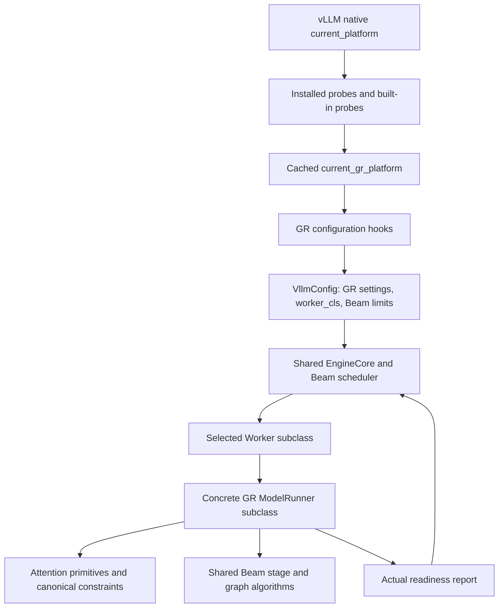

# GR platform integration

vLLM owns the native hardware platform. GR discovers a separate
`current_gr_platform`, following vLLM-Omni's combination of platform inheritance
and independent discovery. GR does not replace `vllm.platforms.current_platform`.
The selected platform supplies configuration and implementation choices; concrete
Worker and ModelRunner subclasses own the engine's runtime resources.

## Discovery

Discovery and the built-in probe table live in
[platforms/__init__.py](../../../vllm_gr/platforms/__init__.py). Installed
`vllm_gr.platform_plugins` entry points and built-ins expose zero-argument probes
returning a qualified platform class name or `None`. A probe can inspect the
native vLLM platform without importing its GR kernels or Worker.

| External matches | Built-in matches | Result |
| --- | --- | --- |
| One | Any | Select the external implementation, including on CUDA and Ascend. |
| More than one | Any | Fail with the matching plugin origins. |
| None | One | Select the built-in implementation. |
| None | More than one | Fail with an ambiguity. |
| None | None | Use `UnspecifiedGRPlatform` for imports; explicit GR initialization fails. |

Failures loading or executing a probe are logged. A malformed result,
incompatible selected class or constructor failure is an error, not a fallback.
The winning instance is cached under a lock. Spawned processes discover their
own platform; forked children clear the inherited cache and lock. Discovery is
outside token execution.

## Platform classes

[GRPlatform](../../../vllm_gr/platforms/interface.py) extends vLLM's `Platform`.
[CudaGRPlatform](../../../vllm_gr/platforms/cuda/platform.py) also inherits the
concrete native `CudaPlatform`; [AscendGRPlatform](../../../vllm_gr/platforms/ascend/platform.py)
also inherits `vllm_ascend.platform.NPUPlatform`. This reuses native hardware
methods while keeping GR-specific methods on the independent GR object.

| Platform method | Responsibility |
| --- | --- |
| `get_gr_worker_cls()` | Return the Worker class path used for a GR engine. Explicit user Worker classes remain authoritative. |
| `check_environment()` | Validate the supported runtime before engine creation. |
| `prepare_gr_engine()` | Install necessary process compatibility hooks, such as Ascend spawn protection. |
| `check_and_update_gr_config(config)` | Validate and finalize GR device settings after native configuration. |
| `get_gr_attention_backend_cls(...)` | Select the backend class for this engine's GR CUSTOM attention. |
| `get_attention_execution()` | Supply Beam primitives for the current engine, including Ascend cascade/xllm selection. |
| `get_beam_limits(config)` / `validate_gr_request(config, request)` | Advertise portable admission limits and enforce the platform's authoritative request policy. |
| `create_constraint_backend(...)` | Construct a worker-owned canonical operator when `constraint_table.backend=platform`. |
| `get_prefill_graph_runner_class()` | Supply the graph runner when the implementation supports GR Prefill capture. |

CUDA and Ascend reuse the canonical constraint loader and select its existing
`cuda` or `npu` implementation. A vendor may reuse these algorithms or implement
the `platform` operator. Algorithm selection follows platform selection.

## Configuration and ownership



`GRConfig` remains the single GR settings representation in
`VllmConfig.additional_config`. The native `parallel_config.worker_cls` selects
the Worker. The compact `vllm_gr_limits` record lets a remote frontend enforce
portable budgets and capabilities without loading the device plugin. SID stage
vocabulary support is an explicit capability; a device name does not grant it.
EngineCore validates the
selected platform's device-specific request rules before allocating work.
There is no backend plan, plan fingerprint, service requirement document,
runner adapter registry or generic stage-binding object.

CUDA's Worker selects `CudaGRModelRunnerV1` or `CudaGRModelRunnerV2` using the
resolved native `use_v2_model_runner` value. Both inherit their native Runner
and reuse existing Beam execution helpers. Ascend selects
`AscendGRModelRunner`, preserving native NPU initialization before Runner
construction. Ascend GR requires V1. Shared scheduling, protocol, EngineCore,
constraint formats and CUDA Beam algorithms remain shared.

vLLM 0.30's CUDA `Worker.init_device()` hard-codes its Runner constructors, so
`CudaGRWorker.init_device()` adapts that pinned method with native distributed,
allocation and workspace helpers. This version-specific override must be
reviewed on vLLM upgrades. Ascend exposes `_init_device()`, which the GR Worker
reuses directly. Neither path mutates a native Worker or ModelRunner class to
install GR execution methods.

Loading a model initializes its canonical constraints and binds the selected
attention primitives to that model's layers. Failed loads unwind acquired
resources. Reload waits for the previous execute/sample dispatch to finish and
releases old resources before replacement. Separate runners own separate
state; the cached platform does not own an engine's models, tables or graphs.

Before serving, EngineCore gathers actual Worker reports. It checks the selected
platform, configured Worker class, runtime/plugin versions, GR settings,
constraint artifact, requested attention/decode selection, graph outcomes and
agreement across ranks. Positive native `max_model_len` reductions within the
configured limit remain valid. Failed readiness shuts down the executor.

## Attention selection

The narrow [selector bridge](../../../vllm_gr/v1/attention/selector_patch.py)
uses the current engine's GR marker. It handles native `None`/`CUSTOM` only when
that engine requests GR CUSTOM, then calls the selected GR platform's backend
method. Explicit other native backends pass through unchanged. The bridge
never writes the shared CUSTOM registry slot or replaces the native platform.
GR selections bypass the native selector cache, whose key omits GR settings.

This preserves Ascend's behavior when its configuration resets native attention
to auto, and selects Beam attention before its Runner constructor chooses ACL
graph replay behavior. Plain vLLM engines keep native selection.

## External platforms

A vendor package registers a probe:

```toml
[project.entry-points."vllm_gr.platform_plugins"]
my_accelerator = "my_gr_backend:probe"
```

```python
def probe():
    from vllm.platforms import current_platform
    if current_platform.device_type == "my_accelerator":
        return "my_gr_backend.platform.MyGRPlatform"
    return None
```

The class extends `GRPlatform` and may also inherit its vendor's native
`Platform`, as the built-ins do. Declare `native_platform_type` to validate
compatibility. A vendor reusing CUDA can subclass `CudaGRPlatform` and override
only the relevant methods. Platform API 3 is the direct-method interface;
plugins implementing the retired plan/binding API must migrate.

Install the vendor's native vLLM platform and GR platform package in each engine
and worker environment. GR's packaging continues to support its existing CUDA
and NPU targets; this design does not add an `external` packaging target.
See [runtime patches](runtime_patches.md) for the remaining compatibility hooks.
