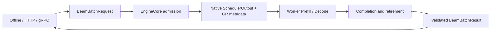

# Development navigation

This guide maps runtime changes to their owning code and contracts. Commands run
from the repository root. For setup and review, use
[Contributing](../CONTRIBUTING.md); for test execution, use
[development utilities](tools/README.md).

## Scope and code map

vLLM-GR is a plugin and adaptation layer over an installed vLLM runtime. OneRec
Beam inference and ordinary Pangu LLM inference have different execution paths.
All paths below are relative to the repository root.

| Change | Start here | Owning contract or guide |
| --- | --- | --- |
| Imports, initialization, runtime compatibility | `vllm_gr/plugin.py`, `vllm_gr/_env_check.py`, `vllm_gr/patch.py` | [Patch inventory](runtime_patch_inventory.md), [inventory data](patch_inventory.yaml) |
| Configuration and public Beam API | `vllm_gr/config/`, `vllm_gr/entrypoints/gr.py` | [Offline configuration](../examples/offline_inference/beam_search/README.md), [online configuration](../examples/online_serving/beam_search/README.md) |
| HTTP, gRPC, transport, and scheduling | `vllm_gr/entrypoints/`, `vllm_gr/v1/engine/` | [Beam batch contract](beam_batch_execution_contract.md), [async scheduling](async_scheduling.md), [gRPC/NumPy](grpc_numpy_upgrade.md) |
| Beam state and candidate selection | `vllm_gr/v1/beam/` | [Beam batch contract](beam_batch_execution_contract.md), [GPU Beam state](beam_gpu_state.md) |
| Worker, Attention, and graph execution | `vllm_gr/v1/worker/`, `vllm_gr/v1/attention/backends/`, `vllm_gr/ops/` | [Prefill capture](prefill_graph_capture.md), [ModelRunner V2](modelrunner_v2_multibatch.md), [NPU Prefill](npu_prefill_bsnd.md) |
| Artifact loading and constrained Top-K | `vllm_gr/constraints/`, `tools/build_constraint_table.py` | [Artifact setup](onerec_v1_async_quickstart.md), [multi-Trie contract](multi_root_constraint_table.md) |
| Platform registration and activation | `vllm_gr/platforms/` | [Platform contract](platform_backend_contract.md) |
| Pangu compatibility | `vllm_gr/pangu_compat.py` | [Pangu examples](../examples/offline_inference/pangu1b/README.md) |

The sections below identify distinctions that are easy to miss across modules.
Detailed lifecycle and numerical rules stay in the linked contracts.

## Initialization boundaries

`import vllm_gr` stays lightweight; resolving the lazy `GRLLM` export loads the
offline entry point. Runtime initialization belongs to
`plugin.initialize_runtime()` and the general-plugin entry point. Verify
repeatable initialization in the relevant frontend, EngineCore, and Worker
processes; frontend startup alone does not establish Worker patch installation.

Platform registration is hardware-import-free. Provider selection keys on a
declared backend ID matched against the native platform identity, not on tensor
device type. Provider activation does not replace the separate Worker and
Attention dispatchers. The
[platform contract](platform_backend_contract.md) explains these boundaries;
the [patch inventory](runtime_patch_inventory.md) records installation ownership.

### Worker packages

The public installer is `vllm_gr.v1.worker.model_runner_patch.apply_worker_patches`.
The worker root owns cross-device dispatch, context, startup coordination,
diagnostics and the adapters shared by V1 and Ascend. Device implementations
live under `worker/cuda/` and `worker/npu/`. CUDA V1 and V2 use the same CUDA
stage, workspace, input and Decode support. Each version owns its native
integration and Prefill code in `cuda/v1/` or `cuda/v2/`.

Keep package initializers lightweight. Select backend implementations lazily
from the installer or the active dispatch branch. CUDA V2 can depend on shared
CUDA support and shared worker code. Its imports must stay independent of
CUDA V1 and Ascend integration.

## Request flow and ownership



`SUBMIT_GR_SESSION` admits the caller-formed batch atomically. EngineCore owns
session progress; native scheduling owns prompt accounting and KV blocks.
Workers own device state. The frontend waits for a terminal result rather than
driving a token loop or sending a separate serialized scheduling plan. See the
[transport and lifecycle contract](beam_batch_execution_contract.md) for typed
validation, retirement, cancellation, and same-revision process requirements.

Public configuration flows through `GRConfig` and
`VllmConfig.additional_config`, including parser-cache invalidation on writes.
The public Beam API is `beam_search_v1()`; retained internal compatibility
helpers do not restore the retired `GRLLM.beam_search()` or catalog flags.
Preserve ordinary non-GR requests when changing shared transport or patches.

### Configuration field maintenance

Declare each configuration field in `vllm_gr/config/models.py` with a dataclass
default, an attribute docstring, and `ConfigFieldSpec` in `field(metadata=...)`.
The specification binds its validator, canonical path, legacy key, required
input policy, and serialization policy. Parsers and writers consume these
declarations; add domain validation in `validation.py` and keep cross-field
constraints in the model. Input-specific path handling stays in `parser.py`.

Preserve the distinction between missing, null, and explicit false inputs.
Canonical inputs require `schema_version` even though direct construction has a
default. `ConstraintTableConfig.max_top_k` remains a required constructor
argument with no default and an explicit `required=True` declaration. The
`validate-config` hook checks defaults and docstrings for both configuration
classes, with that one required-field exception. See the
[standalone configuration tests](tools/README.md#targeted-tests-and-dependencies)
and extend the existing configuration round-trip tests for behavior changes.

## ModelRunner and graph boundaries

`beam.execution_mode="v1"` names the Beam protocol, independently of native
ModelRunner V1/V2. The selection policy lives in `vllm_gr/_env_check.py`.

CUDA V1, CUDA V2, and NPU have different capture and storage lifecycles. Read
[Prefill capture](prefill_graph_capture.md) and
[V2 execution](modelrunner_v2_multibatch.md) for CUDA, and
[NPU Prefill](npu_prefill_bsnd.md) for Ascend. Attention changes may also need the
[prefix](beam_prefix_optimization.md) and [short-suffix](short_suffix_attention.md)
contracts. Verify replay or fallback, buffer ownership, row mappings, and
cleanup for the affected runner; a graph-enabled setting is not replay evidence.

## Constraint and candidate boundaries

Start with `vllm_gr/constraints/backend.py` for output shapes and validity,
`vllm_gr/constraints/scoring.py` for comparable parent scores, and
`vllm_gr/constraints/loader.py` for artifact/tokenizer identity.
Canonical token IDs are tokenizer-global; validity comes from a structural mask,
not whether a score is finite. Read the
[multi-Trie contract](multi_root_constraint_table.md) before changing routing
or platform support. Top-K ties need the declared parity contract, not an
assumption of identical slot ordering.

`vllm_gr/v1/beam/cpu_reference.py` checks candidate selection after generation;
it does not implement production scheduling, KV management, or CPU inference.

## Select regression coverage

Search by the changed symbol and behavior, then inspect the test fixtures. For
example, an initialization or transport change can start with:

```bash
rg -n 'initialize_runtime|re_apply_patches' tests vllm_gr
rg -n 'SUBMIT_GR_SESSION|BeamBatchRequest' tests vllm_gr
rg --files tests -g '*graph*' -g '*model_runner*'
```

| Boundary | Coverage location |
| --- | --- |
| Public API and entrypoints | `tests/entrypoints/` |
| Configuration and engine mode | `tests/engine/` |
| Scheduling, admission, and session lifecycle | `tests/v1/engine/` |
| CI policy and test levels | `tests/ci/` |
| Example scripts and benchmark helpers | `tests/examples/`, `tests/benchmarks/` |
| Protocol and upstream patch compatibility | `tests/contract/` |
| Provider registration and import isolation | `tests/platforms/` |
| Artifact, scoring, and backend behavior | `tests/constraints/`, `tests/tools/` |
| Worker, attention backends, and kernels | `tests/v1/worker/`, `tests/v1/attention/`, `tests/kernels/`, `tests/integration/` |
| OneRec/model integration and acceptance scripts | `tests/st/`, `tests/system/` |
| Wheel metadata and installation | `tests/packaging/` |

Directory names do not establish runtime requirements. Follow the
[validation guide](tools/README.md#validation-levels) for dependencies, slow-test
selection, hardware execution, and packaging isolation.

## Acceptance evidence

The [benchmark acceptance guide](tools/README.md#benchmark-acceptance) owns
policy selection and evidence requirements. Update the relevant contract and
examples when behavior changes; keep this page as navigation rather than a
second specification.
