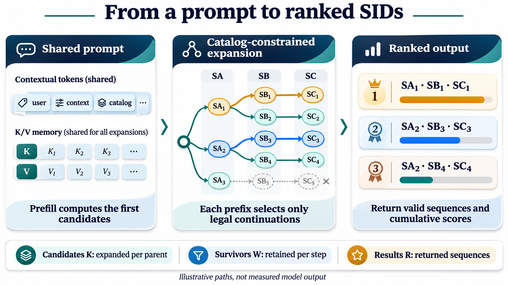
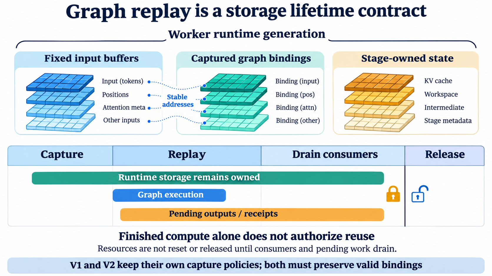

# Beam Search

This feature guide owns the Beam batch protocol, asynchronous scheduling,
Worker state and candidate decisions. Start with the
[OneRec quickstart](../getting_started/quickstart.md) for a runnable example and
[main architecture](../design/main-arch.md) for the overall request path.

- [Batch execution contract](#batch-execution-contract)
- [Asynchronous scheduling](#asynchronous-scheduling)
- [Worker state and execution](#worker-state-and-execution)

## Understand a Beam request

Beam generation expands candidates from each retained parent, ranks complete
continuations, and returns the requested valid sequences. Candidate width K,
retained width W and returned width R describe different boundaries; they
cannot be substituted for one another when sizing an engine.

[](../assets/beam-search.png)

The figure illustrates catalog-constrained selection. Without a constraint
table, candidates come from the full vocabulary or a supported SID-family
restriction; see [unconstrained Beam](unconstrained-beam-search.md).

For a first request, use [First inference](../getting_started/first-inference.md).
For catalog-valid output, use the [catalog quickstart](../getting_started/quickstart.md).
The remaining sections define the implementation and transport contracts.

## Batch execution contract

### Production boundary

Beam Search V1 submits a `BeamBatchRequest` through the atomic
`SUBMIT_GR_SESSION` EngineCore message and returns a `BeamBatchResult` through
`EngineCoreOutput.kv_transfer_params["gr_batch_result"]`. These are the two
transport contracts. Native `SchedulerOutput` carries scheduling data; there
is no separately serialized Plan message.

```text
GRLLM.beam_search / OpenAI Beam V1
  -> input processing and request validation
  -> SUBMIT_GR_SESSION(BeamBatchRequest)
  -> EngineCore admission and native SchedulerOutput
  -> Worker Prefill / Decode stages and resource retirement
  -> BeamBatchResult
  -> frontend result validation and public outputs
```

Contracts live in `vllm_gr/v1/beam/batch_contracts.py`. Production request
transport uses the typed decoder in `vllm_gr/v1/engine/codec.py`, and final
result validation lives in `gr_session_client._terminal_result`.
The NumPy CPU reference is an independent selection oracle, not the production
scheduler or Worker loop.

### Vocabulary

- `batch`: one business Beam batch / GR session;
- `item`: one native request in that batch;
- `beam`: one candidate competing within an item;
- `row`: one physical tensor or buffer row;
- `sequence`: one returned candidate;
- `parent_beam_index`: the logical Beam producing a candidate.

Request and Result carry `protocol_version == 2` and the same `batch_id`.
Native `EngineCoreRequest.request_id` identifies each item. A retry uses a new
batch identity; execution ownership and dispatch generations remain runtime
state, not additional public request fields.

#### Deployment compatibility

All frontend, EngineCore, and Worker processes participating in Beam execution
must use the same code and schema revision. Stop and restart these processes as
one deployment; mixed-revision operation and rolling upgrades are unsupported
for both fixed-width and dynamic-width Beam requests. A matching
`protocol_version == 2` alone does not establish schema compatibility.

`BeamBatchParams` uses an array-like MsgPack struct with strict unknown-field
validation. Its appended `dynamic_beam_widths`, `candidate_width`, and
`per_parent_beam_widths` fields have defaults so a new decoder can read an older,
shorter array. However, array encoding still emits trailing fields when their
values are `None`; an old strict decoder rejects that new array even for a
fixed-width request. Supporting rolling upgrades would
require capability negotiation and compatible encoding, not just a protocol
number change or relaxing validation.

#### NumPy token representation

Schema version 2 uses one-dimensional, contiguous CPU int64 arrays for GR
prompts. BeamBatchItem normalizes legacy list inputs at the boundary; execution
retains arrays through Core, scheduler and Worker. Native non-GR ADD messages
keep the original schema. See the [upgrade guide](../serving/README.md#grpc-and-numpy-transport) for
ownership rules, deployment requirements and performance measurements.

#### Request

```python
class BeamEngineCoreRequest(EngineCoreRequest):
    prompt_token_ids: np.ndarray


class BeamBatchItem:
    item_index: int
    request: BeamEngineCoreRequest


class BeamBatchParams:
    beam_width: int
    max_tokens: int
    temperature: float
    stop_token_ids: tuple[int, ...]
    ignore_stop_tokens: bool
    constraint_resource_id: str = "default"
    length_penalty: float = 1.0
    catalog_strategy: Literal["fill", "null"] | None = None
    dynamic_beam_widths: tuple[int, ...] | None = None
    candidate_width: int | None = None
    per_parent_beam_widths: tuple[int, ...] | None = None


class BeamOutputOptions:
    num_return_sequences: int
    include_stop_token: bool
    include_cumulative_logprob: bool
    include_parent_beam_indices: bool


class BeamBatchRequest:
    protocol_version: int
    batch_id: str
    items: tuple[BeamBatchItem, ...]
    beam_params: BeamBatchParams
    output_options: BeamOutputOptions
```

`EngineCoreRequest.request_id` is the single request identity. The contract does
not duplicate it in `BeamBatchItem`.

`BeamBatchParams` is authoritative for the Worker Beam loop. Native
`EngineCoreRequest.sampling_params` is per-forward adapter state, so its
`max_tokens` does not need to equal Beam `max_tokens`.

Beam `max_tokens` counts generated tokens, including the token selected from
Prefill logits:

```text
1 Prefill candidate selection + N - 1 Decode forwards = N generated tokens
```

Protocol version 1 admits only `constraint_resource_id="default"`. It does not
transport a catalog path, digest, Trie, table payload, backend adapter,
`constraint_step`, or `beam_suffix`.

#### Result

```python
class BeamOutputSequence:
    token_ids: tuple[int, ...]
    cumulative_logprob: float | None
    parent_beam_indices: tuple[int, ...]
    finish_reason: Literal["stop", "length"]
    stop_token_id: int | None


class BeamRequestOutput:
    item_index: int
    request_id: str
    sequences: tuple[BeamOutputSequence, ...] | BeamSequenceColumns


class BeamBatchOutput:
    items: tuple[BeamRequestOutput, ...]


class BeamBatchFailure:
    code: str
    message: str
    item_index: int | None


class BeamBatchResult:
    protocol_version: int
    batch_id: str
    output: BeamBatchOutput | None
    failure: BeamBatchFailure | None
```

Exactly one of `output` and `failure` is present. A failure never carries a
partial output.

For complete, equal-length, non-stopped results, `BeamRequestOutput.sequences`
can instead carry `BeamSequenceColumns`: a count, step count, and owned
little-endian int32 token/parent buffers with optional FP32 scores. The CUDA
output packer uses this representation for at least 64 returned candidates.
Small, stopped, and variable-length results keep the sequence representation.
Both forms receive structural and request-dependent validation. Host output
storage can be reused immediately without changing an already-published result.

HTTP and offline clients materialize the existing public sequence objects by
default. gRPC consumes columns directly while preserving its default response
fields; an explicit binary response is described in the
[gRPC guide](../serving/README.md#binary-beam-results). As with other internal
schema changes, frontend, Core, and Workers must restart on the same revision.

Internal Decode state contains `B * W` Beam rows. Final output contains up to
`B * R` compact sequences, where:

```text
R = num_return_sequences
1 <= R <= W
```

Only valid sequences are returned, without padding validity bits. The generic
contract and CPU oracle can represent empty items and stop completion. The
production V1 boundary is stricter: it requires at least one sequence per
successful item, `finish_reason="length"`, the effective generation budget,
and the score/parent fields selected by the request. A Worker with no valid
final candidates returns `no_valid_beams` instead of a successful empty item.

Failure codes are non-empty strings, such as `admission_rejected`,
`no_valid_beams`, and `worker_result_unavailable`. A failure may identify any
item in the batch: `item_index` is either `None` or in `[0, len(request.items))`.
The frontend validates nested field types and identities on both in-process
and serialized result paths. An invalid transport payload is not a success.

The CPU oracle also defines stop-token exclusion: the excluded stop still
contributes to cumulative score and parent history, and `stop_token_id`
remains populated. This does not enable early stopping in the production V1
path, which currently requires `ignore_eos=True`.

### Scheduling and resource ownership

Native input processing and scheduling own prompt accounting, KV blocks,
slot mappings, and scheduled token counts. GR stage metadata carries session,
member, dispatch, and generation identities for the Worker execution view.
It must agree with the native scheduling data.

Dispatch validation splits along that same line. The session-invariant facts
-- the single-entry metadata map, the logical batch identity, the generation
parameters and execution capacity, the output-producing prompt, and
`session_init` -- are proven once from the Prefill dispatch and carried as a
`GRDispatchSession` record; every later Decode stage compares its own values
against that record and re-derives only the facts a stage can change. The
record is a value snapshot of immutable members (frozen `GRStageMetadata`,
frozen `BeamBatchParams`/`BeamOutputOptions`, tuples and scalars), so it cannot
be invalidated in place, and it is scoped to one logical Beam session: created
with the stage runner, reused while `previous` is set, rebuilt by any caller
that does not hold one, and cleared when the adapter is recycled. Handing a
record to another session is rejected by the session identity comparison.

A complete Prefill may reuse prefix-cache tokens. For every item:

```text
num_computed_tokens + num_scheduled_tokens == num_prompt_tokens
```

The scheduled count need not equal the full prompt length on a cache hit.
Chunked/partial Prefill and recompute after generation are rejected. Decode
advances native accounting by one logical token while Worker execution uses
physical Beam rows. NPU stage widths and CUDA fixed-width state have their
own adapter checks.

NPU Decode binds the previous stage's latest winner tensor directly through
`NPUEagerStagePlan.prepare_decode_inputs`, for both the first and subsequent
Decode steps. Prefill winners must have shape `(B, output_width)` before they
become the latest tokens; Decode consumes `(B, input_width)` previous winners.
Request-level sampling metadata expands through the active `InputBatchProxy`.
There is no separate first-Decode handoff or attention-layout state.

The runtime currently admits one execution owner with two dispatch slots.
Persistent buffers are rebound/reset under matching ownership; physical KV
zeroing is not a wire-protocol requirement. Completion, cancellation, and
failure must drain outstanding work before resources are reused. Terminal
results are delivered only after matching resource-release confirmation.
See [asynchronous scheduling](#asynchronous-scheduling) for receipts and retirement.

NPU stage preparation is part of the Worker's execution error boundary. A
preparation failure preserves the original exception, clears pending stage and
logit state, and requires matching owner retirement before retry. New attention
batches are published only after session and buffer initialization succeeds;
failed initialization releases only the registry slots acquired by that attempt.
An occupied attention context is rejected before shared decision buffers are
reset. An already-published batch remains owned until normal retirement. These
rules do not provide automatic EngineCore recovery or certify retirement after
a failed first Prefill with no previous execution owner.

### Validation boundaries

| Boundary | Responsibility |
| --- | --- |
| `batch_contracts` / typed codec | Structural types, protocol, identities, parameters, output shape |
| V1 `input_processor` | Render/tokenize once, create native requests, validate device/config/request |
| EngineCore `validate_gr_request` | Repeat admission checks at the process boundary before scheduling |
| GR scheduler and Worker execution view | Capacity, complete remaining Prefill, native counts, member order and dispatch ownership |
| `_terminal_result` | Normalize in-process/serialized data, match batch/items, validate failure index and requested result fields |

Structural checks include contiguous item indices starting at zero, unique
non-empty request IDs, positive widths and generation budgets,
`num_return_sequences <= beam_width`, finite non-negative temperature, valid
stop IDs, sampling rather than pooling, and the supported resource identity.
Booleans are not accepted in place of integers.

`BeamBatchLimits` is a non-wire capacity snapshot. Runtime admission also
checks model length, token budget, native request capacity, Beam row capacity,
and supported device features. Logical B=1..8 is supported by admission; the
online batch/capture policy selects which exact sizes are enabled. Do not
confuse this policy with native `max_num_seqs` capacity.

On NPU, frontend and EngineCore admission also require the peak physical Decode
input rows to fit `scheduler_config.max_num_batched_tokens`. For fixed widths,
this is `batch_size * beam_width`. For dynamic widths, it is
`batch_size * max(dynamic_beam_widths[:-1])`: the final winners are returned,
not fed into another model invocation. A one-step request has no Decode and is
exempt from this additional check. Equality is accepted; exceeding the budget
rejects the batch before scheduling. Increase the token budget or reduce the
batch size or Decode input widths to admit it. Prefill token checks still apply.

Constraint Table generation supports up to three effective output steps and a
per-row candidate width (`K`) of at most 256. The Beam width (`W`, rows per
request) is a separate dimension with its own operator ceiling of 1024. The ceiling is
raised together with the scratch-tiling fix that makes the wide-`W` selection
path correct; it also gates the raw Beam operators, so the constant and the
kernels move as one. Widths above 256 take the hierarchical path; the fused
`O(W**2)` merge kernels stay gated on `K == W` and `W in {64, 128, 256}`.

On CUDA the serving path consumes `K` end to end: the sampler is asked for `K`
logprobs per row, the postprocess workspace is keyed by `(W, K)`, and every
stage's selection takes `K` candidates per parent. Unconstrained generation
supports K up to 1024. Constraint-table generation still requires K <= 256;
its backend loader checks that independent operator limit. With a
dynamic schedule, a configured `K` must be at least every stage width and is the
top-k of every stage. An unset `K` is not written onto the request: each stage
keeps taking its own output width as top-k, exactly as before `K` existed, and
the sampler, workspace and `BeamSearchState` are sized from `W`. The NPU native
fixed-width selection path still requires `K == W`.

CUDA and NPU V1 requests can additionally configure each stage's per-parent `K` with
`per_parent_beam_widths` through the dynamic execution path; such a request
schedule overrides the configured `K` (see the candidate boundary below).
On NPU, an explicit schedule uses dynamic selection for the entire session,
including fixed retained widths. This avoids the square native Beam selection
ABI without changing the default path or requiring a new operator build.
The NPU schedule currently requires an enabled canonical NPU Constraint Table;
catalog-free NPU requests with an explicit schedule are rejected at admission.
Frontend and EngineCore admission compare every requested per-parent width with
`constraint_table.max_top_k` before native preprocessing or Worker allocation.
Oversized schedules return a request rejection and leave the engine available
for later supported requests. The Worker also checks the loaded backend's
capacity as a defensive invariant.
The shared execution policy caps an explicit stage's effective candidate width
at `min(K, W_out)`; requesting more cannot increase its contribution beyond the
stage's retained width.

Unconstrained V1 generation has its own configuration and budget checks; it
does not require a catalog artifact. NPU dynamic widths must satisfy their
stage-specific capacity/parent bounds. These deployment checks are implemented
in `vllm_gr/v1/engine/beam_search.py`, not in a parallel Plan schema.

### CPU candidate boundary

The CPU reference starts after candidate generation. It does not query the
Constraint Table, run logits TopK, parse physical Beam rows, or manipulate KV.

```python
class BeamItemCandidates:
    item_index: int
    parent_beam_indices: np.ndarray  # [P]
    token_ids: np.ndarray  # [P, K]
    logprobs: np.ndarray  # [P, K]
    valid_mask: np.ndarray  # [P, K]
```

Bootstrap uses `P=1`. Decode uses `P=num_active_beams`, with
`P <= W`. The reference never fabricates W Prefill parent rows.

`K` is modelled as an independent dimension of `W` throughout this contract,
with `1 <= K <= MAX_CANDIDATE_WIDTH`. Without `per_parent_beam_widths`,
candidate generation uses the configured `K`, or `K=W_out` when it is unset.
CUDA and NPU requests may configure a per-stage candidate schedule: bootstrap requires
`K_1=W_1`, and later stages require `W_i <= W_(i-1)*K_i`. Unconstrained CUDA
supports `K_i <= 1024`; current constraint-table operators require `K_i <= 256`,
so a table request schedule needs `W_1 <= 256`.
An explicit request schedule uses dynamic selection, which flattens the
`P*K` candidate pool and selects W winners.

An explicit `per_parent_beam_widths` schedule overrides the configured
`gr.candidate_width` stage by stage, including when W varies by
stage, and is validated on its own (`input_width * K >= output_width`). Backend
admission checks the actual request K schedule against `max_top_k`. Without a
request K schedule, a configured `K` is the top-k of every stage and must be at
least every dynamic stage width; an unset `K` keeps each stage's output width.

The constrained Top-K, the postprocess workspace, and `BeamSearchState`
capacity are all sized from `K`; rows stay `W`. `K != W` takes the hierarchical
selection path.

Both candidate adapters provide FP32 local log probabilities. The selection
core does not compute softmax.

#### Sampler adapter

Native Sampler input is `[sampled, top1, ..., topK]`. If the sampled token is in
a valid Top-K slot, slot zero is removed. Otherwise the first K slots are kept,
including sampled.

#### Constraint adapter

Constraint TopK has no sampled slot and does not deduplicate duplicate token
IDs. Its adapter supplies an explicit validity mask. The finite `-1e20` padding
sentinel is interpreted by the adapter; the core never uses `isfinite()` to
infer Constraint validity.

### CPU Beam semantics

The public stages are:

```text
select_initial_beams:   one Prefill parent -> W Beam state
select_next_beams:      active Beam state -> next W Beam state
select_final_sequences: completed + final candidates -> compact Top-R output
```

At every generation, cumulative log probability is calculated in FP32:

```text
np.float32(parent_logprob) + np.float32(local_logprob)
```

Within one round, selection order is:

```text
cumulative_logprob descending
then lower parent-major logical flat index
```

For parent Beam `p`, candidate rank `r`, and candidate width K:

```text
tie_break_index = p * K + r
```

Score order decides which candidates survive. The selected active candidates
are then stably grouped by parent Beam to define execution Beam order for the
next Beam KV reorder. Selection order and execution order are distinct.

Terminal candidates enter the completed pool before active Top-W selection.
The final stage merges historical completed Beams with every valid candidate
from the final round, selects Top-R, and does not construct another active
state or perform a KV reorder.

For equal final scores from different generations, the earlier generation wins;
the per-generation logical flat index breaks the remaining tie. There is no
length penalty or final token-sequence deduplication in protocol version 1.

The production NPU V1 dynamic-width path has a narrower, fixed-horizon scope:
the frontend requires `ignore_eos=True`, and engine admission requires
`ignore_stop_tokens=True`. Every surviving path within a request generates the
same number of tokens (N=1, 2, or 3). Consequently final length normalization
applies one common denominator, and selecting Top-R by cumulative log
probability before normalization preserves ranking. This does not extend to
variable-length early completion, which needs separate ranking semantics; the
generic CPU reference above continues to cover stop completion independently.

Raw-logit ties inside a per-parent Constraint TopK operation are outside this
change. The CPU reference assumes each parent row already has a deterministic
candidate order and freezes only global Beam selection semantics.

### Package boundary

#### NPU host terminal columns

The fixed-horizon NPU terminal builder can produce the existing
`BeamSequenceColumns` wire representation from the already transferred packed
CPU buffer. It keeps Python score normalization, finite filtering and tie
ordering unchanged. It creates owned little-endian column bytes only when at
least 64 results are requested from at least 64 candidates, the history spans
the complete generation budget, and no stop-aware truncation is needed. Small
results, partial histories, and stop-aware output retain the row representation.
All-invalid rows retain the existing failure and lazy normalization behavior.

This changes CPU packaging only: the packed D2H, NPU selection and kernels are
unchanged. Both public clients materialize the existing tuple-of-sequences API
before returning. Measurements must include that materialization, not stop at
column receipt. The column protocol predates this producer and is not a new
protocol or a new NPU operator.

`vllm_gr.v1.beam` lazily exposes existing production runtime primitives only.
New contracts, codec, and CPU reference APIs are imported explicitly from
their submodules. Importing the Beam package or `cpu_reference` does not import
Torch through the CPU reference path.

## Asynchronous scheduling

Asynchronous scheduling runs Beam Search V1 on the native vLLM 0.30.0 `execute_model → sample_tokens`
interface. The next dispatch can prepare inputs and submit GPU work after the
preceding sampling submission, before EngineCore consumes its receipt.

For a runnable OneRec-1.7B setup before reading this execution contract, see
[the OneRec-1.7B V1 asynchronous scheduling quickstart](../getting_started/quickstart.md).

### Supported execution contract

- The worked example below uses CUDA ModelRunner V1, one request and a
  canonical Constraint Table. A session has one execution owner and two
  in-flight stage dispatch slots. Dispatch depth and logical batch size
  describe different dimensions.
- [Batch admission](#validation-boundaries)
  defines batch sizes, Beam and candidate width limits, and platform
  constraints. See [ModelRunner V2](cuda-graphs.md#modelrunner-v2-multi-batch-execution) and the
  [Ascend guide](../getting_started/installation/ascend.md) for runner-specific setup.
- An enabled Constraint Table fixes generation to exactly three effective
  steps, including the token sampled in Prefill; with both OneRec boundary
  tokens configured that is public `max_tokens=5`. Without the table, one to
  three steps are supported, subject to the decode-step capacity limit. Enable
  native asynchronous scheduling and disable Chunked Prefill. Prefix Cache hits
  and misses are supported. Use `ignore_eos=True` for the Python V1 API.

Public offline and online `beam_search()` return complete sequences and
cumulative scores only after matching resource-release confirmation.
The legacy frontend step loop is retired.

### Native progress and execution ownership

In the single-request example, one native Request is added and remains
resident across Prefill and Decode.
After native `_update_after_schedule`, the stage index is
`num_computed_tokens - num_prompt_tokens`: zero is Prefill, and positive values
are Decode with `decode_step = stage_index - 1`. The native Scheduler counts one
logical token per Decode; the Worker runs W physical rows using its own mutable
input view. GR stores dispatch/generation identities, dependency records and KV
leases, without a separate token/placeholder budget.

For P=900 and N=3, a cache miss schedules 900 Prefill tokens; a hit reusing
896 tokens schedules 4. Both reach computed=900, stage=0. Subsequent Decode
stages reach computed=901/902 and schedule one logical token each. Worker
snapshots carry the pre-schedule count and validate this same token extent.

The native BatchQueue and Executor use their Future-based submission
interface. The execution stages have the following responsibilities:

1. **Admission before native selection.** A view of native waiting queues exposes
   only the FIFO execution owner, retaining the original Request objects and queue
   ordering. A zero native token budget blocks new stage dispatches when
   either physical slot is unavailable. Admission reserves P+N-1 native KV positions
   through `allocate_slots(num_lookahead_tokens=...)`. Temporary shortage applies
   backpressure; impossible capacity is rejected. Recompute after generation is rejected.
2. **Complete per-step CPU preparation.** `GRInputBuffers.prepare_cpu` rebuilds
   positions, offsets, suffix lengths, prefix blocks and logits rows from Host
   metadata and bindings. No generated device state is read on the CPU. The
   metadata builder's asynchronous entrypoints bypass its geometry, layout,
   view, copy and schedule caches. Missing CPU mirrors are errors.
3. **Ordered device binding.** Ordinary PyTorch operations select actual device
   tokens and constraint prefixes, validate generated count and planned step, and
   mask terminated successors. Active step mismatches produce device error 6.
   Two pinned staging slots each have an H2D completion event. H2D, state binding
   and Forward run on the compute stream; control snapshots use separate slots
   and D2H events. The first Decode retains the native input-preparation Host fence.
4. **Graph execution.** The dedicated Decode graph captures model Forward.
   LM head and Beam postprocessing run outside it. Device input, mask,
   metadata and KV addresses stay fixed while their contents change each step and
   request. Metadata descriptions are fresh each step.
   Prefix bounds are block-aligned model capacity; suffix bounds are pool capacity.
   Decode capture, reuse and fallback depend on the runner and shape. See the
   [V1 and V2 policies](cuda-graphs.md#v1-compatibility-boundary).
   Asynchronous Prefill reuses the existing project Prefill runner, including padded
   graph replay: 900 scheduled tokens can use a captured 1024-token bucket. Bucket
   selection uses the scheduled token count after prefix-cache hits.
   Replay refreshes static buffers, preserves real Attention lengths and masks padded
   KV writes. Missing startup graphs, unsupported live inputs, missing metadata or
   slot mapping, and exceeded captured KV-length or buffer bounds still fall back
   to the native Forward path; requests never create or capture a new runner.
   Padding alone does not trigger eager fallback. It can change BF16 results and
   Beam candidate ordering; the historical exact-bucket results do not establish
   precision for the padded path.
5. **Matching release proof.** Terminal data waits until all in-flight dispatches
   drain and resource release is confirmed. The last terminal output consumer can
   report `resources_released=True`, preserving the existing normal path. When
   that proof is unavailable, a zero-token SchedulerOutput carries session,
   owner generation and retirement ID. Worker drains consumers/GPU work and
   clears session/workspace ownership before acknowledging retirement. Pending
   terminal data survives this round trip and is delivered once, then the next
   owner can start. Cancelled waiting requests allocate no Worker resources;
   running cancellation drains and releases without sending a late success.
   Already-issued successors use masked inputs. Native block references keep
   dispatched prompt KV live until the corresponding receipts drain. See
   [GPU Beam state and slot lifetime](#streams-graphs-and-retirement).
6. **Native queue progress and errors.** Retirement counts as pending work even
   for the last request. Submissions, receipt consumption, retirement and admission
   increment Host progress and avoid the fixed idle sleep. Each active dispatch
   requires a matching Worker receipt; absent receipts cannot confirm tokens.
   Async conversion failures
   become request errors; fatal Worker/CUDA failures reach native Executor failure
   handling, including exceptions raised in Multiproc's output consumer thread.

[](../assets/graph-lifecycle.png)

EngineCore issues stage dispatches, consumes matching completion receipts, and
requests retirement. Worker resource-release proof closes the ownership cycle;
only then may the session publish its terminal result and permit resource reuse.

#### First Decode after Prefill

Native scheduling records complete Prefill progress when it is scheduled;
its real output need not have reached the CPU. Once Worker has submitted both
Prefill execution and sampling, EngineCore can submit D0 into the second slot.
Worker begins D0's CPU layout preparation inside `execute_model(D0)`. It then
checks the native pinned-input fence, updates native request state, uploads the
layout, builds attention metadata, and submits device binding and Forward.
The fence protects Host buffer reuse; it does not wait for Prefill Forward.
Actual token/Beam-state reads remain ordered after Prefill sampling on the GPU.

Prefill Graph reduces the time spent submitting model operations on the Host.
That leaves a larger GPU execution window for D0 preparation in the same Worker
thread. Graph replay and asynchronous queue progress are both needed to explain
the observed benefit; graph replay alone does not move CPU preparation earlier
when the benchmark deliberately waits for each receipt. Short eager fallbacks
can still finish before the next dispatch's CPU preparation starts.

### Independent-engine reduction policy

All public startup paths write the complete normalized GR snapshot into
`VllmConfig.additional_config["vllm_gr"]`. Equivalent settings with omitted
defaults must have the same compilation cache identity. Otherwise, independent offline and
online engines can tune different reduction kernels and produce different BF16
Beam candidates and scores, despite having the same effective configuration.

CUDA ModelRunner V1 engines using the common Beam configuration and Inductor now
default `compilation_config.inductor_compile_config.dynamic_scale_rblock` to
`false`. The native compilation configuration includes this choice in its cache
identity. Existing explicit values take precedence; ModelRunner V2, NPU and
non-Beam engines keep their own defaults.

The reduction block size can affect BF16 scores before candidate selection.
The policy addresses an independent-engine mismatch observed on OneRec.

### Validation

| Boundary | Entrypoints |
| --- | --- |
| Admission, queue progress and retirement | `tests/v1/engine/test_async_scheduling_scheduler.py`, `tests/v1/engine/test_gr_async_scheduler.py` |
| Runner integration and Prefill fallback | `tests/v1/worker/test_gpu_model_runner_patch.py`, `tests/v1/worker/test_prefill_graph_runner.py` |
| Device input staging and Worker lifecycle | `tests/kernels/test_async_scheduling_inputs.py`, `tests/kernels/test_gpu_beam_stage_runner.py`, `tests/kernels/test_gpu_beam_stage_lifecycle.py` |
| Real-model offline and HTTP execution | `tests/st/test_onerec_v1_scheduler_st.py` |

Real-model checks require a configured CUDA environment and `VLLM_GR_TEST_MODEL`.
Use the [validation guide](../contributing/tools/README.md#validation-levels) for device selection.
Record actual replay, fallback reasons and matching retirement receipts.

Padded Prefill is selected from scheduled tokens after cache hits. Missing live
inputs or metadata, unavailable capture and invalid bounds fall back to native
execution. Inspect `last_replay_reason` or DEBUG diagnostics when investigating
fallbacks. Exact-bucket success does not establish padded BF16 parity.

Independent-engine comparisons must use the same normalized compilation
configuration and cache identity. V1 defaults Inductor's
`dynamic_scale_rblock` to false unless explicitly overridden; this does not
change V2 or NPU defaults. Matching configuration is not a guarantee of bitwise
equality across batch shapes, devices or compiler versions.

## Worker state and execution

CUDA Beam Search V1 keeps candidate scores, parent indices, history and
generation counters on the device across Prefill and Decode. See the
[batch execution contract](#scheduling-and-resource-ownership)
for admission and the [scheduler contract](#asynchronous-scheduling) for dispatch
and retirement.

### Storage and ownership

| Component | Responsibility |
| --- | --- |
| `BeamSearchState` | Request-local counters, active masks, current token and parent indices, immutable history and completed records |
| `BeamDecisionBuffers` | Sequence and score allocations aliased by Beam state |
| `BeamPostprocessWorkspace` | Candidate selection and state update scratch |
| `BeamAttentionContext` and `BeamSearchSession` | KV storage, attention metadata and session slots |
| `BeamSearchRunner` and `BeamBatchSearchRunner` | Request-local device updates and request-major routing for fixed-width batches |

The fixed-width batch adapter maps each request to its own state row,
workspace row and KV slot. For Beam width `W`, candidate width `K` and
generation capacity `T`, the state reserves `K + (T - 1) * W * K`
completion records per request. Prefill contributes one candidate row per
request. Each Decode stage can contribute up to `W` candidate rows.

### Stage ordering and completion

Prefill adds the first generated token and initializes the Decode counter to
zero. The first Decode writes KV at position zero. Each Decode stage writes
current KV, selects successors and applies the parent KV mapping once before
the next Forward. Masks let fixed physical shapes represent inactive rows.

A completion record stores its last token, cumulative score, request-local
parent index, length, finish reason and tie-break index. For length `n > 1`,
follow the record's parent into history at layer `n - 2`. Walk back through
the stored parent indices, reverse the recovered tokens and append the
record's last token. A one-token record refers to the implicit Prefill root.
Reordering active sequences leaves earlier history intact.

### Streams, graphs and retirement

Runner updates execute on the current CUDA stream. Cross-stream producers
and consumers establish ordering through events. Graph replay reads the
current masks and counters at captured addresses. Reuse requires compatible
resource bindings and geometry. Active views are overwritten during execution.
Completed records and history remain valid until reset.

Reset and KV slot release follow the drain of outstanding dispatches and
final consumers. A device error does not roll back KV writes already issued
by the current model Forward.

Focused coverage lives in [the state tests](https://github.com/JiusiServe/vllm-gr/blob/main/tests/v1/beam/test_beam_state.py),
[the CUDA runner tests](https://github.com/JiusiServe/vllm-gr/blob/main/tests/kernels/test_beam_search_runner_cuda.py) and
[the Worker lifecycle tests](https://github.com/JiusiServe/vllm-gr/blob/main/tests/kernels/test_gpu_beam_stage_lifecycle.py).
