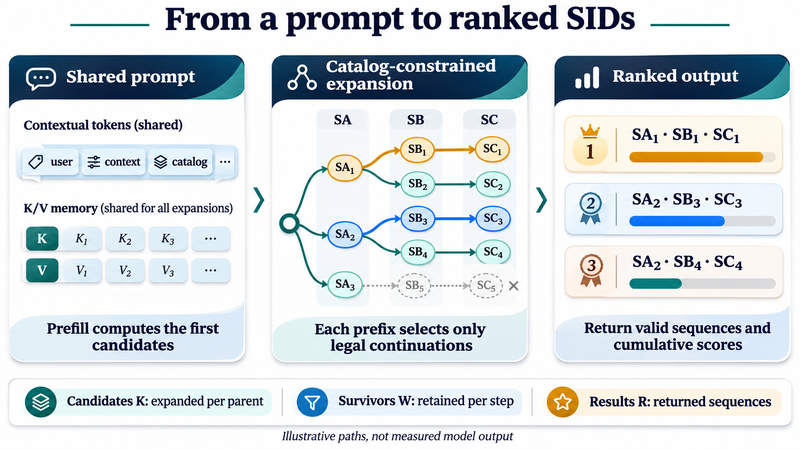

# First inference

Run a short OneRec Beam request from the source checkout and inspect its output.
This checks model loading and the public inference path. It does not measure
recommendation quality or establish catalog membership.

## Prerequisites

- Complete the [CUDA](installation/cuda.md) or [Ascend](installation/ascend.md) installation.
- Use the matching vLLM 0.30.0 and vLLM-GR environment.
- Run commands from the repository root; the example scripts belong to the checkout.
- Make enough accelerator memory available for the model and Beam state.

## 1. Prepare the model

Set a local destination and download OneRec with the Hugging Face CLI:

```bash
export ONEREC_MODEL=/absolute/path/to/OneRec-1.7B
hf download OpenOneRec/OneRec-1.7B --local-dir "$ONEREC_MODEL"
```

Keep this snapshot, including its tokenizer, unchanged while building artifacts
or comparing outputs. Use an existing local snapshot if one is already available.

## 2. Run the offline example

On CUDA:

```bash
python examples/offline_inference/beam_search/quickstart.py \
  --model "$ONEREC_MODEL"
```

On Ascend, select the NPU backend and eager execution for this first run:

```bash
python examples/offline_inference/beam_search/quickstart.py \
  --model "$ONEREC_MODEL" --constraint-backend npu --execution eager
```

The wrapper uses the natural length of its example prompt. On CUDA the direct
example selects ModelRunner V2 by default; on Ascend it selects V1. Library
construction keeps its own V1 default. The [offline reference](https://github.com/JiusiServe/vllm-gr/blob/main/examples/offline_inference/beam_search/README.md)
documents explicit runner selection, widths, prompt files and graph options.

First startup includes model loading and any enabled capture or compilation.
Compare steady-state latency only after the documented warmup.

## 3. Inspect the result

A successful run prints `returned_beams` and candidate token sequences with
scores. Check that the process finishes and returns candidates. Exact tokens,
scores and the number of valid returned beams depend on the model, input and
execution settings; a fixed score is not a pass condition.

[](../assets/beam-search.png)

The figure illustrates the **catalog-constrained** path. The first run above
uses the example's unconstrained defaults. To require valid catalog SIDs,
continue with the [catalog quickstart](quickstart.md): convert the catalog,
compile its tokenizer-bound table, and supply the artifact and both digests.

## Where to go next

| Goal | Next step |
| --- | --- |
| Generate only catalog members | [OneRec catalog quickstart](quickstart.md) |
| Send requests over HTTP | [HTTP serving example](https://github.com/JiusiServe/vllm-gr/blob/main/examples/online_serving/beam_search/README.md) |
| Integrate Python directly | [Python API](../api/README.md) |
| Share configuration between Python and serving | [Configuration](../configuration/README.md) |
| Diagnose startup or admission errors | [Troubleshooting](troubleshooting.md) |
