# Issue #37 EngineCore Beam Batch Ingress — Design Notes

> Related issue: [#37](https://github.com/zhanghanleo10/vllm-gr/issues/37)
> Parent RFC: [#35](https://github.com/zhanghanleo10/vllm-gr/issues/35)
> Contract dependency: PR #292 (`vllm_gr/v1/beam/batch_contracts.py`)

## 1. What This Does (Main Flow)

In one sentence: this change adds a unified `beam_batch` entry for online and
offline inference. The frontend sends a `BeamBatchRequest` through new client
functions to EngineCore, and everything converges on
`EngineCoreBeamBatchIngress`, which uses a single `batch_id` for submission,
cancellation, and terminal-result routing.

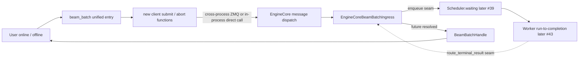

This change completes the path from user to client to the EngineCore ingress,
including registration, state machine, dedup, and reclamation. The downstream
Scheduler / Worker / cross-process result delivery are left to later subtasks.

## 2. Layer-by-Layer Explanation

### 2.1 User Layer: Unified `beam_batch`

Online and offline each expose one facade with the same internal logic:

- Offline: `GRLLM.beam_batch(prompts, beam_params, output_options)` blocks and
  returns the final result;
- Online: `AsyncLLM.beam_batch(prompts, beam_params, output_options)` submits and
  returns a `batch_id` (final-result delivery is handled by #41/#42).

One prompt is B=1; B prompts is B>1. The same function handles both.

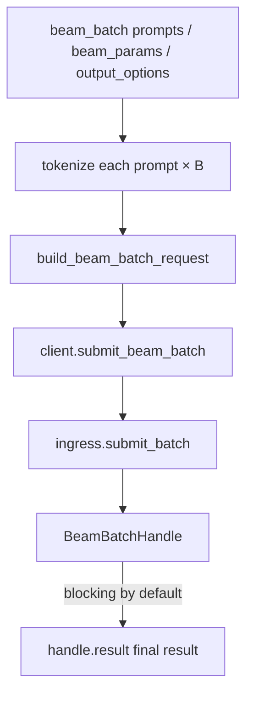

### 2.2 Client Layer: New Functions and Two Paths

Three clients each receive submit/abort functions. Implementations live in
`core_client.py` and are wired in `core_client_patch.py`:

| client | submit | abort | transport |
| --- | --- | --- | --- |
| `AsyncMPClient` (online) | `submit_beam_batch_async` | `abort_beam_batch_async` | ZMQ cross-process |
| `SyncMPClient` (offline mp) | `submit_beam_batch` | `abort_beam_batch` | ZMQ cross-process |
| `InprocClient` (offline default) | `submit_beam_batch` | `abort_beam_batch` | in-process direct call |

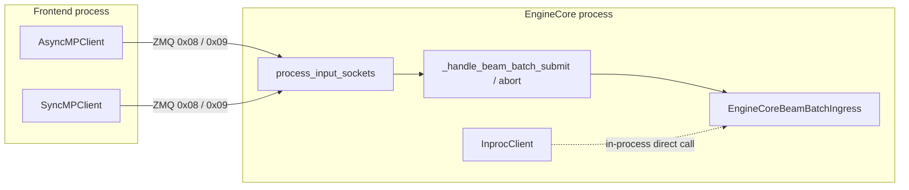

### 2.3 EngineCore Layer: Message Dispatch

`wire.py` registers `BEAM_BATCH_SUBMIT=0x08` and `BEAM_BATCH_ABORT=0x09`;
`codec.py` decodes by type; `process_input_sockets` dispatches to the handler;
the handler calls the ingress.

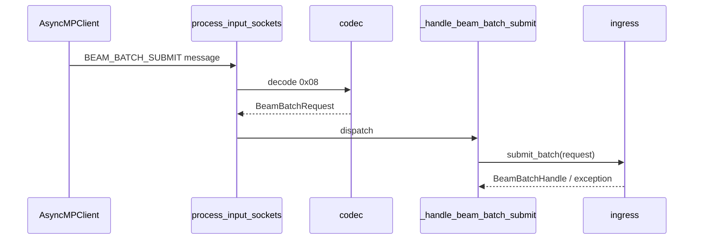

## 3. Ingress Logic in Detail

All branches converge in `vllm_gr/v1/engine/beam_batch.py`. The ingress uses a
single `batch_id` as its only key. `batch_id` is generated internally by the
facade or `submit_single` (uuid); submission, cancellation, terminal routing,
and reclamation all use it.

### 3.1 `submit_batch`

Validates, materializes children, registers, triggers enqueue, and rolls back on
failure.

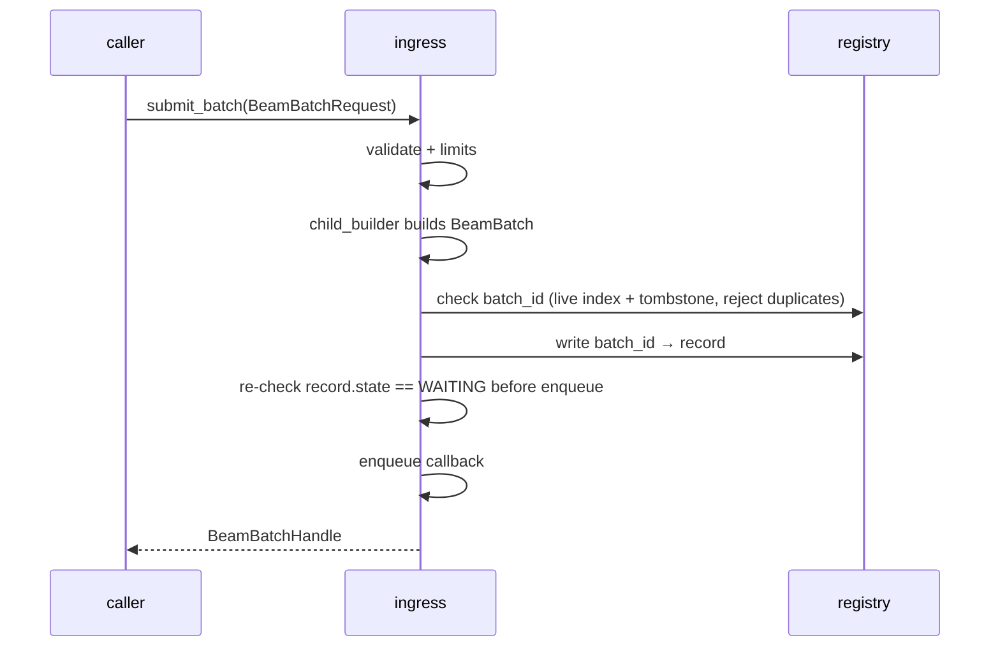

Steps:

1. Validate the request and limits.
2. `child_builder` converts B `EngineCoreRequest` objects into B native
   `Request` objects and wraps them into a `BeamBatch`.
3. Under lock, reject if `batch_id` already exists (live index or tombstone).
4. Create `BeamBatchRecord` (with a Future) and write it into
   `_records_by_batch_id`.
5. Re-check state under lock before enqueue; if not WAITING, return the handle.
6. Call the enqueue callback; on failure, roll back the registry, mark FAILED,
   and set the future exception.
7. On success, return the handle.

### 3.2 `submit_single`

Wraps one `EngineCoreRequest` into a B=1 `BeamBatchRequest`, then calls
`submit_batch`. No separate logic.

### 3.3 `cancel`

Cancels by `batch_id` and forwards the cancellation downstream.

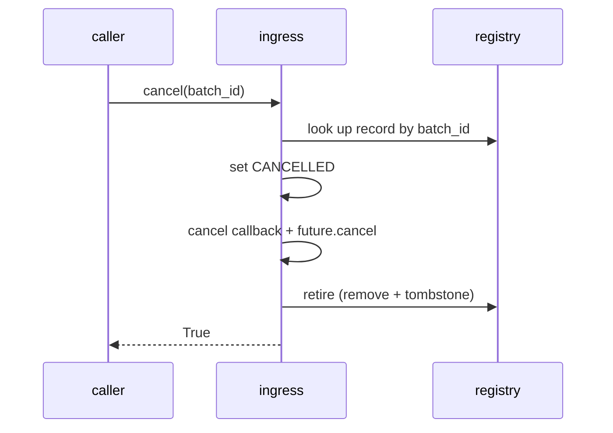

Steps:

1. Under lock, look up the record by `batch_id`; return False if absent,
   COMPLETE, or CANCELLED.
2. Set CANCELLED.
3. `try: cancel callback / finally: future.cancel + retire`.
4. Return True.

### 3.4 `route_terminal_result`

Routes the final result to the single matching record and resolves the future.

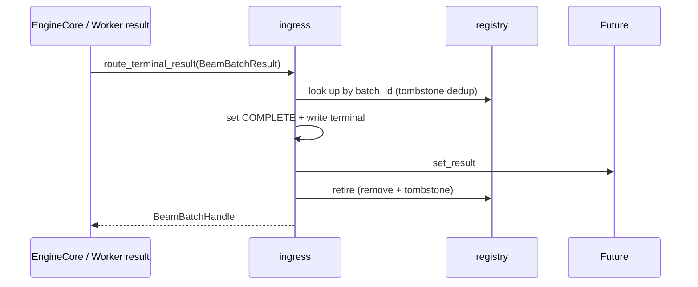

Steps:

1. Validate the result.
2. Under lock, look up the record by `batch_id`; if absent, check the
   tombstone — COMPLETE raises duplicate completion.
3. Reject CANCELLED / FAILED; reject an existing terminal result.
4. Write terminal → set COMPLETE → future.set_result.
5. Retire the record.

### 3.5 `fail_beam_batch`

Wraps a whole-batch failure into `BeamBatchResult.failure`, then calls
`route_terminal_result`.

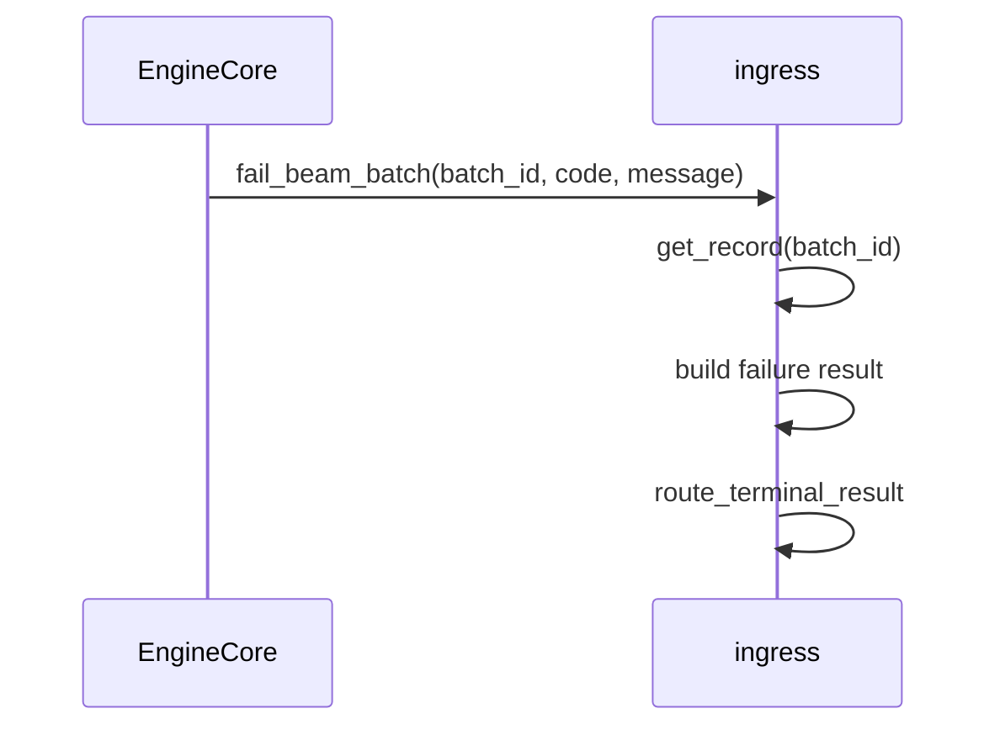

### 3.6 `_retire_record`

Reclaims terminal records: removes them from the live index and writes a bounded
tombstone for duplicate-terminal detection.

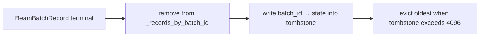

## 4. Data Structures and State

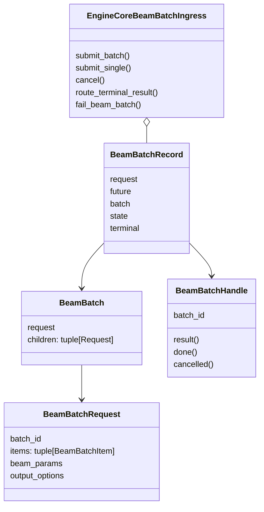

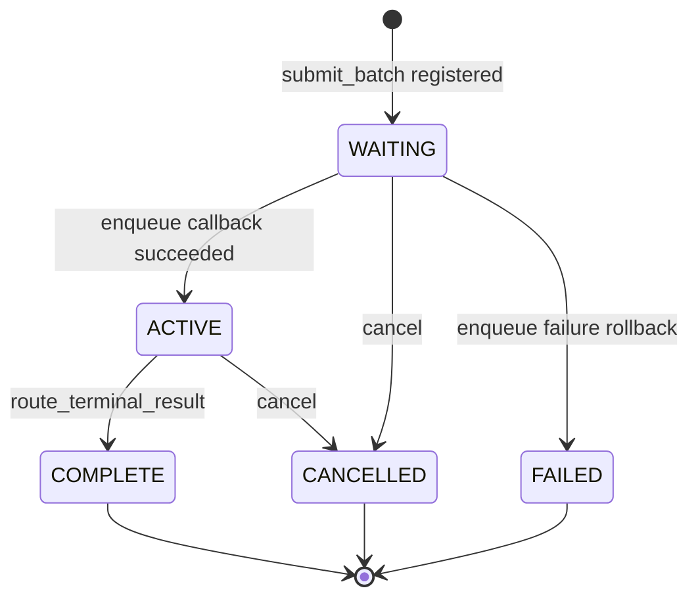

## 5. Later Subtask Integration

| subtask | seam | what it connects |
| --- | --- | --- |
| #39 Scheduler | `_enqueue_beam_batch` | add one `BeamBatch` as one FCFS queue item in `Scheduler.waiting` |
| #40 Lifecycle | `_abort_beam_batch` | cancel forwarding, cleanup, terminal reclamation |
| #41/#42 Output & E2E | after `route_terminal_result` | final-result schema, cross-process delivery |
| #43 Worker | caller of `route_terminal_result` | EngineCore calls it after Worker execution |
| #36 Contract | validation in `submit_batch` | contract changes only touch `batch_contracts.py` |

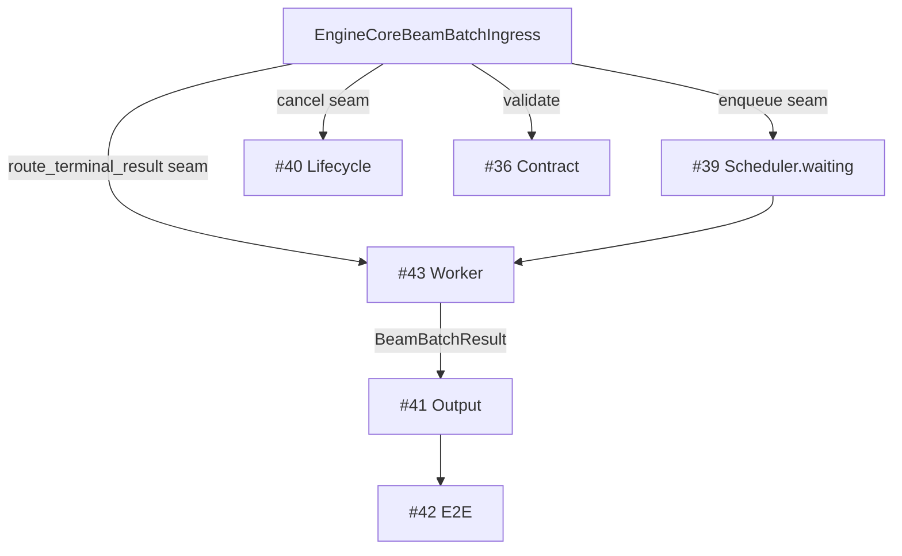

## 6. Changed Files

| file | role |
| --- | --- |
| `vllm_gr/v1/engine/beam_batch.py` | core ingress, BeamBatch, record, handle, child builder, registry |
| `vllm_gr/v1/engine/wire.py` | wire values 0x08 / 0x09 |
| `vllm_gr/v1/engine/codec.py` | payload decoding |
| `vllm_gr/v1/engine/core.py` | EngineCore assembly and dispatch |
| `vllm_gr/v1/engine/engine_core_patch.py` | patch installation |
| `vllm_gr/v1/engine/core_client.py` | client function implementations |
| `vllm_gr/v1/engine/core_client_patch.py` | client wiring |
| `vllm_gr/v1/engine/async_llm.py` | online facade |
| `vllm_gr/entrypoints/gr.py` | offline facade |
| `tests/test_beam_batch_ingress.py` | unit tests |
| `docs/patch_inventory.yaml` / `runtime_patch_inventory.md` | GR-PATCH-016 |

## 7. Tests

`tests/test_beam_batch_ingress.py` covers: submit enqueues once and routes the
terminal result, submit single, duplicate batch_id, completed batch_id reuse
rejection, enqueue-failure rollback, mixed-mode fail-fast, duplicate terminal,
native child materialization, child-builder failure, wire value registration,
cancel-then-terminal rejection, failure routing, and registry reclamation.

## 8. Current Boundaries

- The enqueue / cancel callbacks are placeholders; real Scheduler semantics land
  in #39/#40.
- `route_terminal_result` is only called by unit tests today; the production
  caller is #43.
- The online facade returns a `batch_id`; cross-process final-result delivery
  lands in #41/#42.
- The offline multiprocess backend does not support final-result delivery yet.
