# Issue #37 EngineCore Beam Batch 入口 — 设计说明

> 关联 issue: [#37](https://github.com/zhanghanleo10/vllm-gr/issues/37)
> 父 RFC: [#35](https://github.com/zhanghanleo10/vllm-gr/issues/35)
> 契约依赖: PR #292（`vllm_gr/v1/beam/batch_contracts.py`）

## 1. 做了什么（主线）

一句话：给在线和离线加了一个统一的 `beam_batch` 入口，前端通过 client 新函数
把 `BeamBatchRequest` 发给 EngineCore，最终收敛到
`EngineCoreBeamBatchIngress`，用一个 `batch_id` 完成提交、取消、终态路由。

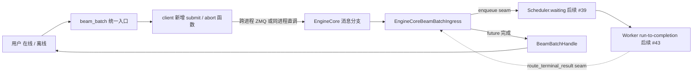

本次打通的是「用户 → client → EngineCore 入口」这条线，并完成入口侧的登记、
状态机、去重、回收；入口之后的 Scheduler / Worker / 跨进程结果回传由后续子
任务接上。

## 2. 分层说明

### 2.1 用户层：统一接口 `beam_batch`

离线与在线各有一个 facade，内部逻辑一致：

- 离线：`GRLLM.beam_batch(prompts, beam_params, output_options)`，阻塞返回
  最终结果；
- 在线：`AsyncLLM.beam_batch(prompts, beam_params, output_options)`，提交后
  返回 batch_id（最终结果回传由 #41/#42 接）。

`prompts` 传 1 个就是 B=1，传 B 个就是 B>1，同一个函数。

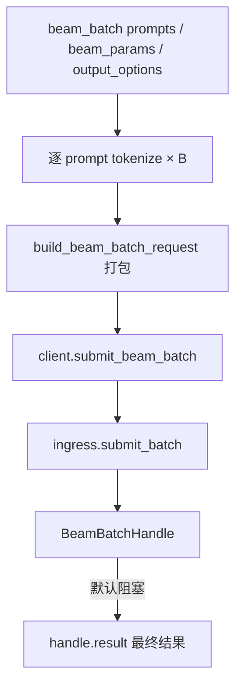

### 2.2 client 层：新增函数与两条路径

给三个 client 各加了提交 / 取消函数，实现本体在 `core_client.py`，绑定在
`core_client_patch.py`：

| client | 提交 | 取消 | 通信方式 |
| --- | --- | --- | --- |
| `AsyncMPClient`（在线） | `submit_beam_batch_async` | `abort_beam_batch_async` | ZMQ 跨进程 |
| `SyncMPClient`（离线 mp） | `submit_beam_batch` | `abort_beam_batch` | ZMQ 跨进程 |
| `InprocClient`（离线默认） | `submit_beam_batch` | `abort_beam_batch` | 同进程直调 |

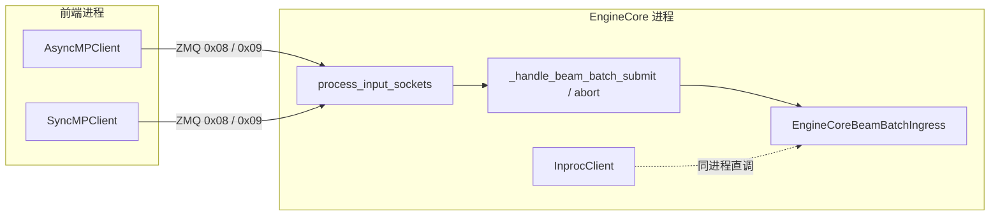

### 2.3 EngineCore 层：消息分发

`wire.py` 注册 `BEAM_BATCH_SUBMIT=0x08`、`BEAM_BATCH_ABORT=0x09`；
`codec.py` 按类型解码；`process_input_sockets` 分发给 handler；handler 再调
ingress。

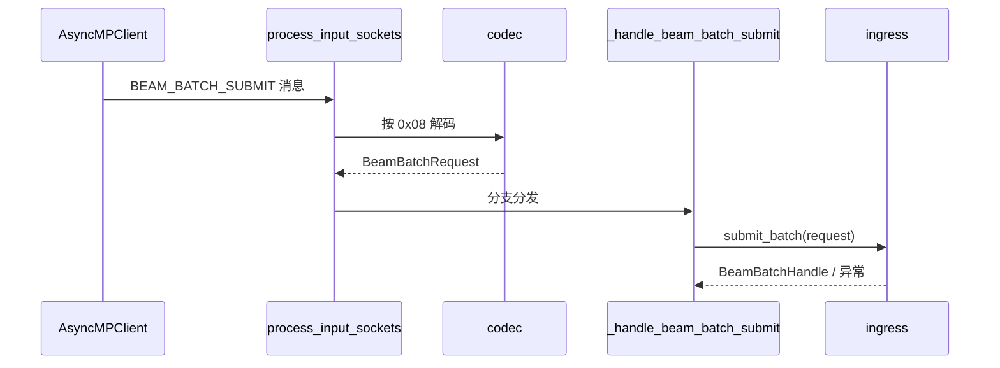

## 3. ingress 详细逻辑

所有分支最终收敛到 `vllm_gr/v1/engine/beam_batch.py`。ingress 只用一个
`batch_id` 作为唯一索引：batch_id 由前端 / `submit_single` 内部生成
（uuid），提交、取消、终态路由、回收全部按它查。

### 3.1 `submit_batch`

负责验证、构造 child、登记、触发 enqueue，并处理失败回滚。

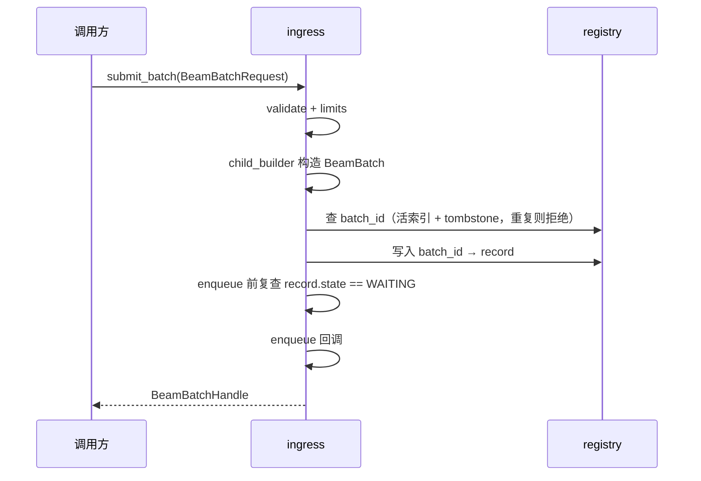

步骤：

1. 校验 request 与 limits；
2. `child_builder` 把 B 个 `EngineCoreRequest` 转成 B 个 native `Request`，
   装进 `BeamBatch`；
3. 加锁检查 batch_id 是否已存在（活索引或 tombstone），存在则拒绝；
4. 创建 `BeamBatchRecord`（含 Future），写入 `_records_by_batch_id`；
5. enqueue 前加锁复查状态，不是 WAITING 直接返回 handle；
6. 调 `enqueue` 回调；失败则回滚 registry、标 FAILED、future 置异常；
7. 成功返回 handle。

### 3.2 `submit_single`

把一个 `EngineCoreRequest` 包成 B=1 的 `BeamBatchRequest`，再调
`submit_batch`，没有独立逻辑。

### 3.3 `cancel`

按 batch_id 取消，并把取消意图转发给下游。

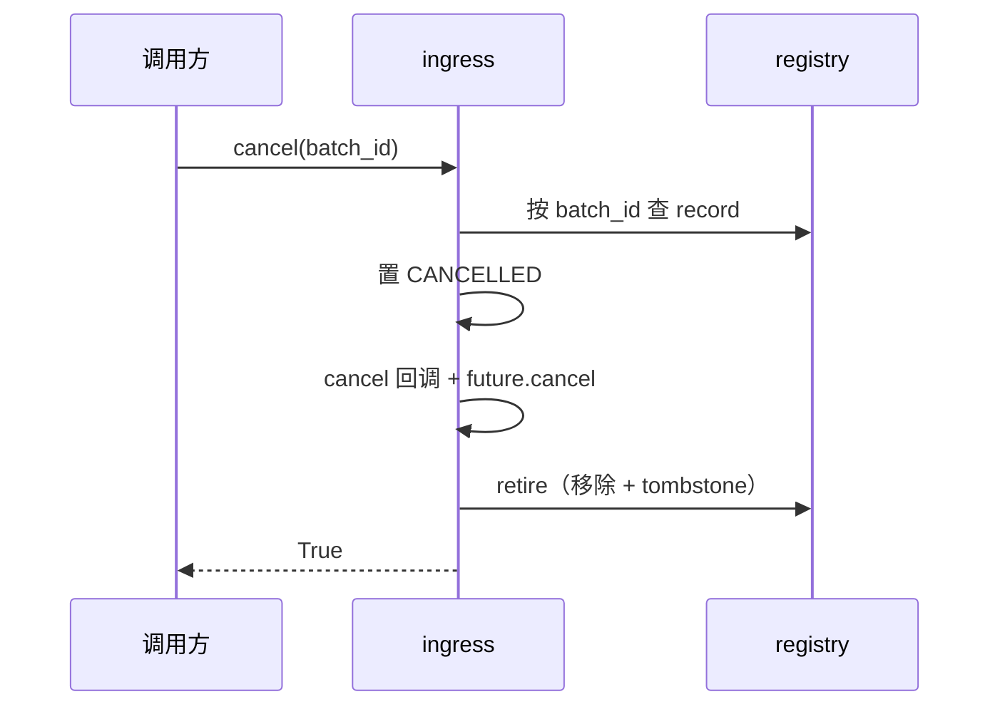

步骤：

1. 加锁按 batch_id 查 record；不存在 / COMPLETE / CANCELLED 返回 False；
2. 置 CANCELLED；
3. `try: cancel 回调 / finally: future.cancel + retire`；
4. 返回 True。

### 3.4 `route_terminal_result`

把最终结果路由回唯一的 record，并完成 future。

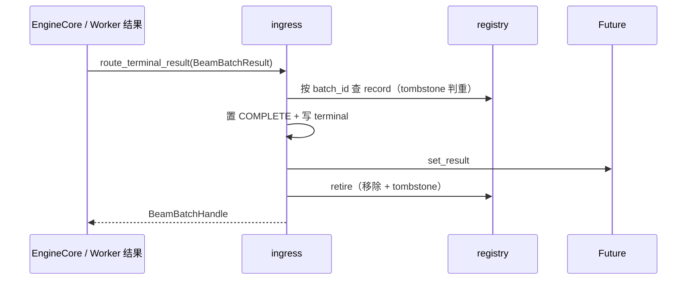

步骤：

1. 校验结果；
2. 加锁按 batch_id 查 record；查不到则查 tombstone，COMPLETE 抛重复完成错误；
3. CANCELLED / FAILED 拒绝；已有 terminal 抛重复完成；
4. 写 terminal → 置 COMPLETE → future.set_result；
5. retire 回收。

### 3.5 `fail_beam_batch`

把整组失败包装成 `BeamBatchResult.failure`，再走 `route_terminal_result`。

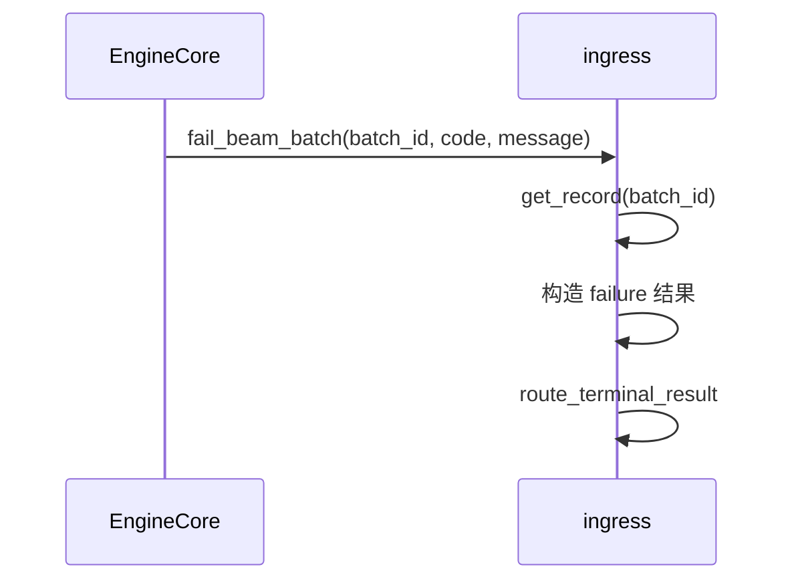

### 3.6 `_retire_record`

终态回收：从活索引移除，写有界 tombstone 用于重复 terminal 判重。

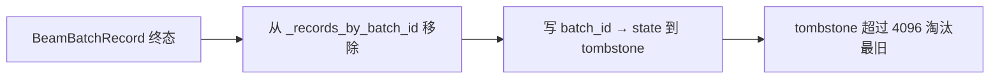

## 4. 数据结构与状态

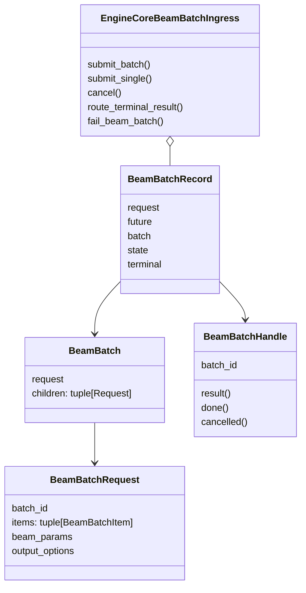

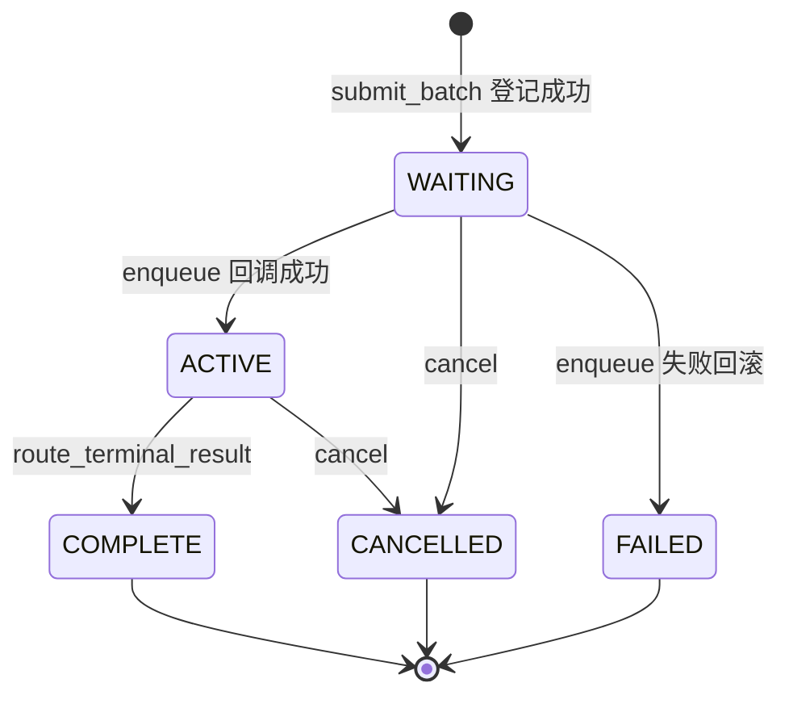

## 5. 后续子任务对接

| 子任务 | 接缝 | 要接什么 |
| --- | --- | --- |
| #39 Scheduler | `_enqueue_beam_batch` | 把 `BeamBatch` 作为一个 FCFS 队列项放进 `Scheduler.waiting` |
| #40 Lifecycle | `_abort_beam_batch` | cancel 转发、cleanup、终态清理 |
| #41/#42 输出与 E2E | `route_terminal_result` 之后 | 最终结果 schema、跨进程回传 |
| #43 Worker | `route_terminal_result` 调用方 | Worker 执行完由 EngineCore 调它 |
| #36 Contract | `submit_batch` 的 validate | 契约字段变化只改 `batch_contracts.py` |

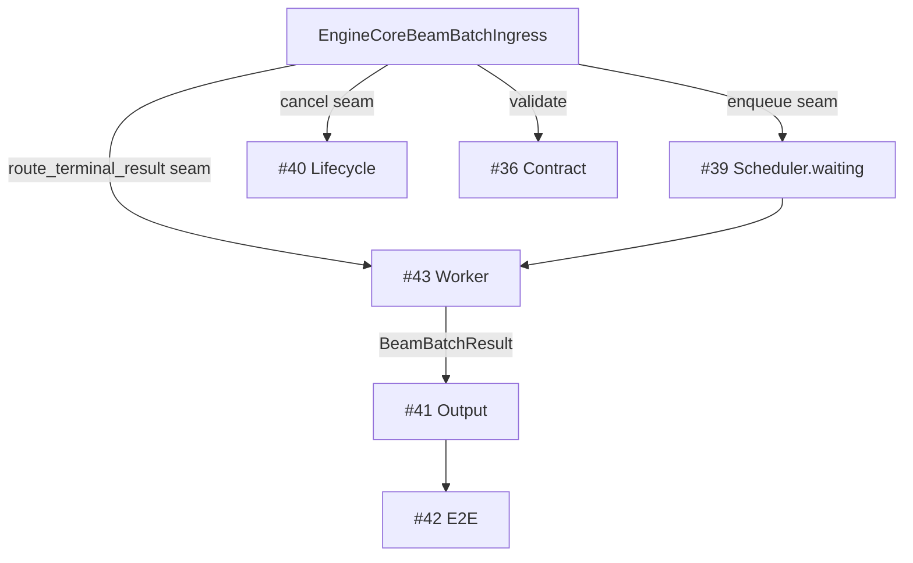

## 6. 改动文件清单

| 文件 | 角色 |
| --- | --- |
| `vllm_gr/v1/engine/beam_batch.py` | 核心：ingress、BeamBatch、record、handle、child builder、registry |
| `vllm_gr/v1/engine/wire.py` | 协议编号 0x08 / 0x09 |
| `vllm_gr/v1/engine/codec.py` | 消息解码 |
| `vllm_gr/v1/engine/core.py` | EngineCore 装配与分发 |
| `vllm_gr/v1/engine/engine_core_patch.py` | patch 安装 |
| `vllm_gr/v1/engine/core_client.py` | client 函数本体 |
| `vllm_gr/v1/engine/core_client_patch.py` | client 接线 |
| `vllm_gr/v1/engine/async_llm.py` | 在线 facade |
| `vllm_gr/entrypoints/gr.py` | 离线 facade |
| `tests/test_beam_batch_ingress.py` | 单测 |
| `docs/patch_inventory.yaml` / `runtime_patch_inventory.md` | GR-PATCH-016 |

## 7. 测试

`tests/test_beam_batch_ingress.py` 覆盖：submit 只 enqueue 一次并路由 terminal、
submit single、重复 batch_id、completed batch_id 复用拒绝、enqueue 失败回滚、
mixed-mode fail-fast、重复 terminal、native child 物化、child 构造失败、wire
值注册、cancel 后拒 terminal、fail 路径、registry 回收。

## 8. 当前边界

- enqueue / cancel 回调目前是占位，真实 Scheduler 语义在 #39/#40；
- `route_terminal_result` 目前只在单测调用，生产调用方在 #43；
- 在线 facade 返回 batch_id，跨进程最终结果回传在 #41/#42；
- 离线 multiprocess 后端的最终结果暂未支持。
