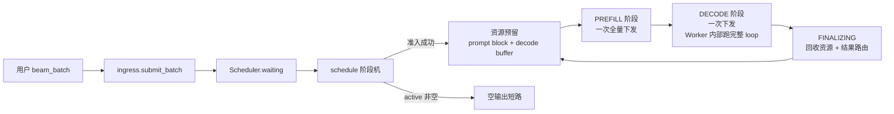
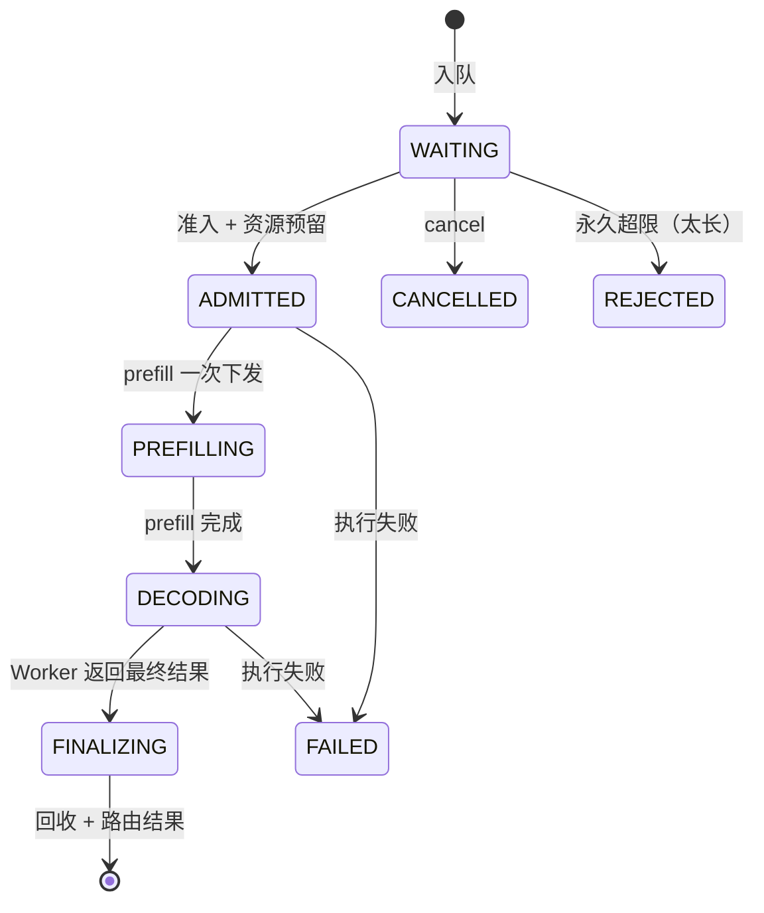
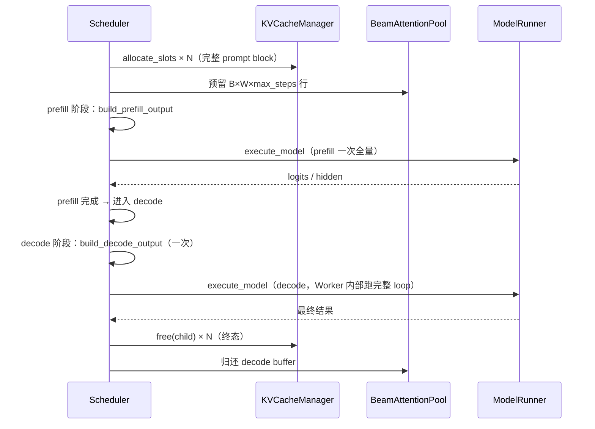
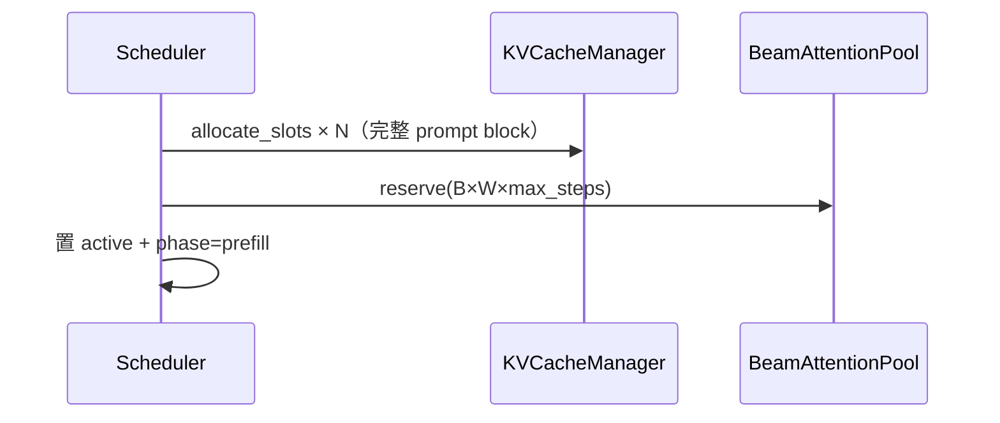
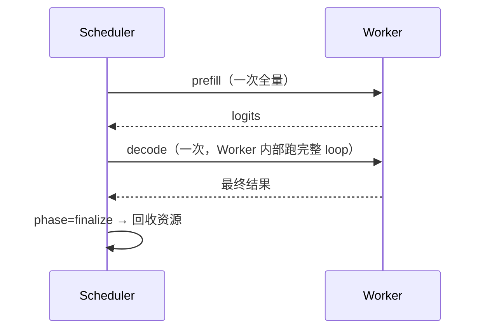

# Issue #39 Scheduler 完整设计方案（Scheduler 全权资源管理版）

> 状态：设计稿 v8（已定稿，issue39 唯一有效设计稿）
> 说明：v8 修订方向——**两次下发**（prefill 一次全量 + decode 一次，decode 内部
> loop 在 Worker），不切 chunk、超长直接 REJECTED。原
> `issue39_scheduler_implementation_framework.md`（v4）已废弃删除。
> 关联 issue: [#39](https://github.com/zhanghanleo10/vllm-gr/issues/39)
> 父 RFC: [#35](https://github.com/zhanghanleo10/vllm-gr/issues/35)
> 上游入口: [#37](https://github.com/zhanghanleo10/vllm-gr/issues/37)（已实现）
> 契约: PR #292（`BeamBatchRequest` / `BeamBatchPlan` / `BeamPrefillData`）
> 基线: vllm==0.22.1

## 0. 设计方向（v8 修订：两次下发、不切 chunk）

> **Scheduler 全权资源管理 + 两次下发**：prompt block、decode buffer、回收全部由
> Scheduler 负责；prefill 一次全量下发（不切 chunk，超长直接 REJECTED）、decode
> 一次下发（Worker 内部跑完整 decode loop，select / top-k / 有效 token 过滤在
> Worker）；最终结果回 EngineCore 后由 `_finalize_beam_group()` 统一回收。

这是对 RFC #35"Worker run-to-completion"的回归：Scheduler 只调度两次（prefill
一次、decode 一次），不再逐 chunk / 逐 step 下发（见 §12 影响说明）。

## 1. 设计目标与原则

1. **Scheduler 是唯一资源权威**：prompt KV block、decode buffer 的申请、
   下发、回收全部在 Scheduler；
2. **执行原语复用 vLLM**：KV 分配、prefill forward、decode forward 复用
   原生能力，Scheduler 只编排阶段；
3. **整组原子**：组内任一资源申请失败，全部回滚，整组留在队首；
4. **single-active**：一个下发单位执行期间，不派发下一个；
5. **业务 batch 排队，组下发**：B=1 攒批，B>1 默认直发。

## 2. 总体架构



Scheduler 每一步（EngineCore step）只做一件事：准入时下发 prefill（一次全量）、
prefill 完成后下发 decode（一次）、之后等待 Worker 最终结果（空输出）。

## 3. 阶段状态机（每个下发单位）



阶段状态挂在 active 单位上：

```python
self._beam_active: BeamGroupState | None
# BeamGroupState.phase ∈ {"prefill", "decode", "finalize"}
```

## 4. 核心设计：资源管理（Scheduler 全权）

### 4.1 两类资源与复用

| 资源 | 归属 | 复用 vLLM | 申请/回收时机 |
| --- | --- | --- | --- |
| PromptKV（paged block） | Scheduler | `allocate_slots` / `free` | 准入时按完整 prompt 预留；终态回收 |
| Decode buffer（BeamKV 行） | Scheduler | 复用/包装 `BeamAttentionPool` 预留 API | 准入时预留 `B×W×max_steps` 行；终态整体归还 |

prefill 不切 chunk：超长 prompt 在准入前即被 REJECTED（`PROMPT_TOO_LONG`），
不会进入等待队列，也不做执行分批。

### 4.2 分配与回收时机

```text
准入（ADMITTED）：
  - 为组内每个 child 调 allocate_slots 预留完整 prompt block
  - 为整组预留 decode buffer：B × W × max_steps 行
  - 任一失败 → free 已分配的 prompt block + 归还已预留 buffer，整组回滚

执行中：
  - prefill / decode 只写已预留资源，不新申请

终态（FINALIZING）：
  - kv_cache_manager.free(child) 释放 prompt block
  - 归还 decode buffer（整体）
  - 清 active 与阶段状态
```

### 4.3 我们的函数与调用的原生函数

| 我们的函数 | 功能 | 调用 |
| --- | --- | --- |
| `reserve_unit_resources(unit)` | 预留 prompt block + decode buffer | `KVCacheManager.get_computed_blocks` / `allocate_slots` / `free`；`BeamAttentionPool` 预留 API |
| `release_unit_resources(unit)` | 终态回收 | `KVCacheManager.free(child)`；`BeamAttentionPool` 归还 API |
| `build_prefill_output(unit)` | 构造一次全量 prefill 调度单 | `NewRequestData.from_request` / `SchedulerOutput` |
| `build_decode_output(unit)` | 构造一次 decode 调度单 | `SchedulerOutput` + beam metadata |

### 4.4 调用关系图



## 5. 关键决策

### 5.1 beam state 归属

decode 只下发一次，Worker 内部跑完整 decode loop，所以 **beam state（候选
token、score、parent、终止判断）放在 Worker 侧**：

- decode 调度单下发后，Worker 内部循环：forward → select → top-k → 有效
  token 过滤 → 判断终止，直到全部 step 完成或超 `max_decode_steps`；
- Worker 返回最终结果给 EngineCore，由 `_finalize_beam_group()` 统一回收；
- Scheduler 侧不持有逐 step 的 beam 状态，只跟踪 prefill/decode/finalize 阶段。

### 5.2 prefill 不切 chunk

- prefill 一次全量下发，不做执行分批；
- 超长 prompt（`prompt + max_tokens > max_model_len`）在入队时直接
  REJECTED（`PROMPT_TOO_LONG`），不进入等待队列、不无限重试。

## 6. 详细原因分析

### 6.1 为什么预留资源一直可用

1. **只有 Scheduler 能释放**：Worker 永不 free；
2. **single-active 短路**：执行期间 `schedule()` 返回空输出，不触发原生
   preemption，预留 block / buffer 不会被抢占。

### 6.2 decode buffer 与标志位问题

- 推荐用**独立 `BeamAttentionPool`**：prompt 走 paged KV，decode 走独立池，
  天然区分，不需要标志位；
- 若坚持共用 paged KV 池预留 decode 块，才需要"预留 block id 集合"标记，
  并让 `allocate_slots` / `free` 跳过这些 id——改动侵入原生分配器，不推荐；
- 本版 Scheduler 通过 `BeamAttentionPool` 预留 API 管理 decode buffer（申请/
  归还由 Scheduler 触发），不引入标志位。

### 6.3 前缀缓存

- 准入时 `get_computed_blocks` 命中则少分配、少计算；
- `free` 只释放占用权，KV 数据与 hash 表仍在，跨 req 可命中；
- batch 结束不清缓存表，保留原生 LRU；
- admission 预算按"无命中"保守算。

### 6.4 显存估算

每 token KV ≈ 层数 × 2(K+V) × head 数 × head_dim × dtype 字节。
7B 级（32 层、32 head、head_dim 128、fp16）：每 token ≈ 0.5 MiB，
block_size=16 → 每 block ≈ 8 MiB。

```text
prompt 512  → 32 blocks  ≈ 256 MiB
prompt 1024 → 64 blocks  ≈ 512 MiB
prompt 4096 → 256 blocks ≈ 2 GiB
B 个 child  → 上面 × B
decode buffer：B × W × max_steps × 0.5 MiB
```

## 7. 数据结构定义

### 7.1 `BeamBatchGroup`

```python
@dataclass
class BeamBatchGroup:
    group_id: str
    members: tuple[BeamBatch, ...]

    @property
    def children(self) -> tuple[Request, ...]:
        return tuple(c for m in self.members for c in m.children)

    @property
    def batch_ids(self) -> tuple[str, ...]:
        return tuple(m.batch_id for m in self.members)
```

### 7.2 `UnitReservation`

```python
@dataclass
class UnitReservation:
    unit: BeamBatchGroup | BeamBatch
    blocks_by_child: dict[str, KVCacheBlocks]
    num_computed_by_child: dict[str, int]
    decode_rows: int                # B × W × max_steps
```

### 7.3 `BeamGroupingConfig`

```python
@dataclass(frozen=True)
class BeamGroupingConfig:
    group_target_size: int = 8
    group_max_wait_ms: int = 10
    group_multi_batches: bool = False
    group_max_scan: int = 64
    max_decode_steps: int = 128
```

### 7.4 `BeamGroupState`

```python
@dataclass
class BeamGroupState:
    unit: BeamBatchGroup
    reservation: UnitReservation
    phase: BeamPhase = BeamPhase.PREFILL
```

## 8. Scheduler 侧函数设计

### 8.1 `schedule()`（两次下发阶段机入口）

```python
def schedule(self, active, *, dispatch_unit=None) -> SchedulerOutput:
    if active is None:
        if dispatch_unit is None:
            return self._make_beam_empty_output()
        return self._schedule_admission(dispatch_unit)   # prefill 一次下发
    if active.phase == "prefill":
        active.phase = "decode"
        return self.build_decode_output(active)          # decode 一次下发
    return self._make_beam_empty_output()                # 等 Worker 最终结果
```

### 8.2 `_schedule_admission()`

```python
def _schedule_admission(self, unit) -> SchedulerOutput:
    reservation = self.reserve_unit_resources(unit)
    if reservation is None:
        return self._make_beam_empty_output()      # 整组留在队首
    self._pop_dispatch_unit(unit)
    self._beam_active = BeamGroupState(unit=unit, reservation=reservation, phase="prefill")
    return self.build_prefill_output(reservation)
```

### 8.3 `reserve_unit_resources()` / `release_unit_resources()`

```python
def reserve_unit_resources(self, unit) -> UnitReservation | None:
    blocks: dict[str, KVCacheBlocks] = {}
    for child in unit.children:
        computed, n = self.kv_cache_manager.get_computed_blocks(child)
        b = self.kv_cache_manager.allocate_slots(
            child, child.num_tokens - n,
            num_new_computed_tokens=n, new_computed_blocks=computed,
            full_sequence_must_fit=True,
        )
        if b is None:
            for prev in blocks:
                self.kv_cache_manager.free(prev)
            return None
        blocks[child.request_id] = b
    rows = self._beam_pool.reserve(B * W * max_decode_steps)
    if rows is None:
        for child in unit.children:
            self.kv_cache_manager.free(child)
        return None
    return UnitReservation(unit, blocks, ..., rows)


def release_unit_resources(self, reservation) -> None:
    for child in reservation.unit.children:
        self.kv_cache_manager.free(child)
    self._beam_pool.release_reserved(reservation.decode_rows)
    self._beam_active = None
```

### 8.4 `build_prefill_output()` / `build_decode_output()`

```python
def build_prefill_output(self, reservation) -> SchedulerOutput:
    # 对每个 child：NewRequestData 一次全量下发完整 prompt
    # num_scheduled_tokens[child_id] = child.num_tokens - num_computed
    # block_ids 复用准入时预留的 block
    ...

def build_decode_output(self, active) -> SchedulerOutput:
    # 组内每个 child 一个 session CachedRequestData，num_output_tokens=1
    # 携带 beam_data（is_beam_decode_run=True），Worker 内部跑完整 decode loop
    ...
```

## 9. EngineCore 侧接口

- `_enqueue_beam_batch`：入队 + 超长 REJECTED（`PROMPT_TOO_LONG`）；
- `_abort_beam_batch`：从 waiting / active 移除，归还已预留资源（#40）；
- `_finalize_beam_group`：Worker 返回最终结果后统一回收资源、清 active；
- `update_from_output`：对 beam child 跳过原生逐 token 记账（decode 内部
  loop 由 Worker 负责，EngineCore 只收最终结果）。

## 10. 详细时序

### 10.1 准入 + 资源预留



### 10.2 prefill 一次 → decode 一次



### 10.3 终态回收

```text
finalize（EngineCore 收到最终结果后触发 _finalize_beam_group）：
  kv_cache_manager.free(child) × N
  beam_pool.release_reserved(decode_rows)
  清 active
  结果按 batch_id 路由（#40/#41）
```

## 11. 与 #40 / #41 / #43 的边界

| 子任务 | 边界 |
| --- | --- |
| #43 Worker | decode 内部完整 loop：select / top-k / 有效 token 过滤 / 终止判断 |
| #40 Lifecycle | 资源回收在 Scheduler（`_finalize_beam_group`，终态阶段） |
| #41 Output | 结果 schema / 跨进程回传 |
| beam state | Worker 内部（decode loop），Scheduler 只跟踪阶段 |

## 12. 与 RFC #35 的关系

- RFC #35 冻结了"Worker run-to-completion"；
- 本版回归"两次下发"：prefill 一次、decode 一次，decode 内部 loop 在
  Worker——与 RFC #35 一致，无需修订 run-to-completion 口径；
- 交付物：prefill 一次下发、decode 一次下发、decode buffer 管理、超长
  REJECTED。

## 13. 配置项

```text
--beam-group-target-size          默认 8
--beam-group-max-wait-ms          默认 10
--beam-group-multi-batches        默认 False
--beam-group-max-scan             默认 64
--beam-max-decode-steps           默认 128
--beam-decode-buffer-rows         默认 B×W×max_steps
```

## 14. 测试计划

- 组批与准入；
- prefill 一次全量下发，完成后进入 decode；
- decode 一次下发（Worker 内部 loop），EngineCore 收最终结果后回收；
- 超长 REJECTED：入队时 `PROMPT_TOO_LONG`；
- 资源：prompt block 预留/回滚/回收；decode buffer 预留/整体归还；
- 失败：任一资源申请失败全部回滚；
- 取消：waiting / active（已预留资源）取消，资源归还；
- single-active：阶段机短路；
- 前缀缓存命中/未命中；
- 显存预算：准入前校验；
- 配置 fail-fast：混合请求等。

## 15. 验收标准映射

| 验收标准 | 对应设计 |
| --- | --- |
| 一个业务 Batch 只在 waiting 出现一次，B child 不独立排队 | §8.2 + §7.1 |
| 永久装不下（太长）的 Batch 入队前拒绝 | §5.2 / §9 |
| 任一 child 资源申请失败全部恢复 | §8.3 |
| prefill 一次全量下发（不切 chunk） | §5.2 / §8.4 |
| decode 一次下发，Worker 内部跑完整 loop | §8.1 / §9 / #43 |
| 资源（prompt block + decode buffer）由 Scheduler 统一管理 | §4 |
| 无普通请求与 Beam 混跑 | §1 / 配置 fail-fast |

## 16. 风险与开放问题

1. **beam state 在 Worker**：decode 内部 loop 的 select / top-k / 过滤逻辑
   在 Worker，跨进程只回传最终结果，延迟最低；
2. **decode buffer 归属**：独立池（推荐）vs 标志位方案需评审；
3. `BeamBatchGroupPlan` / `BeamPrefillData` 需与 #41 定稿；
4. Worker 侧 decode loop 的 `max_decode_steps` 上限与 abort 中断需 #43 落地。
