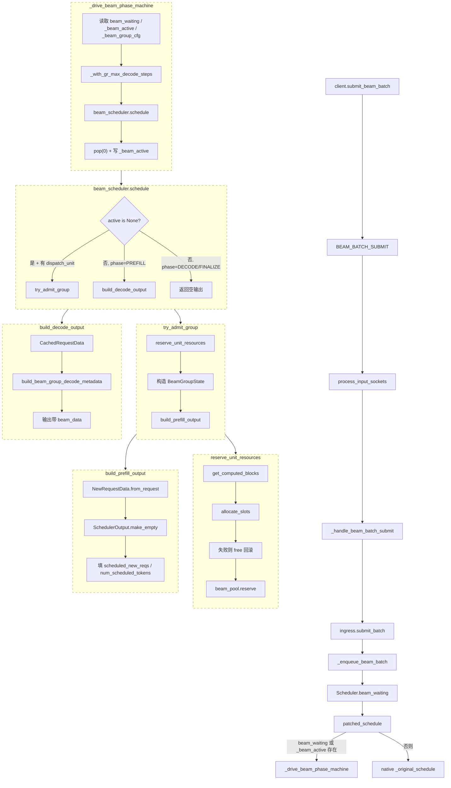

# Issue #39 Scheduler 调用链说明

本文只说明当前代码里 Scheduler 侧 beam batch 的调用逻辑，不涉及尚未实现的 Worker
内部 decode loop 和最终结果回传。

## 1. 顶层调用链

```text
Online/Offline API
  -> client.submit_beam_batch / submit_beam_batch_async
  -> BEAM_BATCH_SUBMIT wire
  -> EngineCore.process_input_sockets
  -> _handle_beam_batch_submit
  -> EngineCoreBeamBatchIngress.submit_batch
  -> _enqueue_beam_batch
  -> Scheduler.beam_waiting
  -> patched_schedule
  -> _drive_beam_phase_machine
  -> beam_scheduler.schedule
  -> try_admit_group / build_prefill_output / build_decode_output
```

## 2. 详细流程图

虚线框表示一个较长的逻辑函数，框内是该函数内部调用的流程。



## 3. 关键函数内部调用说明

### 3.1 `_enqueue_beam_batch(self, record)`

把 materialize 后的 batch 变成单成员 `BeamBatchGroup`，塞进 `scheduler.beam_waiting`。

内部调用：

1. `BeamBatchGroup(group_id=batch_id, members=(batch,))`
2. 超长检查：`self._beam_batch_ingress.fail_beam_batch(...)`
3. `scheduler.beam_waiting.append(group)`

### 3.2 `patched_schedule(self)`

Monkey-patch 后的 `Scheduler.schedule`。先安装 beam 前缀缓存 patch，再判断走 beam 阶段机还是原生调度，最后在 `finally` 恢复 patch。

内部调用：

1. `make_patch_get_computed_blocks(...)` / `patch_cache_blocks`
2. 有 beam 组时：`_drive_beam_phase_machine(self)`
3. 无 beam 组时：`_original_schedule(self)`，再 `build_beam_request_metadata`

### 3.3 `_drive_beam_phase_machine(scheduler)`

读取 waiting / active / 配置，调用 `beam_scheduler.schedule` 产出本次 `SchedulerOutput`，并根据是否准入成功更新 `beam_waiting` 和 `_beam_active`。

内部调用：

1. `_with_gr_max_decode_steps(scheduler, cfg)`
2. `beam_scheduler.schedule(scheduler, active, config=cfg, dispatch_unit=...)`
3. 准入成功时 `beam_waiting.pop(0)`、写 `_beam_active`

### 3.4 `beam_scheduler.schedule(...)`

两次下发阶段机：prefill 一次、decode 一次。

内部调用：

1. `active is None` 且有待准入组：`try_admit_group`
2. `phase == PREFILL`：`build_decode_output`
3. `phase == DECODE/FINALIZE`：返回空 `SchedulerOutput`

### 3.5 `try_admit_group(scheduler, group, config)`

准入一个 group：先预留资源，再构建 prefill 调度单，返回 `(output, BeamGroupState)`。

内部调用：

1. `reserve_unit_resources`
2. `BeamGroupState(phase=PREFILL)`
3. `build_prefill_output`

### 3.6 `reserve_unit_resources(scheduler, unit, config)`

全量预留 prompt KV block 和 decode buffer 行，失败回滚。

内部调用：

1. `kv_cache_manager.get_computed_blocks`
2. `kv_cache_manager.allocate_slots`
3. 失败时 `kv_cache_manager.free`
4. `scheduler.beam_pool.reserve`（当 pool 存在时）

### 3.7 `build_prefill_output(reservation)`

构造一次完整 prefill 的 `SchedulerOutput`。

内部调用：

1. `NewRequestData.from_request(child, block_ids)`
2. `SchedulerOutput.make_empty`
3. 填 `scheduled_new_reqs` / `num_scheduled_tokens`

### 3.8 `build_decode_output(state, max_decode_steps)`

构造一次完整 decode 的 `SchedulerOutput`，并在 `beam_data` 里带 `is_beam_decode_run`。

内部调用：

1. `CachedRequestData(...)`
2. `build_beam_group_decode_metadata(state, max_decode_steps)`
