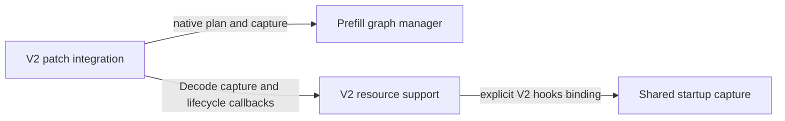
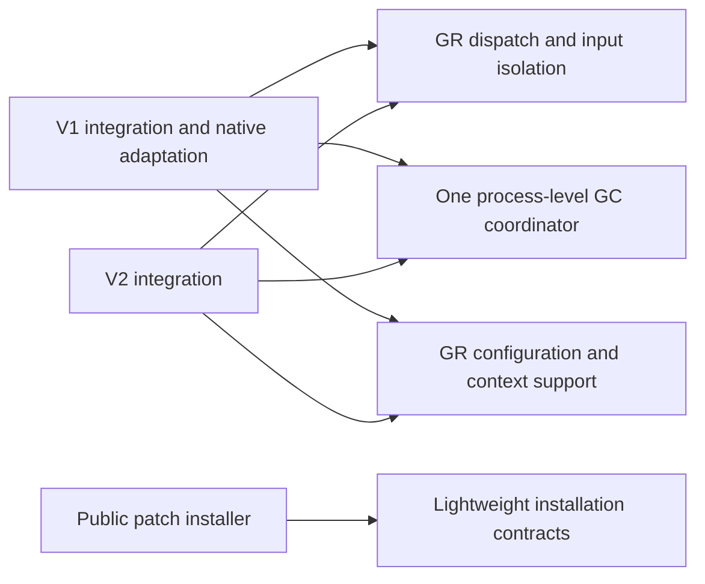
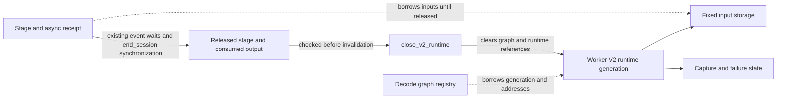

# ModelRunner V2 multi-batch execution

ModelRunner V2 supports one Beam Search V1 call containing B=1 through 8 logical
requests. Each member has its own prompt, candidates, scores and KV history.
Beam width W is fixed by the engine configuration; Decode processes B * W
physical rows. B is not the beam width or the asynchronous dispatch depth.

## Reuse of native vLLM

The implementation keeps native request state, Prefix Cache, KV block tables
and Prefill execution. For an admitted all-new GR Prefill batch, registration
skips unused native sampler initialization and refresh, while preserving
request removal, model state, block IDs and per-slot prompt-logprob resets.
Every member must pass admission before any slot changes. Ordinary, mixed,
new-plus-cached and unsupported batches retain native registration.
`cuda/v2/gpu_prefill_v2` owns registration, the staged-write ABI and guarded V2
input preparation. V1 preparation remains in `cuda/v1/gpu_prefill_inputs`; the V2
stage hooks own execution and lifecycle transitions. Both CUDA integrations
use `cuda/gpu_postprocess_workspace` for workspace initialization and load-time
device-memory accounting; V2 does not import V1 patch implementation code.

Fresh batches on an empty native request set can flush token, total-length,
computed-token and single-group block-table writes through one packed transfer
and one Triton kernel. This includes multi-request batches with unequal prompt
lengths and reused native slots. The specialization requires complete prompts,
zero computed tokens and no previously queued writes; other registrations keep
native flushing. Queue contents are cleared only after successful submission,
and the subsequent native block-table flush still publishes block counts.

For supported pure Prefill batches, one Triton kernel prepares input tokens,
positions, sequence lengths, query offsets, logits indices and sampling row
indices. Multi-request batches and single requests with request padding transfer
one small packed descriptor containing native slot indices and query offsets.
The existing single-request path without request padding needs no descriptor
transfer. GPU computed-token state determines tokens and positions, while CPU
upper bounds remain available to native attention code.
Request padding has monotonic query offsets and zero sequence lengths. Sampling
indices have per-dispatch storage for asynchronous consumers. Block-table gather,
slot mapping and attention metadata construction remain native operations.

Native preparation may reorder requests. The V2 adapter selects the last-token logit rows in the
original logical member order before Beam sampling; it does not reorder
native request or KV state.

After Prefill, both runners use the existing GR stage runner, Beam state,
Constraint Table and Decode graph primitives. V2 alone uses a worker-owned
input allocation with room for 8 * W rows; each batch uses a view of that
storage. V2 startup captures the configured Decode shapes, defaulting to
B=1/2/4, bounded by `max_num_seqs`. Switching B updates buffer
contents and selects an existing graph without request-time capture. V2 can
fall back to eager execution for an individually unsupported capture after
checking cleanup and device health; other captured shapes remain usable.
Legal sizes outside the configured capture policy use eager Decode. A missing
graph for a successfully captured configured size remains an error.

V2 retirement passes all logical member IDs back through native request cleanup.
V2 model replacement and shutdown invalidate both Prefill and Decode captures
before the native lifecycle operation, including when loading fails. Prefill
cleanup releases graph/output bindings and clears readiness, capture results
and counters, then restores an uncaptured native manager. The next capture
installs a fresh GR plan and allocates output storage for the new model.
Decode replay also checks the captured model, context and input storage before
launching.

V2 constrained selection branches on the current device SID stage. Each branch
calls the shared CUDA Top-K kernel with that stage's complete maximum candidate
degree. Full-window score normalization and exact score/tie ordering remain
shared. This avoids processing first-stage padding in later stages without
predicting progress on the Host. V1 retains table-wide capacity for
device-driven selection. The `CudaStageHooks` contract requires an explicit
`specialize_constraint_steps` policy: `False` for V1 and `True` for V2.

V2 warms the stage-specialized kernel before publishing the initial constraint
backend or a replacement Trie. Warmup covers every supported power-of-two K
capacity for the model and configured output-head dtypes, including the table's
current stage degrees and Trie count. A capacity change therefore compiles
during table loading rather than the first request. Failed warmup releases the
candidate backend before it can become active.

### Graph installation and startup ownership

`cuda/v2/gpu_model_runner_v2_patch.py` owns the marker-guarded factories for native
KV initialization, graph-memory profiling and model capture. The existing
`cuda/v2/gpu_model_runner_v2_resources.py` owns multi-batch Decode capture together
with fixed input storage, graph bindings and runtime invalidation.
`cuda/v2/gpu_prefill_graph_runner_v2.py` owns native FULL/PIECEWISE planning and replay.



Startup installs the Prefill plan, runs native capture, then captures configured
Decode batches. Profiling measures the complete GR plan in the native temporary
pool and includes Decode/fixed-state memory. It restores the native capture flag
after Decode capture, including failures, and never freezes GC for profiling.
The native profiler tears down its temporary KV state before GR cleanup runs.
Ordinary non-Beam capture retains native behavior; graph hooks remain optional
capabilities of the native runner. Moving these operations does not change
resource ownership, consumer-drain prerequisites or release timing.

### Execution and shared support ownership

V2 owns `make_patched_execute_model_v2` in `cuda/v2/gpu_model_runner_v2_patch.py`.
`model_runner_common.py` is limited to native V1 execution adaptation and active
input proxies/row/logprob bookkeeping used by NPU. The public installer imports
that V1 wrapper only after selecting V1; V2 does not load this adaptation module.

Shared responsibilities have explicit owners:

- `model_runner_contracts.py`: hardware-free patch markers and completeness checks.
- `gr_execution.py`: frame classification, input isolation, stage/retirement
  execution and failure propagation. Its one sentinel distinguishes an ordinary
  frame from a handled stage whose legitimate result is `None`.
- `gr_gc.py`: all Worker-side process-level GC state, locks, execute-depth accounting,
  background freeze coordination and capture/warmup RPC functions.
- `gr_context.py`: cached GR configuration, context construction and graph
  diagnostics. Configuration remains cached on the native runner.



Both execute wrappers enter/leave the same GC coordination boundary, including
exceptions. The existing freeze thresholds, timeout, retry and acknowledgement
semantics are retained. Async sampling keeps V1 request context alive past
`execute_model`; ordinary V2 frames continue to execute natively. Public Worker
RPC names are unchanged and their functions remain importable in spawned workers.
The public CUDA installer owns NumPy staging installation for both versions;
version-specific sampling delegates retain their own installation markers and
call the shared stage sampler. Resource invalidation and consumer-drain timing
are unchanged. Frontend request guards and startup-heap leases retain their
separate owner in `utils/engine_lifecycle.py`; these guard a different request
lifetime, including when engines run in process.

### V2 runtime generations and teardown prerequisites

`cuda/v2/gpu_model_runner_v2_resources.py` owns `V2RuntimeState`, reached through the
Worker's single `_gr_v2_runtime` reference. Its object identity is the runtime
generation. Fixed input tensors remain lazily allocated at the same capacities
and addresses; graph bindings borrow the generation and its input storage.
Replay and capture of another shape reject a different generation, changed
storage or a replaced model; selecting an uncaptured shape cannot overwrite
the binding used by previously captured shapes.
Startup refusals, runtime shape refusals, capture diagnostics and dynamic-graph
discard state belong to that generation. Repeated startup capture retains published failures and their diagnostics until
the generation ends. A new runtime starts without its
predecessor's refusal records. Dynamic adapter invalidation clears runtime
refusals while retaining the existing startup-shape policy.

| Resource | Owner and release rule |
| --- | --- |
| V2 fixed model inputs | Worker runtime; stage owners borrow views, stable until runtime cleanup |
| Decode graphs and captured output | Shared Worker graph registry; replay overwrites output; stage hidden staging preserves values required by later sampling |
| Startup/runtime capture records | V2 runtime generation; no independent Worker copies |
| Dispatch metadata, control slots and hidden staging | Stage owner; retained through dispatch and output consumption |
| Async output/retirement receipts | Output consumer retains the owner; a cached retirement receipt is removed only after consumption and release |
| Context, sessions and postprocess workspace | Existing resource-specific owners; runtime cleanup requires released leases but retains these allocations |
| Head layout cache | Model's LM head; weight-only load hooks refresh its existing storage |



`close_v2_runtime()` is a lifecycle operation, not a drain implementation.
The serialized Worker/control caller must stop admitting work and consume its
outputs first. Before changing references, cleanup checks the current and cached
stage owners, any cached retirement output, and context/workspace leases. A
stage must be closed, with no pending dispatch or busy output slot. A retirement
receipt must already contain its output. Fused terminal release also requires
successful native request cleanup. The output consumer sets a pending flag
before releasing the GPU owner and clears it under the control lock after native
cleanup succeeds. A live borrower raises before Prefill manager, graph, backend
or model-hook teardown. Shared stage `release()` calls Beam `end_session()`,
which waits for the final consumer event and synchronizes before marking the
owner closed. Cleanup reuses that proof without adding GPU synchronization,
polling or cancellation.

| Lifecycle caller | Required boundary and ordering |
| --- | --- |
| Startup memory profiling | The V2 profile wrapper rejects a bound serving runtime; startup capture releases its dummy stage and checks GPU health. Native temporary KV teardown precedes GR cleanup. Partial capture must release its owner or cleanup rejects it. |
| Full model load/replacement | The serialized Worker load/control caller must drain old GR dispatches and consumers. The load wrapper validates and clears the old runtime before backend teardown and native model loading. |
| Load failure | Old runtime invalidation has completed before native load starts. Backend publication failures retain the existing rollback; partially created graph state cannot bypass the next cleanup check. |
| Shutdown | The Worker shutdown/control caller must drain GR work and outputs. The wrapper checks runtime release before removing model hooks/backend or invoking native shutdown; a later native synchronization is not used as proof for earlier GR cleanup. |

The installed vLLM V2 control paths are `GPUWorker.load_model()` to the patched
runner load method, and `WorkerProc.shutdown()` to `GPUWorker.shutdown()` and
the patched runner shutdown method. EngineCore shutdown normally processes
remaining work before executor teardown. None of these names alone proves GR
release: the guard observes the release established by the output consumer's
`AsyncGPUBeamOutput.get_output()` or `AsyncGRRetireOutput.get_output()` and the
shared stage's `release()`/Beam `end_session()` chain. A forced or out-of-order
lifecycle call with a live GR borrower is rejected rather than assuming native
shutdown will synchronize later.

These are GR release checks, not a global admission lock or a substitute for
the caller's native-request shutdown protocol. Repeated cleanup is harmless.
Externally retained consumed receipts keep their cached results valid. V1 keeps
stage-owned inputs and its own graph policy. Weight-only reload keeps the
runtime and uses the model-owned head-cache refresh path. Directory placement
and allocation/capture policy are unchanged.

### V1 compatibility boundary

ModelRunner V1 uses the GR Prefill grid, clamps capture to the per-request
capacity and requires exact native input extents for async Prefill admission.
It captures B=1 Decode at startup and can lazily capture against stage-owned
buffers when a new batch needs a graph.

Beam attention uses incremental Decode with one query token per beam;
full-suffix recomputation is not supported. NPU retains incremental row views
and B=2 Prefill capture support. Backend row bounds, retirement and shutdown
remain the responsibility of their existing implementations.

Set `beam.adapter_cache_enabled: true` in the canonical service configuration
to opt into cross-batch adapter caching. It defaults to false, preserving the
previous latest-adapter reuse and lazy capture policy. Disabling this cache
does not disable Decode CUDA Graphs or same-batch adapter reuse. The legacy
configuration key is `vllm_gr_beam_adapter_cache_enabled`.

When this option and Decode graphs are enabled, the shared runner retains one drained
adapter per logical batch size while the context, workspace and search geometry
remain compatible. Returning to an already-warmed B reuses that adapter's fixed
input/attention addresses and its Decode graphs instead of clearing and
recapturing them. Each session still rebinds its own inputs and selectors.
Incompatible resources or geometry invalidate the bounded cache; V2 runtime
cleanup removes it before model replacement or shutdown.
The switch is read from service configuration, not from individual requests;
it does not add startup pre-capture or change schedule-miss behavior.

`CudaStageHooksV1` and `CudaStageHooksV2` subclass the `CudaStageHooks` abstract
base class in `cuda/gpu_stage_hooks.py`. The ABC rejects missing operations and policy
flags at construction. The class-side `CudaStageHooksType` Protocol additionally
checks constructor compatibility at binding sites; mypy checks operation signatures
and policy types. Hooks are constructed before session admission or graph-cache
invalidation, so construction failure leaves those resources available for retry.
The CUDA stage factory binds one hooks class to the runner for execution and
startup capture. A Worker cannot switch its concrete hooks type after releasing a stage
owner, including during repeated startup: `validate_stage_hooks_type` compares
the bound class with the requested class. NPU dispatch retains its separate
adapter and does not import either CUDA implementation.

V1 retains stage-owned storage and lazy graph capture. V2 selects fixed Worker
storage, configured startup graph capture, batched Backend admission and
full-member retirement; its existing dynamic-shape recapture and recoverable
failure handling remain in the V2 implementation. The V2 installer alone supplies
the extended Backend capacity, kernel preparation and runtime cleanup callbacks.
Shared graph construction has an optional graph class; V2 uses a subclass for
storage/model validation.
There is no new environment switch or duplicated Beam state machine.

### Native output completion boundary

`GPUBeamStageRunner.sample()` calls `hooks.finish_native_output()` after
submitting GR device output work and recording its producer/copy events,
immediately before clearing the pending dispatch and returning the asynchronous receipt.
This includes cancelled dispatches that still need an asynchronous receipt.
Admission continues to require complete, output-producing Prefill; the hook
does not enable Chunked Prefill.

Partial GR Prefill is rejected before native execution or cleanup. Ordinary
non-GR chunks retain their native execution and sampling path. A Prefix Cache
hit can reduce the query length of complete GR Prefill; it is not a non-final
chunk. The V2 native-state device tests cover actual query-length accounting
and ordinary chunk progress with native input/count operations and stand-in
forward/sampling callbacks.

The hook drops native result references; it does not wait for the output
consumer, release GR resources, advance native counters, or retire requests.

The call is deliberately outside a `finally` block. An earlier execute,
sampling or output-enqueue failure leaves the native result and pending stage
at their existing failure boundary. A hook exception propagates and prevents
the receipt from being returned or the pending dispatch from being cleared.

Both CUDA implementations clear `execute_model_state` followed by
`kv_connector_output`. V1 retains native Prefill logits until this boundary.
V2 continues to clear its pending native state inside `prefill_logits`, before
selecting hidden rows and updating computed-token counters; completion does
not move or repeat those operations. Native V2 obtains connector output through
its connector rather than a persistent V1-style Worker field. Its hook preserves
the previous GR assignment of `kv_connector_output = None`, including when
that attribute was absent; it does not invoke the connector.

State and operations at the native-output boundary have these owners:

| State or operation | Owner and responsibility |
| --- | --- |
| Completion writes to `execute_model_state` and `kv_connector_output` | V1/V2 `finish_native_output()`, called after device output submission and before clearing `pending` |
| Prefill logits/hidden rows, native computed-token updates and Host input fence | Version hooks, with runner-specific state consumption, bookkeeping and fence ordering |
| `pending`, execution failures, cancellation and asynchronous receipts | Shared stage orchestration |
| `_current_scheduler_output`, `_current_beam_data`, `_current_beam_info` | Shared stage GR dispatch metadata |
| Model/head, configuration and attention/KV metadata reads | Shared stage and head helpers |
| Input buffers, graph/cache handles, workspace, context and sessions | Worker/stage resource owners retain allocation and invalidation responsibility; output completion does not release these resources |

Host tests in `tests/v1/worker/test_cuda_native_output.py` cover the completion and failure
ordering. `tests/kernels/test_gpu_beam_stage_lifecycle.py` exercises real CUDA
output consumption for both hook implementations, including cancellation and
terminal output. The ABC rejects missing completion implementations at
construction; the complete-boundary mypy fixture rejects an incompatible
completion return type.
Pytest does not start checker subprocesses.

The contracts describe eleven instance operations and three policy flags,
plus class-side construction and admission sizing. They cover Prefill row
ordering/counter updates, output completion, the V1 Host-input fence, input
storage lifetime and capture recovery. Version-specific graph policies remain
in their implementations. The dedicated mypy group checks the ABC, class-side
Protocol, both implementations, core and binding sites together; see
[CUDA stage hooks contract](PRE_COMMIT.md#cuda-stage-hooks-contract).

Both runners retain upstream's opt-in vocabulary-sliced LM head. Decode hooks
may return `None` after staging hidden states for sliced sampling; those states
must remain valid when a later graph replay overwrites its output buffer.

## Configuration and scope

### vLLM 0.30 integration

V2 remains experimental and requires explicit opt-in; the default runner is V1.
The adapter consumes the native `BatchReqState`, preserves the native request
order and padding fields, and advances Prefill counts through
`postprocess_num_computed_tokens`. GR consumes and clears the pending native
forward state before producing its own Beam output.

The Prefill manager uses the 0.30 `capture() -> None` contract and keeps its
captured graphs in the native registry. Capture capacity follows the native
dummy batch's evenly distributed token counts. Ordinary requests retain the
native input preparation and sampling paths.

Graph memory profiling uses the same GR Prefill plan as startup and includes
Decode graphs and their fixed state. GR's token/request grid has nonuniform
capture costs, so its complete plan is measured in the native temporary pool
instead of extrapolating two FULL samples. This adds startup capture work.
The adapter retires temporary Decode graphs, inputs, owners and newly created
Beam context before real initialization. It preserves the enclosing capture
window and does not freeze the serving heap during profiling.

The worker applies this budget when
`VLLM_MEMORY_PROFILER_ESTIMATE_CUDAGRAPHS=1`. This does not add a profiling pass
when upstream skips it (for example, native `cudagraph_mode=NONE` or an explicit
KV cache byte budget); those configurations need their own memory allowance.
Memory estimates remain configuration dependent and are not a performance
baseline.

Functional tests use `shutdown_timeout=10` and assert EngineCore exits with
code zero; inference success alone does not establish clean shutdown.

### Supported configuration

Use the Beam configuration and Constraint Table artifact described in the
[asynchronous quickstart](onerec_v1_async_quickstart.md). Set
`VLLM_USE_V2_MODEL_RUNNER=1` before importing vLLM, and submit the complete
batch through `GRLLM.beam_search_v1()`. `beam.execution_mode="v1"` selects the
Beam protocol; it does not select ModelRunner V1.

`beam.online_batch_sizes` defaults to `[1, 2, 4]`. For example, `[1, 3, 7]`
enables fixed HTTP batches of 3 and 7 and selects those startup Decode capture
sizes. It also selects Prefill request counts unless the Prefill-specific
environment override is set. Increase `max_num_seqs` explicitly to at least 7;
the policy never enlarges engine capacity automatically.

For B=4, set `max_num_seqs` to at least 4 and make
`max_num_batched_tokens` large enough for the sum of all remaining prompt
tokens. `max_model_len` remains a per-member limit. The native request capacity
does not need to equal B * W; GR allocates the expanded Decode rows separately.
Keep request beam width equal to `beam.max_width`, with sufficient Constraint
Table top-k capacity.

The implemented scope is CUDA, one executing logical batch, fixed beam width,
N=1/2/3 generation steps, asynchronous scheduling, and TP/PP/DP/DCP/PCP=1.
Keep `ignore_eos=True` and Chunked Prefill disabled. This scope does not include
unbounded B, concurrent batch owners, distributed execution, LoRA, multimodal
inputs or speculative decoding. The validation below exercises offline calls;
it does not establish automatic batching through an HTTP service.

V2 consumes the native Prefill token capture list; V1 retains its GR grid.
Configure V2's list explicitly for large prompts and compare actual
`(B, total_tokens)` shapes when evaluating the runners.
See [GPU Prefill capture configuration](prefill_graph_capture.md) for capacity
bounds, Prefix Cache attention bounds and legacy environment overrides.

## Regression coverage

Keep tests at the layer that owns the contract. The fast tests and CUDA tests
are complementary: mocks check admission and error handling, while native
state and actual CUDA replay check request order and storage reuse.

| Contract | Tests |
| --- | --- |
| V1/V2 startup selection, lazy capture, per-B fallback and cleanup failure | `tests/v1/worker/test_gr_startup.py` |
| Native token budget and `(B,T)` admission, V1 grid isolation | `tests/v1/worker/test_gpu_prefill_graph_runner_v2.py` |
| Logical member order, retirement and Backend capacity policy | `tests/v1/worker/test_v2_multibatch.py` |
| Native row/slot reuse and unchanged request state | `tests/kernels/test_gpu_beam_stage_v2_state.py` |
| Batched registration and fused input parity, cached offsets, token-block boundaries, padding and atomic fallback | `tests/kernels/test_gr_prefill_v2.py` |
| SID-stage capacity, exact outputs and changing device step under replay | `tests/kernels/test_stage_topk_v2.py` |
| B-switch replay, fixed storage, configured B=3/7 and 6/8, per-shape fallback | `tests/kernels/test_v2_multibatch_graphs.py` |
| Captured model/storage binding; reload/shutdown cleanup opt-in | `tests/v1/worker/test_beam_decode_graph.py`, `tests/v1/worker/test_constraint_lifecycle.py` |
| Prefill reload/shutdown invalidation, recapture with new model/output storage | `tests/v1/worker/test_gpu_prefill_graph_runner_v2.py`, `tests/kernels/test_prefill_graph_manager_v2.py` |
| Existing public protocol, generation steps and scheduler integration | `tests/st/test_onerec_v1_scheduler_st.py`, `tests/st/test_modelrunner_v2_stage_parity_st.py` |
| Unconstrained B=1/4, V1/V2 Eager, default Graph and explicit FULL Prefill | `tests/entrypoints/gr/test_offline_beam_search.py::test_offline_unconstrained_beam_search_v1` |
| Real-model multi-batch execution and V1 baseline comparison | `tests/st/model_runner_policy_isolation.py` (manual CLI) |
| Real video business accuracy and cross-B comparison | `tests/st/onerec_multibatch_accuracy.py` (manual CLI) |

Partial-prompt cases exercise low-level input-helper parity with native vLLM;
they do not extend the public GR scope to Chunked Prefill.

The two manual CLIs are explicit experiments, not pytest-collected tests.
Profiling, synthetic latency sweeps and intermediate-tensor diagnostics are
not maintained as additional regression entrypoints.

## Reproduce the execution regression

Set `VLLM_GR_TEST_MODEL` to the local OneRec model and run each combination in
a fresh process and output directory. For example:

```bash
CUDA_VISIBLE_DEVICES=0 USE_TF=0 \
python -m tests.st.model_runner_policy_isolation \
  --runner v2 --mode graph --output /tmp/v2-multibatch-graph
```

Repeat with `--runner v2 --mode eager` and `--runner v1 --mode graph`.
The probe uses distinct prompts with unsorted lengths. It checks the
B=1→2→4→1→4→2 sequence with cold/warm Prefix Cache, an N=1 B=4 case and a
mixed-cache B=4 case. Assertions cover actual Decode replay/eager calls,
V2 FULL Prefill replay, fixed input addresses, absence of V2 request-time
capture, candidate structure and resource release. Repeated matching
shapes must produce identical outputs after batch switches.

To compare two revisions, run the same probe with matching inputs and runner
settings. Pass the first run's JSON as `--reference` in the second run to
require exact ordered candidates and scores for matching cases.
`--expected-source` can check the Worker's import source.

Cross-B or Graph/Eager equality is a separate numerical investigation; it is
not a required identity in this probe. Different shapes can change BF16
scores and candidate order. Use the real-data evaluator below to enforce the
benchmark's business thresholds and record cross-B differences separately.

### Unconstrained generation

The existing offline test also runs without a Constraint Table, using the
configured `max_top_k` capacity. Run its six isolated engine configurations:

```bash
CUDA_VISIBLE_DEVICES=0 USE_TF=0 \
python -m pytest --run-slow -q \
  tests/entrypoints/gr/test_offline_beam_search.py::test_offline_unconstrained_beam_search_v1
```

The matrix covers V1/V2 with Eager, default Graph and an explicit FULL Prefill
grid. Each engine processes B=1 and B=4 with W=128. The FULL cases require
actual Prefill replay at 1024 tokens and at 4102 tokens padded to 4224;
enabling graph mode alone does not establish FULL Prefill coverage. The test
uses V1's GR Prefill grid and V2's native token capture list respectively.
It checks runner identity, Decode execution, candidate structure and scores,
request retirement and clean EngineCore shutdown. V2 graph cases also reject
request-time capture. Results are saved in each pytest temporary directory's
`unconstrained.json`. This is a functional check, with no cross-mode numerical
identity or business accuracy claim.

## Reproduce the real-data accuracy run

Set `VLLM_GR_TEST_MODEL`, `DATASET_PATH` and `CATALOG_PATH` as in the system
benchmark. Prepare catalog triples using the quickstart. Load the benchmark
policy's `PASS_AT_1_THRESHOLD`, `PASS_AT_32_THRESHOLD` and
`RECALL_AT_32_THRESHOLD` environment variables; the script does not lower
thresholds when changing runners. Point `ONEREC_TRIPLES` to the triples file
and `ONEREC_ARTIFACT` to a reusable Constraint Table artifact path.

Run each runner in a fresh process, with a new output directory:

```bash
CUDA_VISIBLE_DEVICES=0 USE_TF=0 \
python -m tests.st.onerec_multibatch_accuracy \
  --runner v2 --batches 1 2 4 --num-prompts 100 \
  --triples "$ONEREC_TRIPLES" --artifact "$ONEREC_ARTIFACT" \
  --output /tmp/onerec-v2-multibatch
```

Repeat with `--runner v1` and a different output directory for the controlled
comparison. The script preserves original prompts, uses the system benchmark
loader and evaluator, and records source fingerprints, configuration, raw
candidates, per-sample metrics and graph counters. Exit code zero means that
the structural checks and business thresholds passed; inspect the recorded
cross-batch comparisons separately.

## Online functional validation

The shared `tests/st/test_onerec_v1_scheduler_st.py` suite explicitly
parameterizes ModelRunner V1 and V2. The V1 in its filename and public
`beam_search_v1` API names denotes the GR protocol, not a runner override.
Select `test_onerec_v1_completion_batch_online` with `-k v2` to exercise
independent offline and real HTTP engines at B=1/2/4 and B=1/3/7.
The paired engines use the same fixed KV capacity.

V2 probes observe native input preparation and completed Prefill FULL replays;
they also reject request-time capture, Decode eager fallback and residual
native requests or pending sampling output. The HTTP suite covers ordered
candidates and scores, concurrent sessions, waiting/active TCP disconnects,
recovery and EngineCore shutdown. These fixed-input checks do not replace
business accuracy or performance acceptance.
