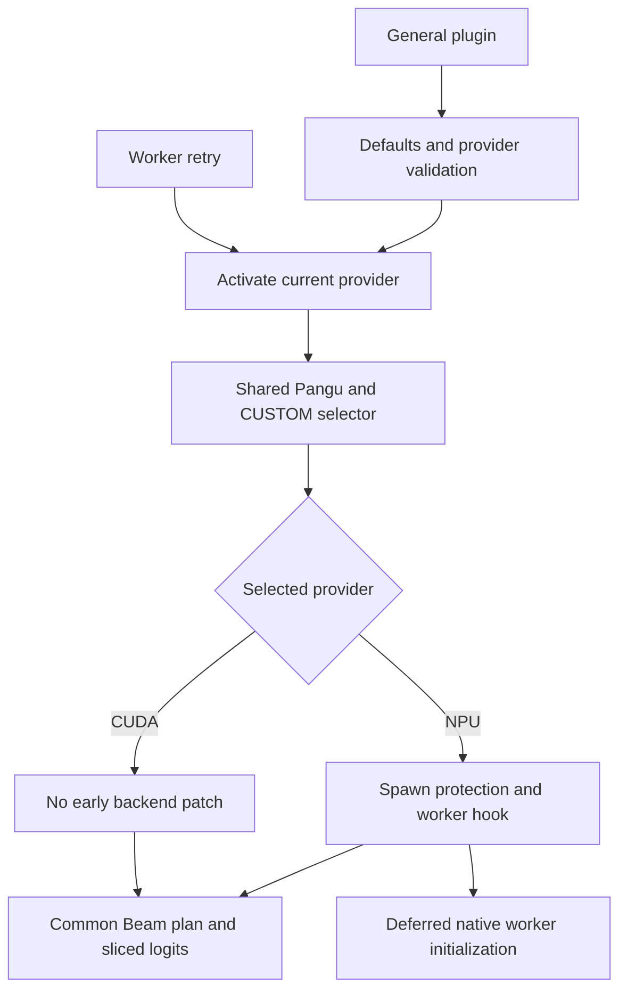

# vLLM-GR platform backend contract

## Scope

The platform backend boundary separates hardware-neutral vLLM-GR runtime
orchestration from CUDA- and NPU-specific implementations. A backend provider
binds an exact canonical vLLM `device_type` to ModelRunner patch hooks,
Beam Attention execution primitives, environment validation, and any
platform-specific compatibility patches.

Production startup already uses provider activation, environment validation,
runtime compatibility patches, and the constrained TopK execution factory.
The worker and attention dispatchers still select their implementations
directly; the two provider getters describe available modules but do not
replace those dispatchers.

## Lifecycle and process model

Backend registration and activation are process-local. Each vLLM main,
EngineCore, or Worker process owns an independent registry.

The general-plugin startup sequence is:

1. Configure the ModelRunner default before platform-dependent configuration.
2. `check_environment()` registers built-ins, loads external providers, activates
   the current vLLM `device_type`, and invokes the provider's environment check.
3. `re_apply_patches()` reuses that provider (or activates it in a fresh process).
4. Install the shared Pangu and CUSTOM attention selector compatibility hooks.
5. Invoke `provider.apply_runtime_patches(force=True)`. The NPU provider installs
   spawn protection, then the native worker hook and its early config filter.
6. Install the common frontend Beam plan and sliced-logits hooks.

The provider's environment method must call leaf validation functions, not the
shared `check_environment()` dispatcher, to avoid recursive activation.
Repeated initialization probes live targets and does not stack wrappers.
Provider patch failures retain their original exception, identify the backend,
and stop initialization with a partial-installation/restart diagnostic. This
stage does not implement rollback; a failed process must not continue serving.

EngineArgs still reasserts the Ascend EngineCore config sanitizer on every
`create_engine_config()` call. The sanitized child entry still initializes the
common EngineCore plan before native construction. The NPU worker hook still
retries runtime installation, installs KV/warmup/utility hooks, and delegates to
native `init_device()` before loading constraint tables. These earlier and
later boundaries are not moved into general-plugin initialization.
Every worker patch attempt revalidates the early config filter and its native
caller bindings before checking the device-wrapper marker. This repairs a
restored native config alias without wrapping `init_device()` again.



Provider resolution and activation must happen before any runtime patch that
needs platform-specific behavior. Activation does not itself run environment
checks or apply patches.

Only one backend may be active in a process. Re-activating the same provider
is idempotent; switching to another provider is an error. Backend aliases are
not resolved by the registry. In particular, `gpu` does not mean `cuda` and
`ascend` does not mean `npu`.

An unknown backend is always an error in the registry APIs and never falls
back to CUDA. This registry guarantee does not describe every independent
worker or attention dispatch branch.

## Provider contract

A provider exposes one canonical `device_type` and five methods:

```python
class GRBackendProvider(Protocol):
    device_type: str

    def check_environment(self) -> dict[str, str]: ...

    def apply_runtime_patches(
        self,
        *,
        force: bool = False,
    ) -> int: ...

    def get_model_runner_hooks(self) -> ModelRunnerPatchHooks: ...

    def get_attention_execution(self) -> BeamAttentionExecution: ...

    def create_constrained_topk_execution(
        self,
        *,
        device: str | torch.device | None = None,
    ) -> "ConstrainedTopKExecution | None": ...
```

Registration validates only `device_type` and the presence of the five
callable methods. It must not invoke the methods. This preserves lazy imports
and allows CUDA and NPU providers to coexist in the registry without loading
both hardware runtimes.

Provider objects are registered directly. Entry points must not expose a
provider class or an arbitrary factory.

## Lazy import boundary

Provider modules and their package initializers must not import `torch`,
`torch_npu`, `vllm`, `vllm_ascend`, ModelRunner implementation modules, Beam
Attention execution modules, or Ascend compatibility code at module import
time.

Hardware-dependent imports belong inside:

- `check_environment()`;
- `apply_runtime_patches()`;
- `get_model_runner_hooks()`;
- `get_attention_execution()`;
- `create_constrained_topk_execution()`.

Importing `vllm_gr.platforms` or registering the built-in providers therefore
has no hardware import side effects and does not mutate the registry unless
the registration function is explicitly called.

## ModelRunner patch hooks

V1 platform ModelRunner hook modules must provide:

```python
class ModelRunnerPatchHooks(Protocol):
    def discover_worker_runners(
        self,
    ) -> tuple[tuple[str, type], ...]: ...

    def make_patched_prepare_inputs(self, original): ...

```

Other factories are optional capabilities discovered by
`model_runner_patch.apply_worker_patches()`. In particular,
`make_patched_bookkeeping_sync(original)` is optional: CUDA retains the native
method and records its identity, while NPU installs its six-item bookkeeping
wrapper. A module without this factory still satisfies `ModelRunnerPatchHooks`.
Optional sample, sample-tokens, state-update, reload, and graph hooks remain
owned by the corresponding platform module.

`make_patched_execute_model()` is intentionally absent. It is shared GPU/NPU
logic owned by `model_runner_common.py` and remains part of the neutral patch
orchestrator.

The CUDA dispatcher selects MR V1 or MR V2 before installing their respective
hooks. The provider's V1 hook getter is not a replacement for this selection;
NPU continues to use its existing runner path.

## Beam Attention execution

Platform Attention execution provides:

- `is_available()`;
- `get_flash_attn_version()`;
- `supports_sinks()`;
- `reshape_and_cache()`;
- `cascade_attention()`.

The complete call signatures are defined by
`vllm_gr.platforms.protocol.BeamAttentionExecution`. The current
`beam_attn_gpu.py` and `beam_attn_npu.py` modules satisfy the contract directly;
providers return those modules rather than copying or wrapping their kernels.

Production attention dispatch also selects the NPU xllm or cascade execution
path. Returning the base `beam_attn_npu` module from a provider must not bypass
that selection. Getter unification is a separate migration.

Metadata construction, KV memory management, and the shared execute-model
wrapper are deliberately outside this contract until their owning migration
stages define stable boundaries.

## External provider entry points

External packages register provider objects in this entry-point group:

```toml
[project.entry-points."vllm_gr.platform_backends"]
npu = "vllm_gr_npu.provider:NPU_BACKEND"
```

The entry-point name must exactly equal `provider.device_type`. Providers are
loaded once per process. A provider cannot silently override a built-in or
another external provider; duplicate device types from different objects are
errors and diagnostics identify both registration sources.

Plugin discovery validates the complete batch before committing registrations,
so a failing entry point does not leave an earlier provider partially
registered.

## Current built-in mappings

| Provider method | CUDA mapping | NPU mapping |
| --- | --- | --- |
| `device_type` | `cuda` | `npu` |
| `check_environment()` | Validate current CUDA platform, then `check_runtime_versions()` | `check_ascend_environment(require_npu_platform=True)` |
| `apply_runtime_patches()` | No early compatibility hooks | NPU spawn protection, then NPUWorker initialization hook; return the summed patch count |
| `get_model_runner_hooks()` | `gpu_model_runner_patch` | `npu_model_runner_patch` |
| `get_attention_execution()` | `beam_attn_gpu` | `beam_attn_npu` |
| `create_constrained_topk_execution()` | Lazy-loads a fresh `CUDAConstrainedTopKExecution(device=device)` | Lazy-loads a fresh `NPUConstrainedTopKExecution(device=device)` |

The NPU provider is built in during the initial migration so the contract is
exercised against all current Ascend requirements. A later stage may move it
to a separately distributed package.

## Regression after removing the built-in NPU provider

When the built-in NPU provider is removed, regression coverage must install or
inject an external `npu` entry point and rerun the same contract tests:

1. Importing and registering core built-ins still loads no NPU modules.
2. The external `npu` provider resolves and activates for the canonical NPU
   platform.
3. Its environment check delegates to the complete Ascend validation.
4. The shared CUSTOM selector runs before its spawn/worker hooks and patch
   counts are summed. CUDA retains CUSTOM routing without importing Ascend.
5. Its getters lazily return the NPU ModelRunner and Attention execution
   modules.
6. An NPU process without the external package fails with an explicit
   unsupported-backend error and never falls back to CUDA.
