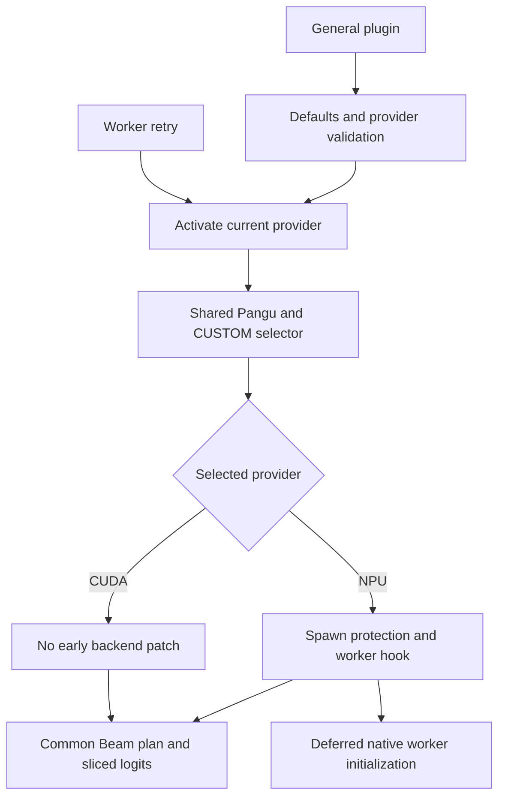

# vLLM-GR platform backend contract

## Scope

The platform backend boundary separates hardware-neutral vLLM-GR runtime
orchestration from CUDA- and NPU-specific implementations. A backend provider
binds declared provider metadata and an identity match against the native
platform vLLM already selected to ModelRunner patch hooks, Beam Attention
execution primitives, environment validation, and any platform-specific
compatibility patches.

Production startup already uses provider activation, environment validation,
runtime compatibility patches, and the constrained TopK execution factory.
GR EngineArgs also publishes an immutable backend plan. Model load binds its
services to the native runner, and EngineCore checks every worker's readiness
before its constructor returns. See [Engine plans](#engine-plans-and-service-binding).
The active provider supplies the process hooks for the native ModelRunner.
Planned runners dispatch through their own adapter. Each CUSTOM attention layer
retains its runner's bound attention executor for Prefill, Decode and KV writes.

## Lifecycle and process model

Backend registration and activation are process-local. Each vLLM main,
EngineCore, or Worker process owns an independent registry.

The general-plugin startup sequence is:

1. Configure the ModelRunner default before platform-dependent configuration.
2. `check_environment()` registers built-ins, loads external providers, selects
   the provider matching the current native platform identity, and invokes its
   environment check.
3. `re_apply_patches()` reuses that provider (or activates it in a fresh process).
4. Install the shared Pangu and CUSTOM attention selector compatibility hooks.
5. Invoke `provider.apply_runtime_patches(force=True)`. The NPU provider installs
   spawn protection, then the native worker hook and its early config filter.
6. Install the common frontend Beam plan and sliced-logits hooks.

The provider's environment method must call leaf validation functions, not the
shared `check_environment()` dispatcher, to avoid recursive activation.
Repeated initialization probes live targets and does not stack wrappers.
Provider patch failures retain their original exception, identify the backend,
and stop initialization with a partial-installation/restart diagnostic. This
stage does not implement rollback; a failed process must not continue serving.

EngineArgs still reasserts the Ascend EngineCore config sanitizer on every
`create_engine_config()` call. The sanitized child entry still initializes the
common EngineCore plan before native construction. The NPU worker hook still
retries runtime installation, installs KV/warmup/utility hooks, and delegates to
native `init_device()` before loading constraint tables. These earlier and
later boundaries are not moved into general-plugin initialization.
Every worker patch attempt revalidates the early config filter and its native
caller bindings before checking the device-wrapper marker. This repairs a
restored native config alias without wrapping `init_device()` again.



Provider resolution and activation must happen before any runtime patch that
needs platform-specific behavior. Activation does not itself run environment
checks or apply patches.

Only one backend may be active in a process. Re-activating the same provider
is idempotent; switching to another provider is an error. Backend IDs are not
aliased by the registry. In particular, `gpu` does not mean `cuda`, and the
built-in Ascend provider's ID is `ascend`, not the `npu` tensor device type.

An unsupported platform fails provider selection before worker hook discovery.

## Engine plans and service binding

`BackendRequest`, `BackendPlan`, and `PlanData` are import-light values in
`platforms/plan.py`. A request contains normalized GR settings, common native
configuration, compatibility versions, and backend-owned JSON options. Plans
encode their schema and planning API versions separately from the provider
identity API. SHA-256 covers the canonical JSON encoding, including the
provider/adapter versions and admitted choices. Device ordinals, native
objects, handles, and unordered containers are excluded. Nested inputs are
copied into immutable canonical data; decoded views cannot mutate the plan.

EngineArgs writes the envelope to
`additional_config["vllm_gr_backend_plan"]` after normalizing configuration.
The ordinary native configuration transport carries this JSON/pickle-safe
data to workers. The canonical GR parser preserves this key alongside the serialized GR settings. Backend
options use the separate `vllm_gr_backend_options` object. The provider validates
its own option schema. Built-ins currently retain their typed `GRConfig`
options and reject additional options; an external provider can add its own
option names and choice values without changing the core encoder.

Provider identity API version 2 remains compatible. Providers opt into the
planning extension by declaring `plan_api_version = 1` and an
`adapter_revision` compatibility string, then implementing:

```python
def resolve(request: BackendRequest) -> BackendPlan: ...
def validate_worker(*, plan: BackendPlan, native_runner): ...
def create_model_runner_adapter(*, plan: BackendPlan, native_runner): ...
def create_attention_executor(*, plan: BackendPlan, device): ...
def create_constrained_topk_execution(*, plan=None, device=None): ...
```

An optional `ConfigProvider.create_config_service()` supplies the host policy
used while EngineArgs builds the native configuration. Providers may subclass
`vllm_gr.platforms.config.BackendConfigService` to apply platform defaults,
validate GR settings, and finalize the native configuration. Explicit user
settings take precedence. Providers without the optional factory use shared
defaults. Registration validates the factory's zero-argument signature when
it is available.

`resolve()` uses only its request. Runtime and installed distribution metadata
are collected before calling it. Factories receive the same engine plan and
the actual owner/device explicitly. A provider never holds `current_plan` or
runner resources. Unknown declared planning versions and missing methods fail
registration. API-v1/v2 providers without this declaration use narrow legacy
delegation: existing getters and the device-only constraint factory are
preserved, extra backend options are rejected, and incidental methods never
count as planning capabilities.

A provider can attach `ServiceRequirements(stage=..., attention=..., graph=...,
constraint=...)` to a `BackendPlan`. Each supplied value pins the implementation
ID in the wire plan. Binding checks each required ID before publishing any
services. The engine checks the same IDs on every worker. A requirement for
a service the worker cannot bind prevents startup. The attention and constraint
compatibility factories and runner-owned stage binding are available. Graph
binding follows in #715. Original schema-1 plans omit the optional
`requirements` field and retain their fingerprints.

The built-in plan records CUDA V1/V2 or Ascend V1, Prefill/Decode policy,
constraint implementation, stage path, and graph/eager policy. Native defaults
and existing configuration validation remain authoritative during migration.
Ascend's unset Decode mode retains its capability-sensitive `auto` behavior;
readiness also compares the actual bound implementation so workers cannot
choose different modes silently. Each runner resolves its own Decode mode. Ascend Prefill always uses cascade,
including when Decode uses xllm. CUDA resolves `gr.dense_prefill` against the
engine's KV transfer, prefix caching, chunked Prefill and native batch invariance
settings. Workers reuse the admitted choice for both attention execution and
fresh-prompt replay on ModelRunner V1 and V2. CUDA supports an independent
Prefill FlashAttention version. The admitted KV layout and actual Decode
implementation travel with the owner.

The runner owns `BackendBinding`. Binding verifies the received plan against
local configuration and runtime versions, runs provider capability validation,
then constructs required services. After model load, the readiness RPC reports
the bound services and their admitted plan. Native KV-cache profiling can
adjust the maximum model length before this RPC. Partial construction releases services
already created. Reload/shutdown detach the binding, release owned services,
and clear the legacy execution alias. Stateless module bindings do not close
process-wide modules. Each runner owns its canonical constraint artifacts and
lends its versioned table to the binding for readiness and execution.

EngineCore calls `worker_backend_readiness` through the native executor and
requires its expected number of worker reports, an identical plan
fingerprint, and matching implementation identities. A failed or missing
report shuts down the executor and aborts startup. This gate runs before
request acceptance. With vLLM's external launcher, each executor owns one
worker. The engines gather those local reports using the native world
CPU group so every participating rank verifies the same result.

### Canonical constraint implementations

Set `gr.constraint_table.implementation_id` to select a registered implementation.
Payloads that only specify `gr.constraint_table.backend` retain the historical
`cpu`, `cuda`, or `npu` interpretation. An explicit ID takes precedence.
A provider can pin the selected ID with `ServiceRequirements(constraint=...)`.
Existing plans can carry the same ID in `choices.constraint_implementation`.
Frontend validation, worker loading, worker readiness and hot reload use that identity.

A provider registers its artifact implementation in every process where it is
used via `vllm_gr.constraints.registry.register_implementation`. Pass a
`ConstraintImplementation` with its stable ID, `legacy_enum=None`, an `admit`
callback and a `build` callback. Admission checks device placement, capacity,
and required operators before artifact I/O. The factory receives the admission
result, validated table, native device, dtype, row and Top-K bounds, and the
engine plan on `ConstraintTableRequest`. An implementation can define
`runner_load_options(runner, gr_config)` to return a mapping for its factory.
Initial load and hot reload both pass the mapping as `request.options`; on
reload, `gr_config.constraint_table` identifies the replacement artifact.
The factory returns a fresh backend reporting
the selected ID. An unknown ID, unavailable operator, or mismatched factory
result aborts startup before EngineCore accepts requests.

Persistent CUDA stages require the `DeviceStageConstraintBackend` contract.
The implementation validates its table device and writes candidates into
preallocated token, score, validity and count buffers. Ascend multi-trie
stages require `select_for_rows` for request-local root selection. The worker
verifies the capabilities its admitted stage will use before reporting ready.

The backend owns selection and any runner-specific model integration.
Implementations that support sliced logits opt in via `supports_vocab_slicing`.
Selection returns global token IDs, normalized scores and the validity mask
specified by `ConstraintOutput`. The runner prepares CUDA V2 variants before
publication, including replacements. A registered implementation that supports
worker-side online replacement sets `supports_hot_reload=True`. The EngineCore
management RPC checks this capability using the admitted ID. Hot reload uses the bound engine plan,
rejects a changed implementation, and retains old artifact versions for
in-flight requests. The versioned table releases these resources on expiry
or runner shutdown.

Host-only contract coverage can run without Torch or vLLM:

```bash
python -m pytest --confcutdir=tests/platforms -q \
  tests/platforms/test_backend_plan.py \
  tests/platforms/test_external_provider_fixture.py::test_installed_provider_plan_round_trip_and_factory_binding
```

`tests/engine/test_backend_plan_engine_args.py` additionally covers the real EngineArgs
wrapper under the normal Torch/vLLM test fixtures. CUDA V1/V2 and Ascend startup,
graph replay, inference accuracy, and performance still require device runs.

## Platform identity and deterministic selection

A backend ID is a stable GR implementation identity, not tensor placement.
NVIDIA CUDA and AMD ROCm both report `device_type == "cuda"`, so selection
cannot key on it.

`vllm_gr.platforms.identity` is the only bridge from the native platform to GR.
It builds an immutable `PlatformIdentity` from the live `current_platform`
instance: the upstream platform enum name, the tensor `device_type`, the
`device_name`, and the qualified class name plus full MRO lineage. Reading it
imports no vendor runtime and instantiates nothing, so the packaging and import
isolation guarantees still hold. Native vLLM remains the only hardware
selection authority, and no availability probe is made here.

Selection follows these rules:

1. Register built-ins that are not explicitly disabled, then discover external
   entry points. Validate the complete batch before committing.
2. Reject a duplicate backend ID from a different provider, reporting both
   origins, before any match is evaluated.
3. Call `provider.matches(identity)` for every registered provider.
4. With an explicit `VLLM_GR_BACKEND`, that ID must exist and match the selected
   platform. An explicit request can resolve ambiguity but cannot suppress a
   duplicate-ID error or make an incompatible platform match.
5. Without an explicit request, exactly one provider must match. Zero matches is
   `UnsupportedBackendError`; several is `AmbiguousBackendError`. Discovery order
   and priority scores are never used as tie-breakers.

Core holds no hardware identity allowlist. `matches()` is the only place a
platform identity is accepted or rejected, so adding a backend never edits a
table under `platforms/`.

## Provider contract

A provider exposes declared metadata, an identity match, and five operations:

```python
class GRBackendProvider(Protocol):
    backend_id: str
    device_type: str            # placement, for diagnostics only
    api_version: int            # currently 2
    gr_version_range: str | None
    vllm_version_range: str | None
    vendor_version_range: str | None
    vendor_distribution: str | None

    def matches(self, identity: PlatformIdentity) -> bool: ...

    def check_environment(self) -> dict[str, str]: ...

    def apply_runtime_patches(
        self,
        *,
        force: bool = False,
    ) -> int: ...

    def get_model_runner_hooks(self) -> ModelRunnerInstaller | ModelRunnerPatchHooks: ...

    def get_attention_execution(self) -> BeamAttentionExecution: ...

    def create_constrained_topk_execution(
        self,
        *,
        device: str | torch.device | None = None,
    ) -> "ConstrainedTopKExecution | None": ...
```

Registration validates `backend_id`, the declared `api_version`, and the
presence of `matches` and the five callable operations. It never invokes them.
This preserves lazy imports and keeps CUDA and Ascend providers registered in
one process without loading either hardware runtime.

The built-in mappings are `backend_id="cuda"` for the native CUDA platform and
`backend_id="ascend"` for the supported Ascend platform. The Ascend provider
matches the vendor class lineage (`vllm_ascend.platform.NPUPlatform`) as well as
`device_type == "npu"`, because the vendor platform's upstream enum is `OOT`,
which another out-of-tree platform could also report.

Provider objects are registered directly. Entry points must not expose a
provider class or an arbitrary factory.

## Lazy import boundary

Provider modules and their package initializers must not import `torch`,
`torch_npu`, `vllm`, `vllm_ascend`, ModelRunner implementation modules, Beam
Attention execution modules, or Ascend compatibility code at module import
time.

Hardware-dependent imports belong inside:

- `check_environment()`;
- `apply_runtime_patches()`;
- `get_model_runner_hooks()`;
- `get_attention_execution()`;
- `create_constrained_topk_execution()`.

Importing `vllm_gr.platforms` or registering the built-in providers therefore
has no hardware import side effects and does not mutate the registry unless
the registration function is explicitly called.

## ModelRunner patch hooks

The public contract lives in `vllm_gr/platforms/interface.py`. Existing providers
can still import the original types from `platforms/protocol.py`.
The worker installer and its startup verifier use the selected provider's
`get_model_runner_hooks()`. An out-of-tree provider may return a module or
object implementing the following interface.

```python
class ModelRunnerInstaller(Protocol):
    def discover_worker_runners(self) -> tuple[tuple[str, type], ...]: ...
    def install(self) -> None: ...
    def is_patched(self, runner_class: type) -> bool: ...
```

`install()` runs at process startup and must tolerate repeated calls.
`is_patched()` inspects the live native class. A missing target or incomplete
installation fails the startup check. Implementations that use the existing
V1 wrapper factories can keep their original hook contract.

CUDA installs its process hook on `Worker.init_device`. At worker startup vLLM
has resolved `use_v2_model_runner`, including overrides such as watermarking.
Before the worker creates its runner, the hook checks that choice against the
admitted plan, installs the selected class's wrappers, and verifies them.
Workers in one process can use different generations.

```python
class ModelRunnerPatchHooks(Protocol):
    def discover_worker_runners(
        self,
    ) -> tuple[tuple[str, type], ...]: ...

    def make_patched_prepare_inputs(self, original): ...

```

Other factories are optional capabilities discovered by
`model_runner_patch.apply_worker_patches()`. CUDA and NPU retain native sampling
and bookkeeping for ordinary inference. V1 stage runners own Beam decisions
and terminal results. Optional sample-tokens, state-update, reload, and graph hooks remain
owned by the corresponding platform module.

`make_patched_execute_model()` is intentionally absent. It is shared GPU/NPU
V1 adaptation owned by `model_runner_common.py`, imported only after V1
selection. V2 owns its execute wrapper in `cuda/v2/gpu_model_runner_v2_patch.py`; both
use shared dispatch in `gr_execution.py`. Installation markers/checks live in
the hardware-free `model_runner_contracts.py` rather than in V1 adaptation.

The CUDA provider chooses the V1 or V2 hook module at patch installation.
The Ascend provider supplies its V1 hooks and preserves deferred worker
initialization. Built-in adapters bind the installed prepare, execute and
sample entry points to one native runner after model load. The installed
entry points use that runner's binding, preserving the native return object
and the separate sampling/completion boundary. Calls during bootstrap or
on unplanned runners use the installed native path directly. Shutdown and a
full model reload release the binding through the owning runner.

An external provider using `install_runner_lifecycle()` supplies a plan-bound
adapter with `prepare_inputs` and `execute_model`, plus `sample_tokens` when
its native runner exposes that entry point. Each method receives the arguments
of its corresponding native call. The factory receives the runner instance
once during binding. The installed-provider regression in
`tests/platforms/test_external_provider_fixture.py` exercises discovery,
installation, worker readiness and dispatch for two different engine plans.

## Beam Attention execution

Platform Attention execution provides:

- `is_available()`;
- `get_flash_attn_version()`;
- `supports_sinks()`;
- `reshape_and_cache()`;
- `cascade_attention()`.

The complete call signatures are defined by
`vllm_gr.platforms.interface.BeamAttentionExecution`. The current
`beam_attn_gpu.py` and `beam_attn_npu.py` modules satisfy the contract directly;
providers return those modules rather than copying or wrapping their kernels.

Production attention dispatch also selects the NPU xllm or cascade execution
path. Returning the base `beam_attn_npu` module from a provider must not bypass
that selection. Getter unification is a separate migration.

Metadata construction, KV memory management, and the shared execute-model
wrapper are deliberately outside this contract until their owning migration
stages define stable boundaries.

## External provider entry points

External packages register provider objects in this entry-point group:

```toml
[project.entry-points."vllm_gr.platform_backends"]
ascend = "vllm_gr_npu.provider:NPU_BACKEND"
```

The API-v2 entry-point name must exactly equal `provider.backend_id`. Providers are
loaded once per process. A provider cannot silently override a built-in or
another external provider; duplicate IDs from different objects are errors, and
diagnostics identify both registration sources plus the installed distribution
and version when entry-point metadata provides them.

`VLLM_GR_DISABLE_BUILTIN_BACKENDS` is a comma-separated list of backend IDs. It
is read before built-in registration, so an external distribution can replace a
built-in with no code change. The switch must be set consistently in every
participating process. It removes one built-in; it never suppresses the
duplicate-ID check.

## Provider API versions

An entry point either declares `api_version` explicitly or is adapted through
the deprecated version-1 path, which is selected by `getattr(provider,
"api_version", 1)` and never by duck typing.

- A version-1 object is wrapped in `LegacyProviderAdapter` and is recognized only
  for the two identities that shipped unversioned: `cuda` maps to the CUDA
  provider ID and `npu` to `ascend`. The installed entry point retains its
  original device-type name. The CUDA adapter requires the native CUDA enum
  and CUDA placement. The adapter emits a deprecation warning naming its source.
- A version-1 object is never upgraded in place, and its optional attributes are
  never read as evidence of version-2 capability. Every declared range of the
  adapter is `None`.
- A version-1 object for any other device placement is rejected and must
  declare `api_version=2`, `backend_id` and `matches(identity)`.
- An unknown `api_version` is rejected with `InvalidBackendVersionError`.

Declared ranges are checked against installed distribution metadata before
activation. An unsatisfied range is advisory by default and logged with the
provider identity; setting `VLLM_GR_STRICT_PROVIDER_RANGES=1` makes it a startup
failure. An invalid version specifier or missing required declaration fails
registration. A missing installed vendor distribution follows the same
warning or strict-failure policy as a version mismatch.

Plugin discovery validates the complete batch before committing registrations,
so a failing entry point does not leave an earlier provider partially
registered.

## Current built-in mappings

| Provider method | CUDA mapping | Ascend mapping |
| --- | --- | --- | --- |
| `backend_id` | `cuda` | `ascend` |
| `device_type` | `cuda` | `npu` |
| `matches()` | `platform_enum == "CUDA"` and `device_type == "cuda"` | `device_type == "npu"` and `vllm_ascend.platform.NPUPlatform` in the lineage |
| `check_environment()` | Validate current CUDA platform, then `check_runtime_versions()` | `check_ascend_environment(require_npu_platform=True)` |
| `apply_runtime_patches()` | No early compatibility hooks | NPU spawn protection, then NPUWorker initialization hook; return the summed patch count |
| `get_model_runner_hooks()` | `cuda/v1/gpu_model_runner_patch` or `cuda/v2/gpu_model_runner_v2_patch` | `npu/npu_model_runner_patch` |
| `get_attention_execution()` | `beam_attn_gpu` | `beam_attn_npu` |
| `create_constrained_topk_execution()` | Lazy-loads a fresh `CUDAConstrainedTopKExecution(device=device)` | Lazy-loads a fresh `NPUConstrainedTopKExecution(device=device)` |

The Ascend provider is built in during the initial migration so the contract is
exercised against all current Ascend requirements. A later stage may move it to
a separately distributed package, and `VLLM_GR_DISABLE_BUILTIN_BACKENDS` is what
makes that extraction possible without a code change.

## Regression after removing the built-in NPU provider

When the built-in NPU provider is removed, regression coverage must install or
inject an external `ascend` entry point and rerun the same contract tests:

1. Importing and registering core built-ins still loads no NPU modules.
2. The external `ascend` provider resolves and activates for the supported
   Ascend platform identity.
3. Its environment check delegates to the complete Ascend validation.
4. The shared CUSTOM selector runs before its spawn/worker hooks and patch
   counts are summed. CUDA retains CUSTOM routing without importing Ascend.
5. Its getters lazily return the NPU ModelRunner and Attention execution
   modules.
6. An NPU process without the external package fails with an explicit
   unsupported-backend error and never falls back to CUDA.

### Stage execution and Beam operators

A provider can pin a `RunnerStage` with `ServiceRequirements(stage=...)`. It
implements execution and retirement. Beam V1 additionally requires a
`StageExecution` with a worker decision policy, startup capture and decision
operators. Original schema-1 plans can declare `stage` and `operator_policy`
in their choices. The per-runner adapter owns the physical stage service.
The worker validates this service at bind time and
reports both the stage identity and the chosen operator implementation. Every
worker serving the same engine must agree on those identities.

The service receives the worker's copy of the scheduled frame for execution and
retirement. The native stage owner still owns its leases, cancellation state,
sampling receipts and retirement acknowledgments. A failed execute retains the
original exception for its associated sample. A service with extra resources
can implement `close()` to release them when its runner adapter closes.

For a Beam retirement frame the worker returns a native `ModelRunnerOutput`
or an asynchronous output whose `get_output()` yields it. After releasing the
physical resources, set `gr_retire_result` on that output to a `GRRetireResult`
with the frame's session ID, owner generation, retire ID and `released=True`.
The scheduler waits for outstanding dispatches to drain, checks the receipt
and publishes the buffered terminal result once.

The service supplies the group and final selection operators, their supported
geometry, KV reorder and optional fallback. Shared decision code owns score
accumulation, global token IDs, parent offsets and sequence history. CUDA binds
the operators for its V1 or V2 runner. Ascend reports the available xllm
kernels or its reference implementation. Fixed-width Ascend
multi-step Decode uses the native decision operators. EngineCore checks their
agreed availability when it admits a request's width schedule, before reserving
session or KV state. Prefill-only requests and requests handled by the dynamic
decision path can run without these operators. Configurations without
an admitted plan retain a runner-local service from the installed native class.

### CUSTOM attention binding

During native model load, a construction scope provides the owning runner to
attention layers. The first layer requests the executor for the admitted plan
and worker device. Subsequent layers share it, and successful startup transfers
that same executor to the runner binding. On failure the construction scope
releases provisional resources. Forward and cache writes use the layer's saved
executor. Metadata builders select the same owner through their native layer
names and use its physical packing profile. Native attention retains its own
selection and execution when GR does not request CUSTOM.

At worker startup the concrete layer implementation may check its runner's
executor with `validate_gr_attention_executor(executor, plan)`. The built-in
Beam implementation checks its execution primitives and the selected Prefill
graph path. Incremental Beam Decode also requires a suffix writer. The default
writer calls `cache_unshared_kv` on the primitive module. A provider that
implements `write_suffix_kv` directly owns that operation. Self-contained
native implementations retain their own backend validation.

An external planning provider can implement `attention_admission(plan=...)`
for stateless early selector queries. Its admission policy may implement
`get_attn_backend_cls(attn_selector_config=..., num_heads=...)` and return a
concrete vLLM `AttentionBackend` class or its qualified import path. That class
supplies the implementation and metadata builder. The default is
`BeamAttentionBackend`. Both explicit and marker-restored CUSTOM validate the
selected class against the normalized geometry before creating a layer.
Implement `create_attention_executor(plan=..., device=...)` for execution.
Primitive-only providers retain the original getter
for cold capability queries. A backend can subclass
`vllm_gr.platforms.attention.AttentionExecutor` and override its Prefill and
Decode modules, supported combinations, KV layout/views, cache writes, reorder,
and metadata profile. Invalidation releases cached geometry before recapture.
Closing a runner releases only that runner's resources.

Ascend 0.30.0rc2 probes the native attention backend before loading layers with
a zero head size and unspecified KV dtype. For that runner probe the Ascend
policy supplies the configured model head size and validates the complete
selector request. Layer construction always validates the layer's own geometry.

### Graph execution

A provider that declares `ServiceRequirements.graph` in its plan supplies
`create_graph_executor(plan=..., runner=...)`. Each worker reports the bound
implementation alongside its plan fingerprint. The runner owns the service
until the next full model load or shutdown. The engine captures the Prefill
switch, bucket grid, request counts and KV bound when it admits the plan.
Eager mode disables both Prefill and Decode capture. The GR Decode switch
can be disabled independently of Prefill.

Providers select how to run Prefill capture in the plan's `choices.prefill_graph`.

- `"shared"` selects GR's `BeamPrefillGraphRunner(model_runner, buckets=...)`
  factory. The graph implements `SharedPrefillGraphExecutor.prefill_runner_class()`.
  Each worker resolves the concrete class before reporting readiness. GR constructs
  it with `model_runner`, `buckets` and any caller-supplied keyword arguments.
- `"provider"` delegates capture to the provider's own runner. Its graph service
  can record the native Prefill operations through `capture` and `replay`.

Existing boolean choices retain their enabled/disabled behavior and fingerprints.
The built-in V1 runners provide their native classes through the shared factory.
Beam Decode startup uses the selected graph's Decode policy and calls
`RunnerStage.capture_startup_graph` for the physical operation.

The built-in services keep the native vLLM CUDA and Ascend graph runners.
Their capture and replay paths check the admitted policy and maintain
per-runner counters. `get_gr_beam_graph_runtime_stats` exposes them under
`graph_service`, grouped by Prefill and Decode. Successful physical captures
and replays are counted after the native operation returns. Native V2
PIECEWISE dispatch counts remain separate because compiled pieces can take
their own eager paths. A recoverable shape or capture miss preserves native
fallback and records its reason. Unexpected native errors propagate.

The CUDA and Ascend graph services own their native cleanup and diagnostic
fields. A provider can include a `runtime_fields` dictionary in its
`graph.stats()` result. The worker RPC publishes these fields at the top
level alongside the shared counters and returns the complete provider report
under `graph_service`. This lets an external provider report native capture
shapes or fallback counters without extending the shared worker RPC.

Graph teardown first checks for live Beam sessions, workspace owners and
outstanding outputs. After the caller drains them, teardown invalidates this
runner's captures and drops static buffers. Reload builds fresh bindings.
Weight-only updates continue through their existing native lifecycle.
