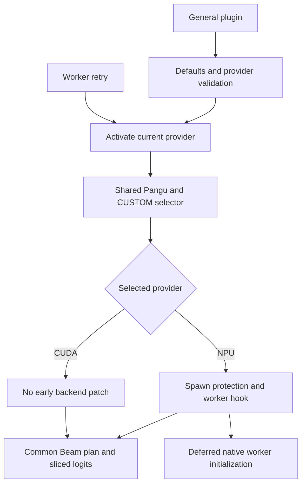

# vLLM-GR platform backend contract

## Scope

The platform backend boundary separates hardware-neutral vLLM-GR runtime
orchestration from CUDA- and NPU-specific implementations. A backend provider
binds declared provider metadata and an identity match against the native
platform vLLM already selected to ModelRunner patch hooks, Beam Attention
execution primitives, environment validation, and any platform-specific
compatibility patches.

Production startup already uses provider activation, environment validation,
runtime compatibility patches, stage execution, and the constrained TopK
execution factory. Shared stage dispatch, startup graph capture, and ModelRunner
patch selection no longer compare a device name: each asks the selected provider
for its bound execution service or its declared patch module.

## Stage execution services

`vllm_gr.platforms.services.StageExecutionService` is the contract shared stage
code calls. A provider returns its service from
`create_stage_execution_service()`, and the service answers the questions that
would otherwise be device-name branches:

| Service method | Question it answers |
| --- | --- |
| `execute(worker, scheduled, original, ...)` | Which executor runs this GR stage, and how does a failure reach sampling |
| `retire(worker, scheduled)` | Which owner releases a drained stage |
| `capture_startup_graph(worker, ...)` | Whether this backend captures a startup graph, and what a skip or failure means |
| `admit_unconstrained_beam(worker)` | Whether this backend serves an unconstrained session |

`vllm_gr/v1/worker/gr_execution.py` and `gr_startup.py` call the service returned
by `activate_current_backend().create_stage_execution_service()`; neither file
inspects `worker.device`. A backend whose service raises fails with its own
diagnostic instead of a shared "no adapter for this device" message.

`capture_startup_graph` returns `True` for a completed capture, `False` when
capture does not apply to the runner, and raises when an attempted capture
failed. Callers record the failure on the worker exactly as before.

Services import their hardware modules inside method bodies, so building one
keeps the import-isolation guarantee described below.

## Runner patch module selection

`select_runner_patch_module_name(prefer_v2=...)` returns the module that owns a
backend's ModelRunner patches, and `supports_v2_model_runner()` declares whether
that backend has a V2 implementation at all. `model_runner_patch` consults both,
so the V2 opt-in is never paired with a device name and a backend without a V2
runner cannot be rerouted to another backend's module.

## Lifecycle and process model

Backend registration and activation are process-local. Each vLLM main,
EngineCore, or Worker process owns an independent registry.

The general-plugin startup sequence is:

1. Configure the ModelRunner default before platform-dependent configuration.
2. `check_environment()` registers built-ins, loads external providers, selects
   the provider matching the current native platform identity, and invokes its
   environment check.
3. `re_apply_patches()` reuses that provider (or activates it in a fresh process).
4. Install the shared Pangu and CUSTOM attention selector compatibility hooks.
5. Invoke `provider.apply_runtime_patches(force=True)`. The NPU provider installs
   spawn protection, then the native worker hook and its early config filter.
6. Install the common frontend Beam plan and sliced-logits hooks.

The provider's environment method must call leaf validation functions, not the
shared `check_environment()` dispatcher, to avoid recursive activation.
Repeated initialization probes live targets and does not stack wrappers.
Provider patch failures retain their original exception, identify the backend,
and stop initialization with a partial-installation/restart diagnostic. This
stage does not implement rollback; a failed process must not continue serving.

EngineArgs still reasserts the Ascend EngineCore config sanitizer on every
`create_engine_config()` call. The sanitized child entry still initializes the
common EngineCore plan before native construction. The NPU worker hook still
retries runtime installation, installs KV/warmup/utility hooks, and delegates to
native `init_device()` before loading constraint tables. These earlier and
later boundaries are not moved into general-plugin initialization.
Every worker patch attempt revalidates the early config filter and its native
caller bindings before checking the device-wrapper marker. This repairs a
restored native config alias without wrapping `init_device()` again.



Provider resolution and activation must happen before any runtime patch that
needs platform-specific behavior. Activation does not itself run environment
checks or apply patches.

Only one backend may be active in a process. Re-activating the same provider
is idempotent; switching to another provider is an error. Backend IDs are not
aliased by the registry. In particular, `gpu` does not mean `cuda`, and the
built-in Ascend provider's ID is `ascend`, not the `npu` tensor device type.

An unknown backend is always an error in the registry APIs and never falls
back to CUDA. This registry guarantee does not describe every independent
worker or attention dispatch branch.

## Platform identity and deterministic selection

A backend ID is a stable GR implementation identity, not tensor placement.
NVIDIA CUDA and AMD ROCm both report `device_type == "cuda"`, so selection
cannot key on it.

`vllm_gr.platforms.identity` is the only bridge from the native platform to GR.
It builds an immutable `PlatformIdentity` from the live `current_platform`
instance: the upstream platform enum name, the tensor `device_type`, the
`device_name`, and the qualified class name plus full MRO lineage. Reading it
imports no vendor runtime and instantiates nothing, so the packaging and import
isolation guarantees still hold. Native vLLM remains the only hardware
selection authority, and no availability probe is made here.

Selection follows these rules:

1. Register built-ins that are not explicitly disabled, then discover external
   entry points. Validate the complete batch before committing.
2. Reject a duplicate backend ID from a different provider, reporting both
   origins, before any match is evaluated.
3. Call `provider.matches(identity)` for every registered provider.
4. With an explicit `VLLM_GR_BACKEND`, that ID must exist and match the selected
   platform. An explicit request can resolve ambiguity but cannot suppress a
   duplicate-ID error or make an incompatible platform match.
5. Without an explicit request, exactly one provider must match. Zero matches is
   `UnsupportedBackendError`; several is `AmbiguousBackendError`. Discovery order
   and priority scores are never used as tie-breakers.

Core holds no hardware identity allowlist. `matches()` is the only place a
platform identity is accepted or rejected, so adding a backend never edits a
table under `platforms/`.

## Provider contract

A provider exposes declared metadata, an identity match, and five operations:

```python
class GRBackendProvider(Protocol):
    backend_id: str
    device_type: str            # placement, for diagnostics only
    api_version: int            # currently 2
    gr_version_range: str | None
    vllm_version_range: str | None
    vendor_version_range: str | None
    vendor_distribution: str | None

    def matches(self, identity: PlatformIdentity) -> bool: ...

    def check_environment(self) -> dict[str, str]: ...

    def apply_runtime_patches(
        self,
        *,
        force: bool = False,
    ) -> int: ...

    def get_model_runner_hooks(self) -> ModelRunnerPatchHooks: ...

    def get_attention_execution(self) -> BeamAttentionExecution: ...

    def create_constrained_topk_execution(
        self,
        *,
        device: str | torch.device | None = None,
    ) -> "ConstrainedTopKExecution | None": ...
```

Registration validates `backend_id`, the declared `api_version`, and the
presence of `matches` and the five callable operations. It never invokes them.
This preserves lazy imports and keeps CUDA and Ascend providers registered in
one process without loading either hardware runtime.

The built-in mappings are `backend_id="cuda"` for the native CUDA platform and
`backend_id="ascend"` for the supported Ascend platform. The Ascend provider
matches the vendor class lineage (`vllm_ascend.platform.NPUPlatform`) as well as
`device_type == "npu"`, because the vendor platform's upstream enum is `OOT`,
which another out-of-tree platform could also report.

Provider objects are registered directly. Entry points must not expose a
provider class or an arbitrary factory.

## Lazy import boundary

Provider modules and their package initializers must not import `torch`,
`torch_npu`, `vllm`, `vllm_ascend`, ModelRunner implementation modules, Beam
Attention execution modules, or Ascend compatibility code at module import
time.

Hardware-dependent imports belong inside:

- `check_environment()`;
- `apply_runtime_patches()`;
- `get_model_runner_hooks()`;
- `get_attention_execution()`;
- `create_constrained_topk_execution()`.

Importing `vllm_gr.platforms` or registering the built-in providers therefore
has no hardware import side effects and does not mutate the registry unless
the registration function is explicitly called.

## ModelRunner patch hooks

V1 platform ModelRunner hook modules must provide:

```python
class ModelRunnerPatchHooks(Protocol):
    def discover_worker_runners(
        self,
    ) -> tuple[tuple[str, type], ...]: ...

    def make_patched_prepare_inputs(self, original): ...

```

Other factories are optional capabilities discovered by
`model_runner_patch.apply_worker_patches()`. In particular,
`make_patched_bookkeeping_sync(original)` is optional: CUDA retains the native
method and records its identity, while NPU installs its six-item bookkeeping
wrapper. A module without this factory still satisfies `ModelRunnerPatchHooks`.
Optional sample, sample-tokens, state-update, reload, and graph hooks remain
owned by the corresponding platform module.

`make_patched_execute_model()` is intentionally absent. It is shared GPU/NPU
logic owned by `model_runner_common.py` and remains part of the neutral patch
orchestrator.

The CUDA dispatcher selects MR V1 or MR V2 before installing their respective
hooks. The provider's V1 hook getter is not a replacement for this selection;
NPU continues to use its existing runner path.

## Beam Attention execution

Platform Attention execution provides:

- `is_available()`;
- `get_flash_attn_version()`;
- `supports_sinks()`;
- `reshape_and_cache()`;
- `cascade_attention()`.

The complete call signatures are defined by
`vllm_gr.platforms.protocol.BeamAttentionExecution`. The current
`beam_attn_gpu.py` and `beam_attn_npu.py` modules satisfy the contract directly;
providers return those modules rather than copying or wrapping their kernels.

Production attention dispatch goes through `BeamAttentionService` rather than
these module primitives. The service selects the Ascend xllm or cascade decode
path, resolves Prefill separately from Decode, and answers configuration
admissibility. `get_attention_execution()` remains the primitive surface; adding
a backend means implementing the service, not editing a device branch in
`beam_attn.py`.

`beam_attn.py` carries no device constants and no process-global decode-mode
cache. A backend that cannot serve a feature rejects the configuration itself,
before shared code stores any per-instance state.

Metadata construction, KV memory management, and the shared execute-model
wrapper are deliberately outside this contract until their owning migration
stages define stable boundaries.

## Constraint Table admission

Constraint Tables are not a separate provider surface. The selected provider
answers the two questions that would otherwise be a backend-name allowlist:

| Call | Question it answers |
| --- | --- |
| `create_config_service().supports_constraint_vocab_slicing()` | Whether this backend's table ABI accepts a sliced logits window |
| `create_constrained_topk_execution(device=...)` | Which operator executes constrained selection, or `None` when this backend has none |

`vllm_gr/constraints/startup.py` asks the first through the provider's
configuration service, so a backend ID this module has never seen is admitted on
its own answer. An absent policy fails closed: missing configuration service
data is not permission to slice. The second is a hard requirement — a provider
that returns `None`, or an adapter whose `is_available()` is `False`, aborts
startup rather than degrading to Trie.

The per-adapter table classes, artifact identity and payload compatibility stay
in `vllm_gr/constraints/` and remain backend-owned; the provider selects which
implementation runs, it does not define the canonical selection semantics.

## External provider entry points

External packages register provider objects in this entry-point group:

```toml
[project.entry-points."vllm_gr.platform_backends"]
npu = "vllm_gr_npu.provider:NPU_BACKEND"
```

The entry-point name must exactly equal `provider.backend_id`. Providers are
loaded once per process. A provider cannot silently override a built-in or
another external provider; duplicate IDs from different objects are errors, and
diagnostics identify both registration sources plus the installed distribution
and version when entry-point metadata provides them.

`VLLM_GR_DISABLE_BUILTIN_BACKENDS` is a comma-separated list of backend IDs. It
is read before built-in registration, so an external distribution can replace a
built-in with no code change. The switch must be set consistently in every
participating process. It removes one built-in; it never suppresses the
duplicate-ID check.

## Provider API versions

An entry point either declares `api_version` explicitly or is adapted through
the deprecated version-1 path, which is selected by `getattr(provider,
"api_version", 1)` and never by duck typing.

- A version-1 object is wrapped in `LegacyProviderAdapter` and is recognized only
  for the two identities that shipped unversioned: `cuda` maps to the CUDA
  provider ID and `npu` to `ascend`, still requiring an exact device-placement
  match. It emits a deprecation warning naming the source, and a warning when it
  matches ROCm through the legacy `cuda` alias.
- A version-1 object is never upgraded in place, and its optional attributes are
  never read as evidence of version-2 capability. Every declared range of the
  adapter is `None`.
- A version-1 object for any other device placement is rejected and must
  declare `api_version=2`, `backend_id` and `matches(identity)`.
- An unknown `api_version` is rejected with `InvalidBackendVersionError`.

Declared ranges are checked against installed distribution metadata before
activation. An unsatisfied range is advisory by default and logged with the
provider identity; setting `VLLM_GR_STRICT_PROVIDER_RANGES=1` makes it a startup
failure. A range that cannot be parsed, or a declared vendor distribution that
is not installed, is reported the same way.

Plugin discovery validates the complete batch before committing registrations,
so a failing entry point does not leave an earlier provider partially
registered.

## Current built-in mappings

| Provider method | CUDA mapping | Ascend mapping |
| --- | --- | --- | --- |
| `backend_id` | `cuda` | `ascend` |
| `device_type` | `cuda` | `npu` |
| `matches()` | `platform_enum == "CUDA"` and `device_type == "cuda"` | `device_type == "npu"` and `vllm_ascend.platform.NPUPlatform` in the lineage |
| `check_environment()` | Validate current CUDA platform, then `check_runtime_versions()` | `check_ascend_environment(require_npu_platform=True)` |
| `apply_runtime_patches()` | No early compatibility hooks | NPU spawn protection, then NPUWorker initialization hook; return the summed patch count |
| `get_model_runner_hooks()` | `gpu_model_runner_patch` | `npu_model_runner_patch` |
| `get_attention_execution()` | `beam_attn_gpu` | `beam_attn_npu` |
| `create_constrained_topk_execution()` | Lazy-loads a fresh `CUDAConstrainedTopKExecution(device=device)` | Lazy-loads a fresh `NPUConstrainedTopKExecution(device=device)` |

The Ascend provider is built in during the initial migration so the contract is
exercised against all current Ascend requirements. A later stage may move it to
a separately distributed package, and `VLLM_GR_DISABLE_BUILTIN_BACKENDS` is what
makes that extraction possible without a code change.

## Regression after removing the built-in NPU provider

When the built-in NPU provider is removed, regression coverage must install or
inject an external `ascend` entry point and rerun the same contract tests:

1. Importing and registering core built-ins still loads no NPU modules.
2. The external `ascend` provider resolves and activates for the supported
   Ascend platform identity.
3. Its environment check delegates to the complete Ascend validation.
4. The shared CUSTOM selector runs before its spawn/worker hooks and patch
   counts are summed. CUDA retains CUSTOM routing without importing Ascend.
5. Its getters lazily return the NPU ModelRunner and Attention execution
   modules.
6. An NPU process without the external package fails with an explicit
   unsupported-backend error and never falls back to CUDA.
