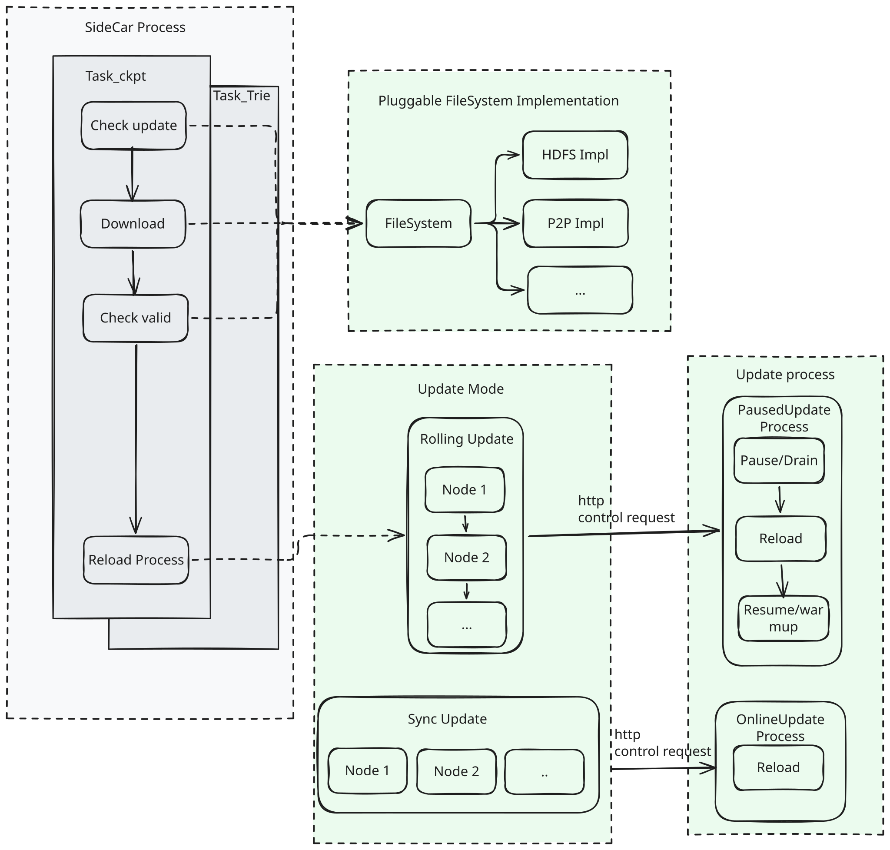

# Model and Trie update sidecar design

[Chinese version](weight_update_sidecar_design.zh-CN.md)

## Purpose and scope

A sidecar manages resource updates for the GR service instances in one Pod.
Checkpoint updates change model weights only; Trie updates change constraint
contents only. Model architecture, tokenizer, resource formats, and serving
configuration remain unchanged.

This document describes the architecture and how to configure and start the
implemented checkpoint/Trie update flow. Test cases and validation results are
maintained in [Hot-update tests](hot_update_tests.md).

## Architecture



One Sidecar Process owns multiple Tasks. Each Task independently discovers,
downloads, and validates a resource version, then applies it to its target service
instances. The diagram shows a checkpoint Task and a Trie Task.

`Node` means one GR service instance, not a physical host. A Pod commonly has
eight single-GPU instances, but the target instance count is configurable. An
instance can own multiple workers; its resource update must cover every worker.

## Core abstractions

| Abstraction | Responsibility |
| --- | --- |
| **Sidecar** | Run and monitor Tasks, and coordinate updates that target the same instances. |
| **Task** | Own one resource's source, polling interval, local cache, checker, target instances, Update Mode, and Update Process. |
| **FileSystem** | Discover published versions and download a selected version; hide storage-specific behavior. |
| **Update Mode** | Decide how updates are scheduled across the target instances. |
| **Update Process** | Define the steps performed on each selected instance. |

Update Mode and Update Process are independent: the mode controls **which
instances update together**, while the process controls **what happens on each
instance**. Neither is hard-coded into the resource type. A Task must choose a
combination supported by its resource and the server.

### Task

The checkpoint Task and Trie Task have separate sources and configurations.
A resource update in one Task does not imply an update in the other. Each Task
selects its FileSystem, Update Mode, and Update Process. Sidecar keeps no progress
journal: every poll queries the instances' live versions and status.

Discovery and download can proceed independently across Tasks. Update execution
on overlapping service instances must be coordinated so checkpoint and Trie
reloads cannot race with each other.

### FileSystem

Use pluggable implementations such as HDFS, P2P, and other storage systems. Start
with HDFSDownloader; adding another implementation does not change Task scheduling
or instance update behavior.

The initial interface is:

```python
from pathlib import Path
from typing import Protocol


class FileSystem(Protocol):
    async def get_latest_version(self, address: str) -> str | None: ...

    async def download(
        self, address: str, version: str, target_dir: Path
    ) -> None: ...
```

- `get_latest_version` takes the monitored address and returns the latest published
  version, or `None` if no version is available. Storage access failures raise an
  exception rather than returning `None`.
- `download` takes the same monitored address, a selected version, and a local
  target directory. HDFSDownloader resolves the version's storage location and
  downloads that exact version. If it is unavailable, raise an exception rather
  than silently downloading a newer version.

For each poll, the controller discovers the latest ready version, downloads it
if not already cached, and queries each target's live version/status. Matching
running instances are skipped; paused instances already on the target version only
need resume. Other instances validate the old/new resource paths before updating.

Downloads remain pinned to the selected version even if another version appears.
The controller downloads to a temporary directory, then renames it into the local
version cache. Checkers run before service mutation. The default checkpoint
checker requires identical relative file names and sizes; the default Trie
checker requires identical tensor names/count. A custom `checker(old_path,
new_path)` may be synchronous or asynchronous. Checksum or model-specific semantic
validation requires a custom checker; default checks do not provide it.

### Update Mode

- **Rolling Update:** update instances in groups of at most `n`, defaulting to 1.
  Wait for the current group to finish before starting the next. Instances outside
  the group continue serving.
- **Sync Update:** dispatch updates to all target instances concurrently, without
  rolling groups. This means concurrent execution, not an atomic version switch
  at exactly the same instant.

Both modes execute the Task's selected Update Process on each instance and track
completion or failure separately for every target.

### Update Process

- **PausedUpdate Process:** **Pause/Drain -> Reload -> Resume**. Pause uses the
  upstream drain API with `clear_cache=True` to clear KV/prefix caches after
  draining. Reload calls upstream Worker `reload_weights`. No separate warmup
  step is implemented.
- **OnlineUpdate Process:** directly reload the resource while serving continues.
  Sidecar does not issue pause, drain, resume, or warmup steps for Trie updates.

Each process owns its instance-level completion and failure conditions. The
sidecar delegates resource loading and execution-resource maintenance to the
server; it does not manipulate model or Trie objects itself.

## Initial Task combinations

| Task | Update Mode | Update Process |
| --- | --- | --- |
| **Task_ckpt** | Rolling Update, at most `n` instances per group | PausedUpdate Process |
| **Task_Trie** | Sync Update, all target instances concurrently | OnlineUpdate Process |

### Checkpoint Task

After preparing a valid checkpoint, update instances in rolling groups using
PausedUpdate Process. Native weight reload updates every worker; GR head-derived
caches refresh in their own post-load processing. Model structure/configuration
must stay unchanged. The tested paths preserve graph-visible weight storage and
continue CUDA Graph replay after reload; no separate recapture step is added.

### Trie Task

After preparing a valid artifact, invoke OnlineUpdate Process concurrently on the
target instances. The existing `constraint_backend` holds a
`VersionedConstraintTable`: reload creates a new backend and switches its default
access to the latest table. Preparation failure leaves the current table active.

Old tables remain for `VLLM_GR_TRIE_RETENTION_SECONDS` (default 60 seconds), then
are released on a subsequent wrapper API call. There is no timer thread or
per-request version pinning/reference counting. Lookups default to the latest
version; this does not promise one fixed Trie version for a whole request.
Online Trie reload currently supports the CUDA asynchronous `beam_search_v1`
path, preserving Trie count and vocabulary projection.

## Shared update lifecycle

Every Task follows **Check update -> Download -> Check valid -> Apply update**.
The Update Mode expands Apply update across instances, and the Update Process
executes the per-instance actions through HTTP control requests. These control
requests are independent of the inference protocol.

A failed download or checker does not mutate serving instances. A failed rolling
group prevents subsequent groups from starting. Before native checkpoint reload,
the service sets `checkpoint_valid=false`; only complete success restores it to
`true`. Failed or cancelled loading stays paused and invalid, with the last
committed version still reported. Resume and further checkpoint reloads return
HTTP 409. Sidecar refuses to update or resume this instance, even after a Sidecar
restart or source-version withdrawal. An operator must restart the model service
with a known-good checkpoint. There is no automatic rollback.

A lost reply after a successful reload is different: validity remains true, and
the next poll or a new Sidecar queries the committed version to reconcile it;
no local progress file is used. Each new poll chooses the latest ready source version, rather
than replaying a saved update plan. A timed-out control call may have completed;
live status determines whether reload or only resume is required.

## User configuration example

The user provides a Python configuration file exporting a `config: SidecarConfig`
object. The framework loads that object and manages startup and execution; the
configuration file does not construct a running Sidecar or call `run()`.

FileSystem, Update Mode, and Update Process implementations are passed as Python
objects, so users can supply custom implementations directly. A runnable example
is [examples/sidecar/config.py](../examples/sidecar/config.py).

```python
from pathlib import Path

from vllm_gr.sidecar import (
    HDFSDownloader,
    Instance,
    OnlineUpdateProcess,
    PausedUpdateProcess,
    RollingUpdate,
    SidecarConfig,
    SyncUpdate,
    UpdateTask,
)

config = SidecarConfig(
    instances=[
        Instance(id=f"node-{i}", control_url=f"http://127.0.0.1:{9100 + i}")
        for i in range(8)
    ],
    tasks=[
        UpdateTask(
            name="ckpt",
            resource_type="checkpoint",
            filesystem=HDFSDownloader(),
            address="hdfs://cluster/models/gr/checkpoints",
            target_dir=Path("/updates/checkpoints"),
            poll_interval_seconds=30,
            update_mode=RollingUpdate(max_concurrent_updates=1),
            update_process=PausedUpdateProcess(),
        ),
        UpdateTask(
            name="trie",
            resource_type="trie",
            filesystem=HDFSDownloader(),
            address="hdfs://cluster/models/gr/tries",
            target_dir=Path("/updates/tries"),
            poll_interval_seconds=60,
            update_mode=SyncUpdate(),
            update_process=OnlineUpdateProcess(),
        ),
    ],
)
```

- `instances` lists service control endpoints; its length is independent of the
  physical GPU count. Tasks can target `all` or a list of instance IDs.
- `filesystem` is an implementation object. The Task passes `address` to both
  version lookup and download, together with the selected version for download.
- `target_dir` is the Task's shared local cache root; Task cache roots must not
  overlap. Sidecar and all target services must see the same absolute paths.
- Omitting `checker` selects `default_ckpt_checker` or `default_trie_checker`.
  Both compare against the service's reported local `checkpoint_path`/`trie_path`, which must
  also be readable by Sidecar.
- `update_mode` controls instance scheduling; `update_process` controls each
  instance's actions. The initial combinations are checkpoint + RollingUpdate +
  PausedUpdateProcess and Trie + SyncUpdate + OnlineUpdateProcess.
- No `state_dir` is configured. Shared local storage holds downloaded resources;
  completed versions and readiness are queried from each service. Overlapping
  Tasks share an instance lock within the Sidecar process.

## User startup and publication guide

### Prepare the Pod

Install vLLM-GR with its gRPC extra in the serving environment and provide a working
HDFS client/credentials for Sidecar. `HDFS_BIN` optionally selects the client;
`HDFS_USES_DFS_SUBCOMMAND=1` selects the Hadoop `hdfs dfs -...` dialect when needed.

Mount a shared local directory such as `/updates` at the **same absolute path**
in Sidecar and every target service container. Prepare the initial local Hugging
Face checkpoint and, for constrained serving, the canonical Trie artifact selected
by the existing GR config. Use an initial published checkpoint directory including
`_SUCCESS`: the default checker compares all relative file names/sizes, so adding
or omitting that marker on only one side causes rejection.

### Start the gRPC instances

Keep the existing gRPC entrypoint and inference arguments. The required startup
addition is **`VLLM_GR_ADMIN_PORT`**, unique per instance. It enables a separate HTTP
control listener in that gRPC service process; it is not the inference port and
does not replace the gRPC server. Without it, no update listener is started.

For instance 0, a minimal example is:

```bash
CUDA_VISIBLE_DEVICES=0 \
VLLM_GR_ADMIN_PORT=9100 \
vllm serve /updates/bootstrap/ckpt_1700000000 --gr \
  --grpc \
  --vllm-gr-config /etc/vllm-gr/gr-config.json \
  --host 127.0.0.1 --port 9000 \
  --async-scheduling --no-enable-chunked-prefill
```

Retain your deployment's existing model, capacity, dtype, compile and other
inference flags. For instance `i`, use its GPU assignment, inference port
`9000+i`, and control port `9100+i`; configure those control URLs in
`SidecarConfig.instances`. The example configuration targets eight instances;
change the list to the number actually started.

The control host defaults to `127.0.0.1`, suitable for containers sharing a Pod
network. `VLLM_GR_ADMIN_HOST` overrides it. Set
`VLLM_GR_TRIE_RETENTION_SECONDS` on each service to override the 60-second old-table
retention period. The HTTP inference entrypoint does not enable these hot-update
endpoints; use the gRPC serving path.

### Start Sidecar

Save the Python configuration above, with your HDFS sources, shared cache paths,
and actual instance control URLs, for example as `/etc/vllm-gr/sidecar-config.py`.
Start **one Sidecar process** for those targets:

```bash
vllm-gr-sidecar --config /etc/vllm-gr/sidecar-config.py
```

Equivalent module invocation:

```bash
python -m vllm_gr.sidecar --config /etc/vllm-gr/sidecar-config.py
```

For one discovery/update pass instead of continuous polling:

```bash
vllm-gr-sidecar --config /etc/vllm-gr/sidecar-config.py --once
```

Normal mode polls each Task at its configured interval. `--once` processes each
Task once and exits; an update failure returns a nonzero exit status. Sidecar
restart uses the same config/cache and reconciles the live instances, without
loading a progress journal. Locks coordinate Tasks in this process, not multiple
independent Sidecars targeting the same instances.

### Publish a version and inspect status

HDFS sources contain immutable version directories. Default discovery accepts a
suffix of at least ten timestamp digits (for example `ckpt_1700000000`) or
`_YYYYMMDD_HHMMSS` (for example `trie_20261106_120000`). Upload all files first and
create `_SUCCESS` last. Incomplete newer versions are skipped; published version
contents must not be overwritten.

```text
checkpoints/
└── ckpt_1700000000/
    ├── config.json
    ├── model.safetensors
    ├── ... other checkpoint files
    └── _SUCCESS
tries/
└── trie_20261106_120000/
    ├── table.safetensors
    └── _SUCCESS
```

The model structure/configuration stays fixed. Default checkpoint validation
compares file lists/sizes, not weight contents; default Trie validation compares
tensor names/count, not tensor values or file sizes. The server then performs
native loading and its resource compatibility checks. Only single-file checkpoint
loading has been exercised in the recorded GPU tests.

Inspect each instance's committed version and readiness through its control port:

```bash
curl -fsS 'http://127.0.0.1:9100/service/status'
```

Status has no query parameters and returns both resources in one response:

```json
{
  "service_state": "running",
  "checkpoint_valid": true,
  "checkpoint_version": "ckpt_1700000000",
  "trie_version": "trie_20261106_120000",
  "checkpoint_path": "/updates/checkpoints/ckpt_1700000000",
  "trie_path": "/updates/tries/trie_20261106_120000/table.safetensors"
}
```

`ServiceState` is an internal enum with only `RUNNING` and `PAUSED`. Core and
Sidecar business logic use enum members; IPC/HTTP serialize their values as
`running`/`paused`, and receivers restore the enum at the boundary. `PAUSED`
indicates a scheduler pause mode; callers still await the pause operation's
completion before loading weights.

Versions/paths are independent of service state. Checkpoint version changes only
after reload succeeds; while loading or after failure it remains the last
successfully committed version. Trie version identifies the latest published
table, not retained old tables. An unloaded resource has null version/path; no
resource phase or `ready` field is returned. `checkpoint_valid` reports whether
checkpoint weights are safe to serve; it is false while loading and after a
failed load. This flag belongs to the model service, not the Sidecar.

Sidecar compares the relevant version, reads its path for validation, and checks
service state and checkpoint validity. A paused instance already on the target
version only needs resume if `checkpoint_valid=true`.
After an interrupted rollout, restart Sidecar or allow its next poll to reconcile
the remaining instances. Keep published resources and local serving paths
available for validation and loading.

## Validation

[Hot-update tests](hot_update_tests.md) is the single maintained test document.
It records added cases, existing regressions, real HDFS/two-instance rollout,
checkpoint/Trie recovery, and compile/CUDA Graph/memory results. Those tests do
not establish support for every model, eight physical GPUs, NPU, or a full
performance/accuracy gate.
