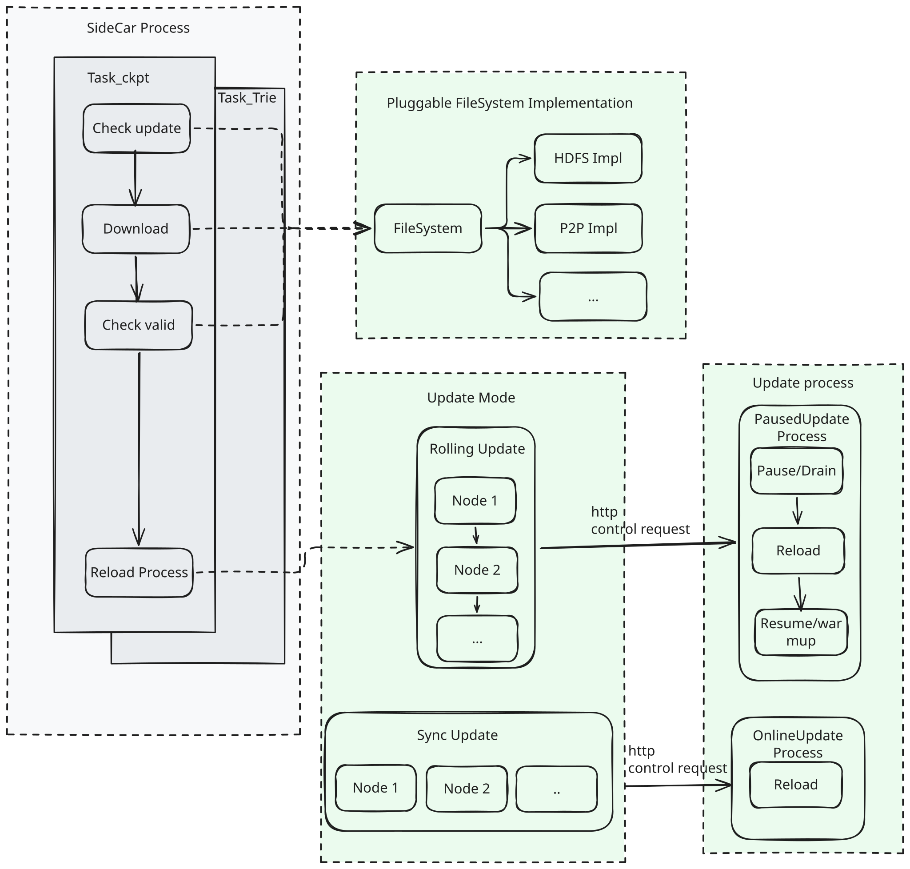

# 模型权重与 Trie 热更 Sidecar 设计

[English version](weight_update_sidecar_design.md)

## 目的和范围

一个 Sidecar 管理同一 Pod 内多个 GR 服务实例的资源更新。
checkpoint 热更仅修改模型权重；Trie 热更仅修改约束内容。
模型结构、tokenizer、资源格式和服务配置保持不变。

本文介绍整体架构，以及已实现的 checkpoint/Trie 更新流程的配置与启动方式。
测试项和验证结果统一记录在[热更测试](hot_update_tests.zh-CN.md)中。

## 架构



一个 Sidecar 进程包含多个 Task。每个 Task 独立发现、下载、检查一个资源版本，
然后更新其目标服务实例。图中分别展示 checkpoint Task 和 Trie Task。

`Node` 表示一个 GR 服务实例，不是物理主机。一个 Pod 通常包含八个单 GPU 实例，
但目标实例数量可以配置。单个实例也可能包含多个 Worker，资源更新需要覆盖它的所有 Worker。

## 核心抽象

| 抽象 | 职责 |
| --- | --- |
| **Sidecar** | 运行和监控多个 Task，协调作用于同一实例的更新。 |
| **Task** | 定义一种资源的来源、轮询间隔、本地缓存、checker、目标实例、Update Mode 和 Update Process。 |
| **FileSystem** | 发现已发布版本、下载指定版本，封装不同存储系统的访问方式。 |
| **Update Mode** | 决定目标实例如何分组、哪些实例同时更新。 |
| **Update Process** | 定义每个实例具体执行哪些更新动作。 |

Update Mode 与 Update Process 相互独立：前者控制**哪些实例一起更新**，
后者控制**每个实例上执行哪些动作**。二者不与资源类型硬编码绑定，
Task 需要选择资源和服务支持的组合。

### Task

checkpoint Task 和 Trie Task 分别配置各自的数据源。
一个 Task 的资源更新不代表另一个 Task 也需要更新。
每个 Task 独立选择 FileSystem、Update Mode 和 Update Process。
Sidecar 不保存更新进度日志，每轮轮询都查询实例的实际版本和服务状态。

不同 Task 可以独立执行版本发现和下载；更新同一服务实例时需要协调，
避免 checkpoint 和 Trie reload 并发冲突。

### FileSystem

通过可插拔实现支持 HDFS、P2P 等存储系统。先提供 HDFSDownloader，
新增其他实现不需要修改 Task 调度和实例更新逻辑。

初始接口如下：

```python
from pathlib import Path
from typing import Protocol


class FileSystem(Protocol):
    async def get_latest_version(self, address: str) -> str | None: ...

    async def download(
        self, address: str, version: str, target_dir: Path
    ) -> None: ...
```

- `get_latest_version` 接收监控地址，返回最新已发布版本；没有可用版本时返回 `None`。
  存储访问失败应抛出异常，不能返回 `None`。
- `download` 接收同一个监控地址、已选定的版本和本地目标目录。
  HDFSDownloader 根据地址和版本定位远端目录，只下载该版本。
  如果指定版本不可用，应抛出异常，不能静默改成其他新版本。

每轮轮询先发现最新已完成版本；本地没有缓存时下载，然后查询各目标实例的实际版本和状态。
版本一致且 running 的实例跳过；已经是目标版本但 paused 的实例只需 resume。
其余实例在更新前检查新旧资源路径。

即使下载期间发布了更新的版本，也继续下载本轮已选定的版本。
控制器先下载到临时目录，完成后 rename 到本地版本缓存目录。
修改服务前先执行 checker：默认 checkpoint checker 要求相对文件名和大小一致；
默认 Trie checker 要求 tensor 名称和数量一致。
自定义 `checker(old_path, new_path)` 支持同步或异步函数。
checksum 或模型特定语义检查需要自定义 checker，默认检查不提供这些能力。

### Update Mode

- **Rolling Update：** 每组最多更新 `n` 个实例，默认 1 个。
  当前组完成后再开始下一组，其余实例继续服务。
- **Sync Update：** 同时向全部目标实例发起更新，不分滚动批次。
  这里表示并发执行，不保证所有实例在同一时刻原子切换版本。

两种方式都执行 Task 指定的 Update Process，并分别处理各目标实例的完成或失败。

### Update Process

- **PausedUpdate Process：** **Pause/Drain -> Reload -> Resume**。
  pause 复用上游排空接口，使用 `clear_cache=True` 在排空后清理 KV/prefix cache。
  reload 调用上游 Worker 的 `reload_weights`，当前没有独立 warmup 步骤。
- **OnlineUpdate Process：** 服务继续运行时直接 reload 资源。
  Trie 更新不由 Sidecar 调用 pause、drain、resume 或 warmup。

每种流程负责单个实例的完成条件和失败处理。
资源加载和执行资源维护由服务自身处理，Sidecar 不直接操作模型或 Trie 对象。

## 初始 Task 组合

| Task | Update Mode | Update Process |
| --- | --- | --- |
| **Task_ckpt** | Rolling Update，每组最多 `n` 个实例 | PausedUpdate Process |
| **Task_Trie** | Sync Update，全部目标实例并发 | OnlineUpdate Process |

### Checkpoint Task

资源准备和检查完成后，按滚动分组执行 PausedUpdate Process。
原生权重 reload 更新每个 Worker；GR 派生的 head 缓存在自身 post-load 处理中刷新。
模型结构和配置必须保持不变。
已测试路径保留 CUDA Graph 引用的权重存储，reload 后继续 replay，不新增单独的重新成图步骤。

### Trie Task

资源准备和检查完成后，在目标实例上并发执行 OnlineUpdate Process。
已有 `constraint_backend` 持有 `VersionedConstraintTable`：
reload 创建新的 backend，成功后将默认访问切换到最新表；准备失败时继续使用当前表。

旧表保留 `VLLM_GR_TRIE_RETENTION_SECONDS` 指定的时间，默认 60 秒，
到期后在下一次 wrapper API 调用时释放。
没有计时线程，也不按请求固定版本或做引用计数。
访问默认指向最新版本，因此不保证一个请求全过程使用同一个 Trie 版本。
当前在线 Trie reload 支持 CUDA 异步 `beam_search_v1` 路径，Trie 数量和词表投影保持不变。

## 统一更新生命周期

每个 Task 均遵循 **检查更新 -> 下载 -> 合法性检查 -> 应用更新**。
Update Mode 将应用更新展开到多个实例，Update Process 通过 HTTP 管控请求执行单实例动作。
这些管控请求独立于推理协议。

下载或 checker 失败时，不修改服务实例。
某个滚动分组失败后，不再启动后续分组。
原生 checkpoint reload 开始前，服务设置 `checkpoint_valid=false`；全部加载成功后才恢复为 true。
加载失败或取消后保持 paused 和无效，版本号仍为最后成功提交的版本；resume 和再次 reload 返回 HTTP 409。
Sidecar 不再自动更新或恢复该实例，即使 Sidecar 重启或源版本撤回也一样。
需要人工使用已知正常的 checkpoint 重启模型服务；不自动回滚。

如果 reload 已成功但响应丢失，valid 仍为 true，下一轮或新的 Sidecar 根据实际版本继续对齐，
不使用本地进度文件。
每轮都重新选择远端最新已完成版本，而不是重放之前保存的更新计划。
管控请求超时不代表动作未完成，需要查询实际状态，判断应重新 reload 还是只执行 resume。

## 用户配置示例

用户提供一个 Python 配置文件，导出 `config: SidecarConfig` 对象。
框架加载该对象并负责启动、执行；配置文件不需要创建运行中的 Sidecar，也不需要调用 `run()`。

FileSystem、Update Mode 和 Update Process 均以 Python 对象传入，
用户可以直接提供自定义实现。可运行示例见
[examples/sidecar/config.py](../examples/sidecar/config.py)。

```python
from pathlib import Path

from vllm_gr.sidecar import (
    HDFSDownloader,
    Instance,
    OnlineUpdateProcess,
    PausedUpdateProcess,
    RollingUpdate,
    SidecarConfig,
    SyncUpdate,
    UpdateTask,
)

config = SidecarConfig(
    instances=[
        Instance(id=f"node-{i}", control_url=f"http://127.0.0.1:{9100 + i}")
        for i in range(8)
    ],
    tasks=[
        UpdateTask(
            name="ckpt",
            resource_type="checkpoint",
            filesystem=HDFSDownloader(),
            address="hdfs://cluster/models/gr/checkpoints",
            target_dir=Path("/updates/checkpoints"),
            poll_interval_seconds=30,
            update_mode=RollingUpdate(max_concurrent_updates=1),
            update_process=PausedUpdateProcess(),
        ),
        UpdateTask(
            name="trie",
            resource_type="trie",
            filesystem=HDFSDownloader(),
            address="hdfs://cluster/models/gr/tries",
            target_dir=Path("/updates/tries"),
            poll_interval_seconds=60,
            update_mode=SyncUpdate(),
            update_process=OnlineUpdateProcess(),
        ),
    ],
)
```

- `instances` 列出服务管控地址，数量不直接绑定物理 GPU 数量。
  Task 可以选择 `all` 或指定实例 ID 列表。
- `filesystem` 是具体实现对象。Task 将 `address` 传给版本查询和下载，下载时同时传入选定版本。
- `target_dir` 是 Task 的共享本地缓存根目录，不同 Task 的缓存目录不能重叠。
  Sidecar 和全部目标服务必须看到相同的绝对路径。
- 不提供 `checker` 时，使用 `default_ckpt_checker` 或 `default_trie_checker`。
  两者都与服务返回的本地 `checkpoint_path`/`trie_path` 比较，Sidecar 也必须能够读取这些路径。
- `update_mode` 控制实例调度，`update_process` 控制单实例动作。
  初始组合为 checkpoint + RollingUpdate + PausedUpdateProcess，
  以及 Trie + SyncUpdate + OnlineUpdateProcess。
- 不配置 `state_dir`。共享本地目录保存已下载资源，已完成版本和状态从服务查询。
  同一 Sidecar 进程内，不同 Task 通过实例锁协调更新。

## 启动和发布使用说明

### 准备 Pod

服务环境安装带 gRPC extra 的 vLLM-GR，并为 Sidecar 配置可用的 HDFS 客户端和凭据。
可通过 `HDFS_BIN` 指定客户端；需要 Hadoop `hdfs dfs -...` 命令形式时，
设置 `HDFS_USES_DFS_SUBCOMMAND=1`。

在 Sidecar 和每个目标服务容器中，以**相同绝对路径**挂载共享目录，例如 `/updates`。
准备初始本地 Hugging Face checkpoint；约束生成场景还需要 GR 配置指定的标准 Trie artifact。
初始 checkpoint 目录也应包含 `_SUCCESS`：默认 checker 比较所有相对文件名和大小，
只有一侧包含该标记会导致检查拒绝更新。

### 启动 gRPC 实例

保留现有 gRPC 入口和推理参数，新增必需的启动环境变量 **`VLLM_GR_ADMIN_PORT`**，
每个实例使用不同端口。它在 gRPC 服务进程中启用独立的 HTTP 管控监听器，
不是推理端口，也不替换 gRPC server。不设置该变量就不启动热更管控监听器。

实例 0 的最小示例：

```bash
CUDA_VISIBLE_DEVICES=0 \
VLLM_GR_ADMIN_PORT=9100 \
vllm-gr serve /updates/bootstrap/ckpt_1700000000 \
  --grpc \
  --vllm-gr-config /etc/vllm-gr/gr-config.json \
  --host 127.0.0.1 --port 9000 \
  --async-scheduling --no-enable-chunked-prefill
```

保留部署已有的模型、容量、dtype、compile 等推理参数。
实例 `i` 使用对应 GPU、推理端口 `9000+i`、管控端口 `9100+i`，
并将管控地址填入 `SidecarConfig.instances`。
示例配置包含八个实例，实际使用时按启动数量调整。

管控地址默认绑定 `127.0.0.1`，适用于同一 Pod 共享网络的容器；
可通过 `VLLM_GR_ADMIN_HOST` 覆盖。
每个服务可用 `VLLM_GR_TRIE_RETENTION_SECONDS` 覆盖旧表默认 60 秒的保留时间。
HTTP 推理入口不启用这些热更接口，当前使用 gRPC 服务路径。

### 启动 Sidecar

将上述 Python 配置保存到例如 `/etc/vllm-gr/sidecar-config.py`，
填写真实 HDFS 来源、共享缓存目录和实例管控地址。
针对这些目标启动**一个 Sidecar 进程**：

```bash
vllm-gr-sidecar --config /etc/vllm-gr/sidecar-config.py
```

等价的模块启动方式：

```bash
python -m vllm_gr.sidecar --config /etc/vllm-gr/sidecar-config.py
```

如果只执行一轮发现和更新，不持续轮询：

```bash
vllm-gr-sidecar --config /etc/vllm-gr/sidecar-config.py --once
```

普通模式按各 Task 的配置间隔持续轮询。
`--once` 对每个 Task 执行一轮后退出；更新失败时返回非零退出码。
Sidecar 重启后使用相同配置和缓存，通过实例实际状态继续对齐，不读取进度日志。
实例锁只协调当前进程内的 Task，不能协调多个独立 Sidecar 同时更新相同实例。

### 发布版本和查询状态

HDFS 数据源包含不可变的版本目录。
默认版本发现支持目录名末尾至少十位数字的时间戳，例如 `ckpt_1700000000`，
或 `_YYYYMMDD_HHMMSS`，例如 `trie_20261106_120000`。
先上传全部文件，最后创建 `_SUCCESS`。
缺少完成标记的较新版本会被跳过；已发布版本的内容不得覆盖修改。

```text
checkpoints/
└── ckpt_1700000000/
    ├── config.json
    ├── model.safetensors
    ├── ... other checkpoint files
    └── _SUCCESS
tries/
└── trie_20261106_120000/
    ├── table.safetensors
    └── _SUCCESS
```

模型结构和配置保持不变。默认 checkpoint 检查比较文件列表和大小，不比较权重内容；
默认 Trie 检查比较 tensor 名称和数量，不比较值或文件大小。
服务随后执行原生加载及资源兼容性检查。
已记录的 GPU 测试仅验证了单个权重文件的 checkpoint 加载。

通过每个实例的管控端口查询当前已提交版本和服务状态：

```bash
curl -fsS 'http://127.0.0.1:9100/service/status'
```

status 没有查询参数，一次返回两类资源的信息：

```json
{
  "service_state": "running",
  "checkpoint_valid": true,
  "checkpoint_version": "ckpt_1700000000",
  "trie_version": "trie_20261106_120000",
  "checkpoint_path": "/updates/checkpoints/ckpt_1700000000",
  "trie_path": "/updates/tries/trie_20261106_120000/table.safetensors"
}
```

`ServiceState` 是内部枚举，仅包含 `RUNNING` 和 `PAUSED`。
Core 与 Sidecar 内部使用枚举；IPC/HTTP 边界序列化为 `running`/`paused`，接收后恢复枚举。
`PAUSED` 表示调度器处于暂停模式；加载权重前，调用者仍需等待 pause 操作完成。

版本和路径独立于服务状态。
checkpoint 版本仅在 reload 成功后变化；加载期间或失败后，仍返回最后成功提交的版本。
Trie 版本表示最新发布的表，不是保留中的旧表。
未加载资源的版本和路径为 null；不返回独立的 `phase` 或 `ready` 字段。
`checkpoint_valid` 表示权重是否可服务：加载期间或失败后为 false，由模型服务维护，Sidecar 重启不会清除。

Sidecar 比较对应资源版本、读取路径做合法性检查，并检查服务状态。
已加载目标版本且 paused 的实例，仅在 `checkpoint_valid=true` 时可以直接 resume。
滚动更新被打断后，可重启 Sidecar，或等待下一轮轮询对齐剩余实例。
已发布资源和本地服务路径应保持可访问，供检查和加载使用。

## 验证

[热更测试](hot_update_tests.zh-CN.md)是统一维护的测试记录。
其中列出新增 case、已有功能回归、真实 HDFS/双实例滚动更新、checkpoint/Trie 失败恢复，
以及 compile/CUDA Graph/显存验证结果。
这些测试不代表已支持所有模型、八张物理 GPU、NPU，或完整性能/准确率门禁全部通过。
